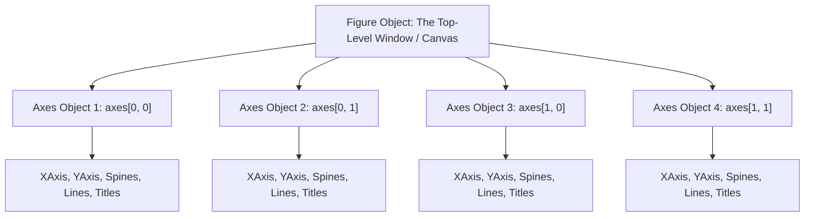

# Lecture 19.08: Modern Matplotlib (Object-Oriented API)

## 📌 Topic Overview
In this lecture, Shraddha ma'am introduces the **Object-Oriented (OOP) API of Matplotlib**, contrasting it with the legacy pyplot state machine. By explicitly instantiating `Figure` and `Axes` objects using `plt.subplots()`, programmers gain deterministic control over complex multi-panel visual layouts.

---

## 🏛️ Matplotlib OOP Hierarchy



---

## 📐 Method Mapping: Pyplot vs Object-Oriented Interface

| Pyplot State-Machine (`plt.*`) | Object-Oriented API (`ax.*` / `fig.*`) | Purpose |
| :--- | :--- | :--- |
| `plt.plot(x, y)` | `ax.plot(x, y)` | Draw line / scatter points |
| `plt.title("...")` | `ax.set_title("...")` | Set title for specific subplot |
| `plt.xlabel("...")` | `ax.set_xlabel("...")` | Set horizontal axis label |
| `plt.ylabel("...")` | `ax.set_ylabel("...")` | Set vertical axis label |
| `plt.grid(True)` | `ax.grid(True)` | Enable coordinate grid |
| `plt.suptitle("...")` | `fig.suptitle("...")` | Global super-title for the figure |
| `plt.tight_layout()` | `fig.tight_layout()` | Automatically adjust padding |

---

## 💻 Python Implementation

```python
import matplotlib.pyplot as plt
import numpy as np

def demonstrate_oop_matplotlib(show_plot=True):
    """
    Demonstrates the Object-Oriented (OOP) API of Matplotlib:
    Explicit creation of Figure and Axes objects via plt.subplots().
    Uses axes[row][col] and ax.set() dictionary packing.
    
    Returns:
        dict: Figure and grid dimensions info.
    """
    x = [1, 2, 3, 4, 5, 6, 7, 8, 9, 10]
    y1 = [np.sqrt(i) for i in x]
    y2 = [i * 2 for i in x]
    y3 = [i ** 2 for i in x]
    y4 = [i ** 3 for i in x]
    
    # OOP explicit creation
    fig, axes = plt.subplots(2, 2, figsize=(8, 7))
    
    # 2D indexing on axes array
    axes[0, 0].plot(x, y1, color="navy")
    axes[0, 0].set_title("Plot 1: Square Root")
    axes[0, 0].grid(True, linestyle=":", alpha=0.6)
    
    axes[0, 1].plot(x, y2, color="forestgreen")
    axes[0, 1].set_title("Plot 2: Double")
    axes[0, 1].grid(True, linestyle=":", alpha=0.6)
    
    axes[1, 0].plot(x, y3, color="crimson")
    axes[1, 0].set_title("Plot 3: Square")
    axes[1, 0].grid(True, linestyle=":", alpha=0.6)
    
    axes[1, 1].plot(x, y4, color="purple")
    axes[1, 1].set_title("Plot 4: Cube")
    axes[1, 1].grid(True, linestyle=":", alpha=0.6)
    
    fig.suptitle("Multiple Mathematical Plots (OOP Interface)", fontsize=14, fontweight="bold")
    fig.tight_layout()
    
    if show_plot:
        plt.show()
        
    return {
        "axes_shape": axes.shape,
        "grid_rows": 2,
        "grid_cols": 2
    }

# --- Execution & Verification ---
oop_info = demonstrate_oop_matplotlib(show_plot=False)
print(f"OOP Grid Configuration: {oop_info}")

```

---

## 🔑 Key Takeaways
1. The OOP API (`fig, axes = plt.subplots(nrows, ncols)`) is the industry standard for production code, data pipelines, and research publications.
2. In a 2D grid, `axes` is a 2D NumPy array indexed via `axes[row, col]`.
3. `ax.set(title=..., xlabel=..., ylabel=...)` provides a clean single-line configuration for subplot properties.
