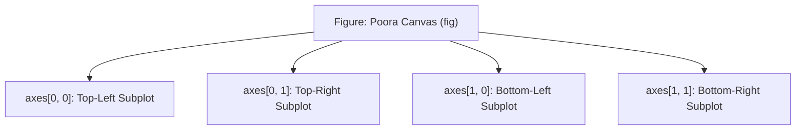

# Notes_19.08: Modern Matplotlib (Object-Oriented API) [Hinglish]

## 📌 Topic Overview
Is lecture mein Shraddha ma'am ne **Modern Matplotlib ka Object-Oriented (OOP) Approach** sikhaya hai: `fig, axes = plt.subplots()` ka use karke Figure aur Axes objects ko explicitly control karna kyu industry-standard mana jata hai.

---

### 📋 Is Topic Mein Hum Kya Seekhenge?
- Pyplot state machine vs Object-Oriented (OOP) API ka farq.
- `Figure` aur `Axes` objects ka role.
- 2D grid indexing: `axes[row, col]` ya `axes[0][0]` ka use.
- `fig.suptitle()` aur `fig.tight_layout()` ke fayde.

---

### 🔍 Har Ek Point Ka Simple & Detailed Explanation

#### 1. Pyplot vs OOP API:
Pichle lectures mein hum `plt.plot()`, `plt.title()` likhte the. Woh **Pyplot interface** tha jisme Matplotlib internally yaad rakhta tha ki current plot kaunsa hai.
Modern data science aur production code mein hum **OOP API** use karte hain:
`fig, axes = plt.subplots(2, 2)`
- `fig`: Poora blank canvas (Figure).
- `axes`: Us canvas ke andar ke individual subplots (Axes array).

#### 2. Function Mapping:
- `plt.title()` ban jata hai `ax.set_title()`
- `plt.xlabel()` ban jata hai `ax.set_xlabel()`
- `plt.ylabel()` ban jata hai `ax.set_ylabel()`
- `plt.grid()` ban jata hai `ax.grid()`
- Global title ke liye: `fig.suptitle()`

---

### 📊 Blackboard Diagram: Figure Aur Axes Ki Hierarchy



---

### 💻 Python Code Implementation

```python
import matplotlib.pyplot as plt
import numpy as np

def demonstrate_oop_matplotlib(show_plot=True):
    """
    Demonstrates the Object-Oriented (OOP) API of Matplotlib:
    Explicit creation of Figure and Axes objects via plt.subplots().
    Uses axes[row][col] and ax.set() dictionary packing.
    
    Returns:
        dict: Figure and grid dimensions info.
    """
    x = [1, 2, 3, 4, 5, 6, 7, 8, 9, 10]
    y1 = [np.sqrt(i) for i in x]
    y2 = [i * 2 for i in x]
    y3 = [i ** 2 for i in x]
    y4 = [i ** 3 for i in x]
    
    # OOP explicit creation
    fig, axes = plt.subplots(2, 2, figsize=(8, 7))
    
    # 2D indexing on axes array
    axes[0, 0].plot(x, y1, color="navy")
    axes[0, 0].set_title("Plot 1: Square Root")
    axes[0, 0].grid(True, linestyle=":", alpha=0.6)
    
    axes[0, 1].plot(x, y2, color="forestgreen")
    axes[0, 1].set_title("Plot 2: Double")
    axes[0, 1].grid(True, linestyle=":", alpha=0.6)
    
    axes[1, 0].plot(x, y3, color="crimson")
    axes[1, 0].set_title("Plot 3: Square")
    axes[1, 0].grid(True, linestyle=":", alpha=0.6)
    
    axes[1, 1].plot(x, y4, color="purple")
    axes[1, 1].set_title("Plot 4: Cube")
    axes[1, 1].grid(True, linestyle=":", alpha=0.6)
    
    fig.suptitle("Multiple Mathematical Plots (OOP Interface)", fontsize=14, fontweight="bold")
    fig.tight_layout()
    
    if show_plot:
        plt.show()
        
    return {
        "axes_shape": axes.shape,
        "grid_rows": 2,
        "grid_cols": 2
    }

# --- Execution & Verification ---
oop_info = demonstrate_oop_matplotlib(show_plot=False)
print(f"OOP Grid Configuration: {oop_info}")

```

---

### 🎯 Key Takeaways:
1. Industry aur open-source libraries (jaise Seaborn, Pandas) internally OOP API hi use karti hain.
2. `axes[row, col]` se aap kisi bhi specific subplot ko directly control kar sakte hain bina order ki chinta kiye.
