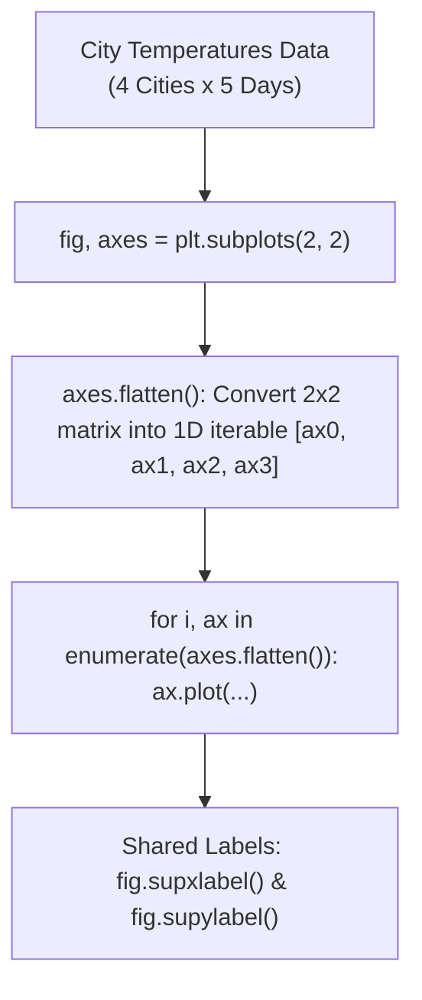

# Lecture 19.09: Practice Task (Weekly Temperature)

## 📌 Topic Overview
In this lecture, Shraddha ma'am walks through a complete **Practice Task**, synthesizing subplots, OOP layout management, automated iteration via `axes.flatten()`, and shared figure labels (`fig.supxlabel()` and `fig.supylabel()`) to visualize weekly temperature trends across 4 global cities (New York, London, Delhi, Tokyo).

---

## 🏛️ Automated Subplot Iteration Architecture



---

## 📐 Mathematical Formulation: Central Tendency across Cities

For each city $c \in \{1, 2, 3, 4\}$, the weekly average temperature $\bar{T}_c$ across $D = 5$ days is given by:

$$
\bar{T}_c = \frac{1}{D} \sum_{d=1}^D T_{c, d}
$$

The standard deviation measuring atmospheric temperature volatility is:

$$
s_c = \sqrt{\frac{1}{D-1} \sum_{d=1}^D (T_{c, d} - \bar{T}_c)^2}
$$

---

## 💻 Python Implementation

```python
import matplotlib.pyplot as plt

def plot_weekly_city_temperatures(days=None, cities=None, temperatures=None, show_plot=True):
    """
    Plots weekly temperature trends for 4 global cities on a 2x2 subplot grid
    using axes.flatten() and shared figure labels (fig.supxlabel, fig.supylabel).
    
    Parameters:
        days (list): List of weekday names.
        cities (list): City names.
        temperatures (list of lists): 2D temperature array.
        show_plot (bool): Display control.
        
    Returns:
        dict: Mean temperature per city.
    """
    if days is None:
        days = ["Mon", "Tue", "Wed", "Thu", "Fri"]
    if cities is None:
        cities = ["New York", "London", "Delhi", "Tokyo"]
    if temperatures is None:
        temperatures = [
            [22, 23, 21, 24, 25],   # New York
            [18, 19, 17, 20, 21],   # London
            [30, 32, 31, 33, 34],   # Delhi
            [25, 26, 24, 27, 28]    # Tokyo
        ]
        
    fig, axes = plt.subplots(2, 2, figsize=(9, 7))
    axes_flat = axes.flatten()
    
    colors = ["#1f77b4", "#ff7f0e", "#2ca02c", "#d62728"]
    city_means = {}
    
    for i, ax in enumerate(axes_flat):
        ax.plot(days, temperatures[i], marker="o", color=colors[i], linewidth=2.0)
        ax.set_title(cities[i], fontweight="bold")
        ax.grid(True, linestyle=":", alpha=0.6)
        city_means[cities[i]] = sum(temperatures[i]) / len(temperatures[i])
        
    fig.suptitle("Weekly Temperature by City (Practice Task)", fontsize=14, fontweight="bold")
    fig.supxlabel("Day of the Week", fontsize=11)
    fig.supylabel("Temperature (°C)", fontsize=11)
    fig.tight_layout()
    
    if show_plot:
        plt.show()
        
    return city_means

# --- Execution & Verification ---
means = plot_weekly_city_temperatures(show_plot=False)
for city, avg in means.items():
    print(f"{city}: Average Temp = {avg:.1f} °C")

```

---

## 🔑 Key Takeaways
1. `axes.flatten()` simplifies 2D grid loops: instead of writing nested `for i in range(2): for j in range(2):`, you can iterate cleanly with `enumerate(axes.flatten())`.
2. Use `fig.supxlabel()` and `fig.supylabel()` for global labels rather than repeating identical axis labels across all 4 subplots.
3. Looping keeps code DRY (Don't Repeat Yourself) when working with homogeneous subplots.
