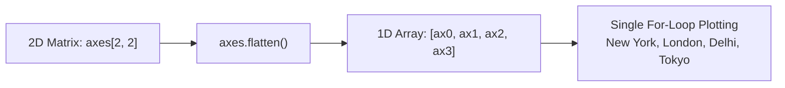

# Notes_19.09: Practice Task (Weekly Temperature) [Hinglish]

## 📌 Topic Overview
Is lecture mein Shraddha ma'am ne ek practical task karwaya hai: 4 alag-alag cities (New York, London, Delhi, Tokyo) ke 5 dino ke temperature data ko 2x2 subplots grid mein `axes.flatten()` aur `fig.supxlabel()` ka use karke visualize karna.

---

### 📋 Is Topic Mein Hum Kya Seekhenge?
- 2x2 subplot grid ko loop ke through automate karna.
- `axes.flatten()` ka use karke 2D array ko 1D list mein badalna.
- Global figure labels: `fig.supxlabel()` aur `fig.supylabel()` ka use.
- Clean aur readable code likhna bina har subplot ka code repeat kiye.

---

### 🔍 Har Ek Point Ka Simple & Detailed Explanation

#### 1. Task Kya Hai?
Hamare paas 4 cities ka weekly temperature data hai:
- New York: `[22, 23, 21, 24, 25]`
- London: `[18, 19, 17, 20, 21]`
- Delhi: `[30, 32, 31, 33, 34]`
- Tokyo: `[25, 26, 24, 27, 28]`

Hum chahte hain ki 2x2 grid bane jisme har city ka apna clean line plot ho aur marker points bane hon.

#### 2. `axes.flatten()` Ka Jaadu:
Jab hum `fig, axes = plt.subplots(2, 2)` likhte hain, toh `axes` ek 2D array hota hai: `[[ax0, ax1], [ax2, ax3]]`.
Isko iterate karne ke liye do `for` loop lagane padte. Lekin `axes.flatten()` karne se yeh seedha 1D list ban jata hai: `[ax0, ax1, ax2, ax3]`. Isse hum single loop mein sara kaam kar sakte hain!

#### 3. Common Labels:
Har plot par alag se "Day" aur "Temperature" likhne ki jagah hum poore figure par common label lagate hain:
- `fig.supxlabel("Day")`
- `fig.supylabel("Temperature (°C)")`

---

### 📊 Blackboard Diagram: 2x2 Grid Flattening



---

### 💻 Python Code Implementation

```python
import matplotlib.pyplot as plt

def plot_weekly_city_temperatures(days=None, cities=None, temperatures=None, show_plot=True):
    """
    Plots weekly temperature trends for 4 global cities on a 2x2 subplot grid
    using axes.flatten() and shared figure labels (fig.supxlabel, fig.supylabel).
    
    Parameters:
        days (list): List of weekday names.
        cities (list): City names.
        temperatures (list of lists): 2D temperature array.
        show_plot (bool): Display control.
        
    Returns:
        dict: Mean temperature per city.
    """
    if days is None:
        days = ["Mon", "Tue", "Wed", "Thu", "Fri"]
    if cities is None:
        cities = ["New York", "London", "Delhi", "Tokyo"]
    if temperatures is None:
        temperatures = [
            [22, 23, 21, 24, 25],   # New York
            [18, 19, 17, 20, 21],   # London
            [30, 32, 31, 33, 34],   # Delhi
            [25, 26, 24, 27, 28]    # Tokyo
        ]
        
    fig, axes = plt.subplots(2, 2, figsize=(9, 7))
    axes_flat = axes.flatten()
    
    colors = ["#1f77b4", "#ff7f0e", "#2ca02c", "#d62728"]
    city_means = {}
    
    for i, ax in enumerate(axes_flat):
        ax.plot(days, temperatures[i], marker="o", color=colors[i], linewidth=2.0)
        ax.set_title(cities[i], fontweight="bold")
        ax.grid(True, linestyle=":", alpha=0.6)
        city_means[cities[i]] = sum(temperatures[i]) / len(temperatures[i])
        
    fig.suptitle("Weekly Temperature by City (Practice Task)", fontsize=14, fontweight="bold")
    fig.supxlabel("Day of the Week", fontsize=11)
    fig.supylabel("Temperature (°C)", fontsize=11)
    fig.tight_layout()
    
    if show_plot:
        plt.show()
        
    return city_means

# --- Execution & Verification ---
means = plot_weekly_city_temperatures(show_plot=False)
for city, avg in means.items():
    print(f"{city}: Average Temp = {avg:.1f} °C")

```

---

### 🎯 Key Takeaways:
1. `axes.flatten()` code ko bohot chhota aur efficient bana deta hai.
2. `fig.supxlabel()` aur `fig.supylabel()` se plots ke beech ka clutter hat jata hai.
