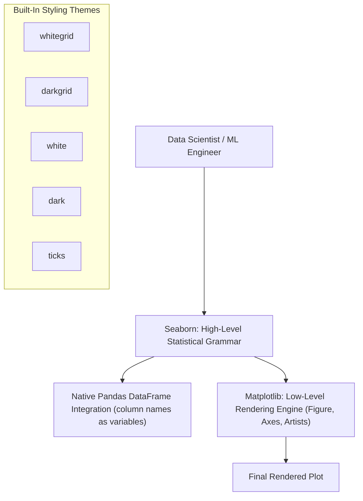

# Lecture 19.10: Introduction to Seaborn

## 📌 Topic Overview
In this lecture, Shraddha ma'am introduces **Seaborn**, the premier statistical data visualization library built on top of Matplotlib. Seaborn provides high-level APIs that interface directly with pandas DataFrames, elegant aesthetic defaults, and built-in statistical aggregation.

---

## 🏛️ Matplotlib Foundation vs Seaborn Abstraction



---

## 📐 Mathematical Formalism: Statistical Semantic Mapping

Seaborn maps tabular DataFrame features $(X_{\text{feat1}}, X_{\text{feat2}}, \dots)$ into visual channels:

$$
\Phi: (x, y, \text{hue}, \text{style}, \text{size}) \to \mathbb{R}^2 \times \mathcal{C} \times \mathcal{M} \times \mathbb{R}^+
$$

where $\mathcal{C}$ denotes color space (hue), $\mathcal{M}$ denotes marker glyphs, and $\mathbb{R}^+$ denotes point scale.

---

## 💻 Python Implementation

```python
import seaborn as sns
import matplotlib.pyplot as plt

def demonstrate_seaborn_basics(theme="whitegrid", show_plot=True):
    """
    Demonstrates the fundamental setup of Seaborn:
    1. Setting themes via sns.set_theme().
    2. Loading standard built-in datasets (tips).
    3. High-level statistical visualization integration with pandas.
    
    Returns:
        dict: Summary metadata of the loaded dataset.
    """
    # 1. Set global styling theme
    sns.set_theme(style=theme)
    
    # 2. Load built-in tips dataset
    tips = sns.load_dataset("tips")
    
    # 3. Simple Relational Plot
    g = sns.relplot(
        data=tips,
        x="total_bill",
        y="tip",
        hue="time",
        style="time",
        size="size",
        height=5,
        aspect=1.3
    )
    g.fig.suptitle(f"Seaborn Relational Plot (Theme: {theme})", y=1.03, fontweight="bold")
    
    if show_plot:
        plt.show()
        
    return {
        "dataset_rows": len(tips),
        "columns": list(tips.columns),
        "available_themes": ["darkgrid", "whitegrid", "dark", "white", "ticks"]
    }

# --- Execution & Verification ---
meta = demonstrate_seaborn_basics(show_plot=False)
print(f"Tips Dataset Columns: {meta['columns']}")
print(f"Total Observations: {meta['dataset_rows']}")

```

---

## 🔑 Key Takeaways
1. Seaborn operates directly on pandas DataFrames (`data=df, x="col_name", y="col_name"`).
2. `sns.set_theme()` sets global aesthetic defaults including gridlines, fonts, and color palettes.
3. Built-in datasets (`tips`, `penguins`, `flights`) can be loaded instantly via `sns.load_dataset()`.
