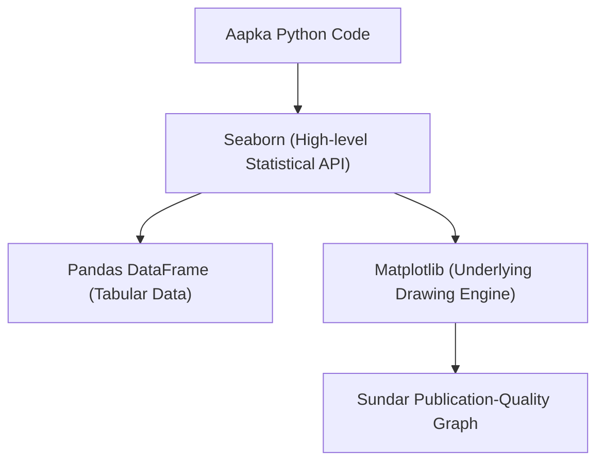

# Notes_19.10: Seaborn Ka Parichay [Hinglish]

## 📌 Topic Overview
Is lecture mein Shraddha ma'am ne **Seaborn** library ka introduction diya hai: Seaborn Matplotlib se kaise alag aur behtar hai, themes kaise set kiye jaate hain, aur built-in datasets (`tips`) par kaam kaise kiya jata hai.

---

### 📋 Is Topic Mein Hum Kya Seekhenge?
- Seaborn kya hai aur iski zaroorat kyu padi?
- Seaborn vs Matplotlib ka comparison.
- `sns.set_theme()` ke 5 alag-alag styles (whitegrid, darkgrid, etc.).
- Pandas DataFrames ke sath direct integration (`data=tips, x="total_bill", y="tip"`).

---

### 🔍 Har Ek Point Ka Simple & Detailed Explanation

#### 1. Seaborn Kya Hai?
Matplotlib ek foundational library hai jisme har choti cheez (colors, legend, grids) code karke set karni padti hai.
**Seaborn** Matplotlib ke upar bani ek high-level library hai jo specifically **Data Science aur Statistical Analysis** ke liye banayi gayi hai. Iske graphs default mein bohot sundar aur modern dikhte hain.

#### 2. Seaborn Ke Fayde:
1. **Pandas Ke Sath Seamless:** Aapko alag se x aur y arrays nikalne ki zaroorat nahi hoti. Bas DataFrame pass karo aur column names likh do!
2. **Themes:** `sns.set_theme(style="whitegrid")` likhte hi graph ka professional look set ho jata hai.
3. **Multi-dimensional Visuals:** Ek hi plot mein Color (`hue`), Marker (`style`), aur Size (`size`) ek sath map ho jaate hain!

---

### 📊 Blackboard Diagram: Seaborn Ki Layered Architecture



---

### 💻 Python Code Implementation

```python
import seaborn as sns
import matplotlib.pyplot as plt

def demonstrate_seaborn_basics(theme="whitegrid", show_plot=True):
    """
    Demonstrates the fundamental setup of Seaborn:
    1. Setting themes via sns.set_theme().
    2. Loading standard built-in datasets (tips).
    3. High-level statistical visualization integration with pandas.
    
    Returns:
        dict: Summary metadata of the loaded dataset.
    """
    # 1. Set global styling theme
    sns.set_theme(style=theme)
    
    # 2. Load built-in tips dataset
    tips = sns.load_dataset("tips")
    
    # 3. Simple Relational Plot
    g = sns.relplot(
        data=tips,
        x="total_bill",
        y="tip",
        hue="time",
        style="time",
        size="size",
        height=5,
        aspect=1.3
    )
    g.fig.suptitle(f"Seaborn Relational Plot (Theme: {theme})", y=1.03, fontweight="bold")
    
    if show_plot:
        plt.show()
        
    return {
        "dataset_rows": len(tips),
        "columns": list(tips.columns),
        "available_themes": ["darkgrid", "whitegrid", "dark", "white", "ticks"]
    }

# --- Execution & Verification ---
meta = demonstrate_seaborn_basics(show_plot=False)
print(f"Tips Dataset Columns: {meta['columns']}")
print(f"Total Observations: {meta['dataset_rows']}")

```

---

### 🎯 Key Takeaways:
1. `sns.set_theme()` sabse upar call karein taaki poore project mein consistent styling rahe.
2. `sns.load_dataset("tips")` se practice ke liye ready-made datasets mil jaate hain.
