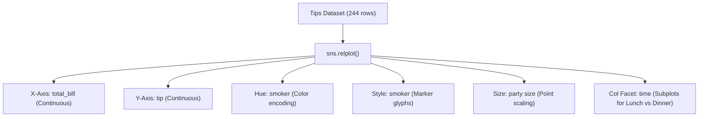

# Lecture 19.11: Creating Plots with Seaborn (`relplot`)

## 📌 Topic Overview
In this lecture, Shraddha ma'am demonstrates **`sns.relplot()`**, Seaborn's figure-level relational plotting powerhouse. By mapping up to five continuous and categorical variables simultaneously across positional axes, color hues, marker styles, marker sizes, and facet columns, complex multivariate interactions are uncovered in a single unified command.

---

## 🏛️ Semantic Mapping Framework



---

## 📐 Mathematical Formulation: Bivariate Correlation with Conditioning

For a conditioned subset $\mathcal{D}_k = \{(x_i, y_i) \mid C_i = k\}$ (e.g., Dinner vs Lunch):

The sample Pearson correlation coefficient between $x$ (`total_bill`) and $y$ (`tip`) is:

$$
r_{xy \mid C=k} = \frac{\sum_{i \in \mathcal{D}_k} (x_i - \bar{x}_k)(y_i - \bar{y}_k)}{\sqrt{\sum_{i \in \mathcal{D}_k} (x_i - \bar{x}_k)^2} \sqrt{\sum_{i \in \mathcal{D}_k} (y_i - \bar{y}_k)^2}}
$$

Faceted plots visually reveal whether the slope $\beta_1$ differs across categorical subgroups.

---

## 💻 Python Implementation

```python
import seaborn as sns
import matplotlib.pyplot as plt

def create_multidimensional_relplot(show_plot=True):
    """
    Creates a multi-dimensional relational plot using sns.relplot().
    Maps 5 variables simultaneously:
    - x: total_bill
    - y: tip
    - hue: smoker (smoker vs non-smoker)
    - style: smoker (different marker symbols)
    - size: size (party size / number of guests)
    - col: time (faceted columns for Lunch vs Dinner)
    
    Returns:
        dict: Metadata regarding the mapped dimensions.
    """
    sns.set_theme(style="white")
    tips = sns.load_dataset("tips")
    
    # Figure-level Faceted Relational Plot
    g = sns.relplot(
        data=tips,
        x="total_bill",
        y="tip",
        col="time",
        hue="smoker",
        style="smoker",
        size="size",
        sizes=(20, 200),
        palette="Set1",
        alpha=0.85
    )
    g.fig.subplots_adjust(top=0.85)
    g.fig.suptitle("Multi-Dimensional Relational Plot (Total Bill vs Tip by Meal Time)", fontweight="bold")
    
    if show_plot:
        plt.show()
        
    return {
        "x_variable": "total_bill",
        "y_variable": "tip",
        "hue_variable": "smoker",
        "facet_column": "time",
        "party_size_range": (int(tips["size"].min()), int(tips["size"].max()))
    }

# --- Execution & Verification ---
dims = create_multidimensional_relplot(show_plot=False)
print(f"Mapped Plot Dimensions: {dims}")

```

---

## 🔑 Key Takeaways
1. `sns.relplot()` is a figure-level function returning a `FacetGrid` object.
2. Up to 5 dimensions can be visualized cleanly without cognitive overload: X, Y, Hue, Style/Size, and Col facets.
3. Faceting (`col="time"`) splits data into distinct subplots automatically, eliminating manual subplot code.
