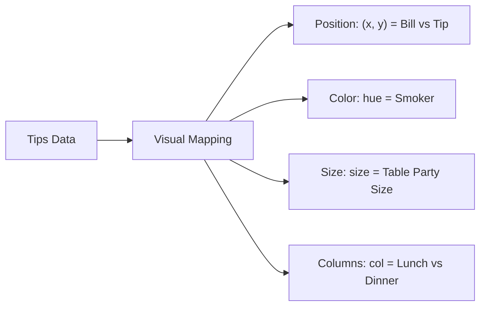

# Notes_19.11: Seaborn relplot Ka Upyog [Hinglish]

## 📌 Topic Overview
Is lecture mein Shraddha ma'am ne **`sns.relplot()`** function ka use sikhaya hai: kaise ek hi graph ke andar 5 alag-alag features (Total Bill, Tip, Smoker status, Party Size, aur Lunch/Dinner) ko visual properties ke through represent kiya jata hai.

---

### 📋 Is Topic Mein Hum Kya Seekhenge?
- `sns.relplot()` kya hai aur yeh standard scatter plot se alag kyu hai?
- Semantic parameters: `hue`, `style`, `size`, aur `col`.
- Faceting: `col="time"` likhne se do alag subplots (Lunch vs Dinner) automatically kaise bante hain.
- Complex multi-variable relationships ko single glance mein samajhna.

---

### 🔍 Har Ek Point Ka Simple & Detailed Explanation

#### 1. `relplot` Kya Karta Hai?
`relplot` ka matlab hai **Relational Plot**. Yeh do variables ke beech ka sambandh (relationship) dikhata hai.
Lekin iski asli taqat yeh hai ki yeh ek sath 5 variables ko alag-alag visual dimensions par map kar sakta hai:
1. `x="total_bill"`: Horizontal position
2. `y="tip"`: Vertical position
3. `hue="smoker"`: Color (Smoker vs Non-smoker)
4. `style="smoker"`: Marker shape (Circle vs Cross)
5. `size="size"`: Dot ka aakar (Kitne log the table par)
6. `col="time"`: Do alag columns (Ek Lunch ke liye, ek Dinner ke liye)

---

### 📊 Blackboard Diagram: 5-Dimensional Mapping



---

### 💻 Python Code Implementation

```python
import seaborn as sns
import matplotlib.pyplot as plt

def create_multidimensional_relplot(show_plot=True):
    """
    Creates a multi-dimensional relational plot using sns.relplot().
    Maps 5 variables simultaneously:
    - x: total_bill
    - y: tip
    - hue: smoker (smoker vs non-smoker)
    - style: smoker (different marker symbols)
    - size: size (party size / number of guests)
    - col: time (faceted columns for Lunch vs Dinner)
    
    Returns:
        dict: Metadata regarding the mapped dimensions.
    """
    sns.set_theme(style="white")
    tips = sns.load_dataset("tips")
    
    # Figure-level Faceted Relational Plot
    g = sns.relplot(
        data=tips,
        x="total_bill",
        y="tip",
        col="time",
        hue="smoker",
        style="smoker",
        size="size",
        sizes=(20, 200),
        palette="Set1",
        alpha=0.85
    )
    g.fig.subplots_adjust(top=0.85)
    g.fig.suptitle("Multi-Dimensional Relational Plot (Total Bill vs Tip by Meal Time)", fontweight="bold")
    
    if show_plot:
        plt.show()
        
    return {
        "x_variable": "total_bill",
        "y_variable": "tip",
        "hue_variable": "smoker",
        "facet_column": "time",
        "party_size_range": (int(tips["size"].min()), int(tips["size"].max()))
    }

# --- Execution & Verification ---
dims = create_multidimensional_relplot(show_plot=False)
print(f"Mapped Plot Dimensions: {dims}")

```

---

### 🎯 Key Takeaways:
1. `col="time"` pass karne se Seaborn khud do subplots bana deta hai, aapko `plt.subplots()` likhne ki zaroorat nahi padti.
2. `sizes=(20, 200)` se point sizes ko visually prominent banaya ja sakta hai.
