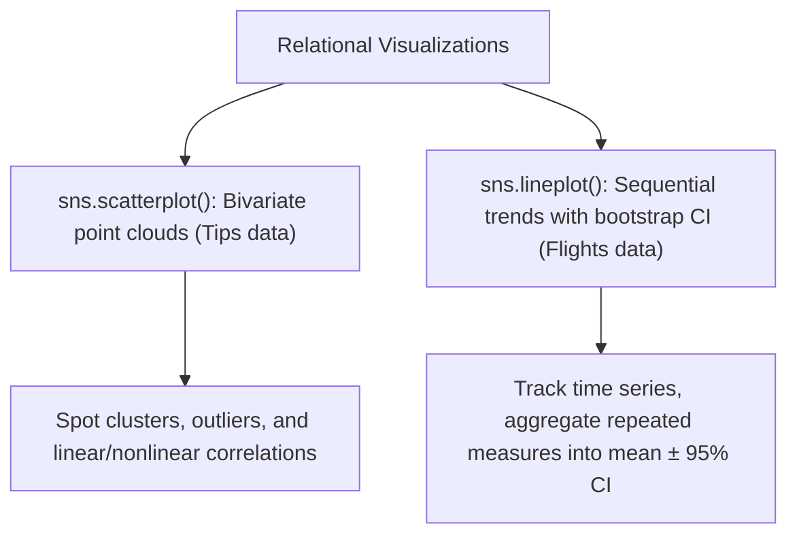

# Lecture 19.12: Relational Plots in Seaborn (`scatterplot` & `lineplot`)

## 📌 Topic Overview
In this lecture, Shraddha ma'am explains the two specialized **axes-level relational plot functions**: `sns.scatterplot()` for observing individual bivariate point clouds and `sns.lineplot()` for tracking continuous temporal trends with automatic statistical aggregation and confidence interval shading.

---

## 🏛️ Axes-Level Relational Functions



---

## 📐 Mathematical Formulation: Bootstrap Confidence Intervals

When multiple measurements exist for each time point $t$ (e.g. 12 months for each year in the flights dataset), `sns.lineplot()` computes the sample mean:

$$
\bar{y}_t = \frac{1}{M} \sum_{m=1}^M y_{t, m}
$$

The translucent shaded band represents the **95% Bootstrap Confidence Interval** around the mean, calculated by resampling monthly observations with replacement to estimate sampling variance without normality assumptions.

---

## 💻 Python Implementation

```python
import seaborn as sns
import matplotlib.pyplot as plt

def plot_scatter_and_line_relationships(show_plot=True):
    """
    Demonstrates Axes-level relational plots in Seaborn:
    1. sns.scatterplot() for bivariate continuous relationships (total_bill vs tip).
    2. sns.lineplot() for temporal trends with automatic aggregation (flights dataset).
    
    Returns:
        dict: Summary metrics for both plots.
    """
    sns.set_theme(style="whitegrid")
    tips = sns.load_dataset("tips")
    flights = sns.load_dataset("flights")
    
    fig, axes = plt.subplots(1, 2, figsize=(14, 5))
    
    # 1. Scatter Plot on axes[0]
    sns.scatterplot(
        data=tips,
        x="total_bill",
        y="tip",
        hue="time",
        palette="deep",
        ax=axes[0]
    )
    axes[0].set_title("Scatter Plot: Total Bill vs Tip (by Time)", fontweight="bold")
    
    # 2. Line Plot on axes[1] (Aggregates multiple months per year into mean + 95% CI)
    sns.lineplot(
        data=flights,
        x="year",
        y="passengers",
        color="crimson",
        marker="o",
        ax=axes[1]
    )
    axes[1].set_title("Line Plot: Airline Passengers Over Years (Mean + CI)", fontweight="bold")
    
    plt.tight_layout()
    if show_plot:
        plt.show()
        
    return {
        "tips_count": len(tips),
        "flights_year_range": (int(flights["year"].min()), int(flights["year"].max()))
    }

# --- Execution & Verification ---
info = plot_scatter_and_line_relationships(show_plot=False)
print(f"Relational Plots Metadata: {info}")

```

---

## 🔑 Key Takeaways
1. `sns.scatterplot()` and `sns.lineplot()` accept an `ax=axes[i]` argument, integrating directly into Matplotlib multi-panel subplots.
2. `sns.lineplot()` automatically computes the mean and shades the 95% confidence interval across repeated measurements.
3. Pass `errorbar=None` in `lineplot` if you wish to disable the translucent confidence interval band.
