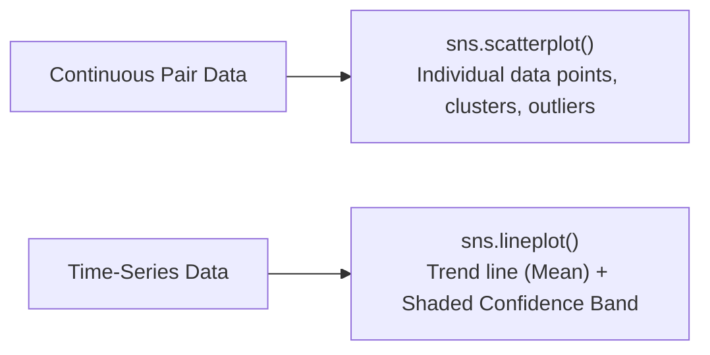

# Notes_19.12: Seaborn scatterplot Aur lineplot [Hinglish]

## 📌 Topic Overview
Is lecture mein Shraddha ma'am ne do sabse zaroori relational plots sikhaye hain: **`sns.scatterplot()`** (do features ka relation dekhne ke liye) aur **`sns.lineplot()`** (time ke sath badlav aur confidence intervals dekhne ke liye).

---

### 📋 Is Topic Mein Hum Kya Seekhenge?
- `sns.scatterplot()` ka use kab karte hain?
- `sns.lineplot()` flights dataset ke passengers ko years ke sath kaise aggregate karta hai?
- Shaded band (95% Confidence Interval) ka matlab kya hota hai?
- Matplotlib ke `ax=axes[i]` ke sath Seaborn ko connect karna.

---

### 🔍 Har Ek Point Ka Simple & Detailed Explanation

#### 1. `sns.scatterplot()`:
Jab aapke paas do continuous variables hon (jaise `total_bill` aur `tip`), toh scatter plot har row ko ek dot ki tarah plot karta hai. Isse humein pata chalta hai ki:
- Kya bill badhne se tip badh rahi hai? (Positive correlation)
- Kya koi aisa customer hai jisne $50 ke bill par bohot kam tip di? (Outlier)

#### 2. `sns.lineplot()` Aur Automatic Aggregation:
Flights dataset mein har saal ke 12 mahino ka data hai.
Jab hum `x="year"` aur `y="passengers"` pass karte hain, toh Seaborn:
- Har saal ke 12 mahino ka **Mean (Average)** nikal kar solid line banata hai.
- Aur uske aas-paas ek halka shaded band banata hai jo **95% Confidence Interval** hota hai!

---

### 📊 Blackboard Diagram: Scatterplot vs Lineplot



---

### 💻 Python Code Implementation

```python
import seaborn as sns
import matplotlib.pyplot as plt

def plot_scatter_and_line_relationships(show_plot=True):
    """
    Demonstrates Axes-level relational plots in Seaborn:
    1. sns.scatterplot() for bivariate continuous relationships (total_bill vs tip).
    2. sns.lineplot() for temporal trends with automatic aggregation (flights dataset).
    
    Returns:
        dict: Summary metrics for both plots.
    """
    sns.set_theme(style="whitegrid")
    tips = sns.load_dataset("tips")
    flights = sns.load_dataset("flights")
    
    fig, axes = plt.subplots(1, 2, figsize=(14, 5))
    
    # 1. Scatter Plot on axes[0]
    sns.scatterplot(
        data=tips,
        x="total_bill",
        y="tip",
        hue="time",
        palette="deep",
        ax=axes[0]
    )
    axes[0].set_title("Scatter Plot: Total Bill vs Tip (by Time)", fontweight="bold")
    
    # 2. Line Plot on axes[1] (Aggregates multiple months per year into mean + 95% CI)
    sns.lineplot(
        data=flights,
        x="year",
        y="passengers",
        color="crimson",
        marker="o",
        ax=axes[1]
    )
    axes[1].set_title("Line Plot: Airline Passengers Over Years (Mean + CI)", fontweight="bold")
    
    plt.tight_layout()
    if show_plot:
        plt.show()
        
    return {
        "tips_count": len(tips),
        "flights_year_range": (int(flights["year"].min()), int(flights["year"].max()))
    }

# --- Execution & Verification ---
info = plot_scatter_and_line_relationships(show_plot=False)
print(f"Relational Plots Metadata: {info}")

```

---

### 🎯 Key Takeaways:
1. `ax=axes[0]` pass karke aap Seaborn ko Matplotlib subplots ke sath seamlessly combine kar sakte hain.
2. Line plot ka shaded band data ki uncertainty aur monthly variance ko show karta hai.
