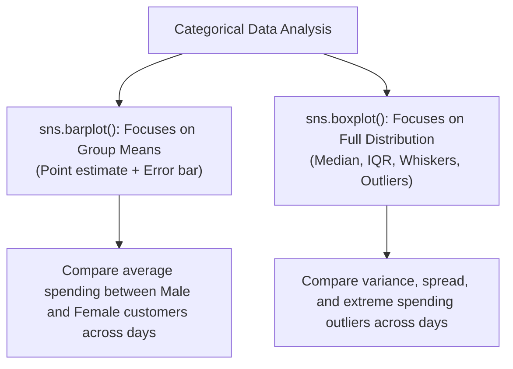

# Lecture 19.13: Categorical Plots in Seaborn (`barplot` & `boxplot`)

## 📌 Topic Overview
In this lecture, Shraddha ma'am explores **Categorical Plots in Seaborn**, contrasting `sns.barplot()` (which aggregates numeric values into group means with confidence error bars) with `sns.boxplot()` (which visualizes full five-number distributions and outliers across discrete categories).

---

## 🏛️ Categorical Visual Summaries



---

## 📐 Mathematical Formulation: Error Bars in Bar Plots

In `sns.barplot()`, the bar height represents the sample mean of category $c$:

$$
\bar{y}_c = \frac{1}{N_c} \sum_{i=1}^{N_c} y_{c, i}
$$

The vertical black cap line (error bar) represents the **Standard Error of the Mean (SEM)** or 95% confidence interval:

$$
\text{SE}(\bar{y}_c) = \frac{s_c}{\sqrt{N_c}}
$$

where $s_c$ is the sample standard deviation and $N_c$ is sample size.

---

## 💻 Python Implementation

```python
import seaborn as sns
import matplotlib.pyplot as plt

def plot_categorical_analyses(show_plot=True):
    """
    Demonstrates categorical plots in Seaborn:
    1. sns.barplot() with automatic mean aggregation and error bars.
    2. sns.boxplot() displaying 5-number distributions across discrete categories.
    
    Returns:
        dict: Mean total bill per day.
    """
    sns.set_theme(style="whitegrid")
    tips = sns.load_dataset("tips")
    
    fig, axes = plt.subplots(1, 2, figsize=(14, 5))
    
    # 1. Bar Plot: Average Total Bill by Day and Sex
    sns.barplot(
        data=tips,
        x="day",
        y="total_bill",
        hue="sex",
        palette="muted",
        ax=axes[0]
    )
    axes[0].set_title("Bar Plot: Mean Total Bill by Day & Sex (with Error Bars)", fontweight="bold")
    
    # 2. Box Plot: Distribution of Total Bill across Days
    sns.boxplot(
        data=tips,
        x="day",
        y="total_bill",
        palette="pastel",
        ax=axes[1]
    )
    axes[1].set_title("Box Plot: Total Bill Distribution by Day", fontweight="bold")
    
    plt.tight_layout()
    if show_plot:
        plt.show()
        
    day_means = tips.groupby("day")["total_bill"].mean().to_dict()
    return day_means

# --- Execution & Verification ---
means_dict = plot_categorical_analyses(show_plot=False)
for day, avg in means_dict.items():
    print(f"{day}: Mean Bill = ${avg:.2f}")

```

---

## 🔑 Key Takeaways
1. Unlike Matplotlib's `plt.bar()` which requires pre-computed heights, `sns.barplot()` automatically calculates group means directly from raw tabular rows.
2. `sns.boxplot()` partitions the continuous metric by category on the x-axis, allowing instant visual comparisons of medians and variance.
3. Adding `hue="sex"` automatically splits each categorical bar into clustered sub-bars.
