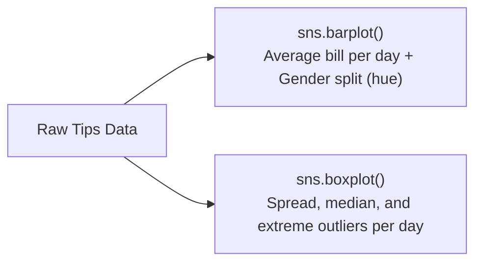

# Notes_19.13: Seaborn barplot Aur boxplot [Hinglish]

## 📌 Topic Overview
Is lecture mein Shraddha ma'am ne **Categorical Plots** sikhaye hain: `sns.barplot()` aur `sns.boxplot()` ka use karke alag-alag categories (jaise Days: Thurs, Fri, Sat, Sun aur Gender: Male, Female) ke beech ka difference kaise dekha jata hai.

---

### 📋 Is Topic Mein Hum Kya Seekhenge?
- Matplotlib `plt.bar()` vs Seaborn `sns.barplot()` ka mukhya farq.
- Bar plot mein vertical black error bar ka matlab kya hota hai?
- Categories ke cross-distribution dekhne ke liye `sns.boxplot()` ka use.
- `hue="sex"` se grouped/clustered bar chart banana.

---

### 🔍 Har Ek Point Ka Simple & Detailed Explanation

#### 1. `sns.barplot()` Ki Khasiyat:
Matplotlib mein agar aapko bar chart banana hota tha, toh pehle aapko khud Python mein average calculate karni padti thi.
Seaborn mein aapko kuch calculate nahi karna! Bas likhiye:
`sns.barplot(data=tips, x="day", y="total_bill", hue="sex")`
Seaborn khud har din aur har gender ka **Average (Mean)** nikalega aur bar ki height bana dega.

#### 2. Bar Plot Ka Error Bar:
Har bar ke top par ek kaali line (whisker) dikhti hai. Yeh **Confidence Interval / Standard Error** hota hai jo batata hai ki us category ka data kitna reliable hai.

#### 3. `sns.boxplot()`:
Bar plot sirf average dikhata hai. Lekin agar aapko dekhna ho ki Saturday ko sabse ameer customer ne kitna bill bhara aur median bill kya tha, toh **Boxplot** middle 50% data aur outliers saaf dikha deta hai.

---

### 📊 Blackboard Diagram: Grouped Bar Plot vs Category Box Plot



---

### 💻 Python Code Implementation

```python
import seaborn as sns
import matplotlib.pyplot as plt

def plot_categorical_analyses(show_plot=True):
    """
    Demonstrates categorical plots in Seaborn:
    1. sns.barplot() with automatic mean aggregation and error bars.
    2. sns.boxplot() displaying 5-number distributions across discrete categories.
    
    Returns:
        dict: Mean total bill per day.
    """
    sns.set_theme(style="whitegrid")
    tips = sns.load_dataset("tips")
    
    fig, axes = plt.subplots(1, 2, figsize=(14, 5))
    
    # 1. Bar Plot: Average Total Bill by Day and Sex
    sns.barplot(
        data=tips,
        x="day",
        y="total_bill",
        hue="sex",
        palette="muted",
        ax=axes[0]
    )
    axes[0].set_title("Bar Plot: Mean Total Bill by Day & Sex (with Error Bars)", fontweight="bold")
    
    # 2. Box Plot: Distribution of Total Bill across Days
    sns.boxplot(
        data=tips,
        x="day",
        y="total_bill",
        palette="pastel",
        ax=axes[1]
    )
    axes[1].set_title("Box Plot: Total Bill Distribution by Day", fontweight="bold")
    
    plt.tight_layout()
    if show_plot:
        plt.show()
        
    day_means = tips.groupby("day")["total_bill"].mean().to_dict()
    return day_means

# --- Execution & Verification ---
means_dict = plot_categorical_analyses(show_plot=False)
for day, avg in means_dict.items():
    print(f"{day}: Mean Bill = ${avg:.2f}")

```

---

### 🎯 Key Takeaways:
1. Average values compare karne ke liye `barplot` best hai.
2. Outliers aur spread samajhne ke liye `boxplot` best hai.
