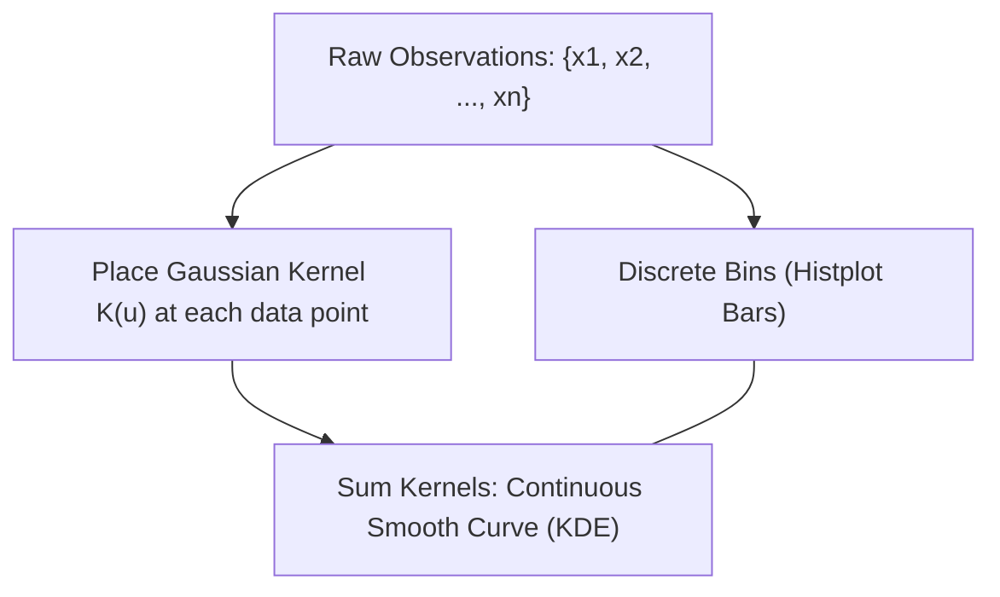

# Lecture 19.14: Distribution Plots in Seaborn (`histplot` & KDE)

## 📌 Topic Overview
In this lecture, Shraddha ma'am covers modern distribution plotting in Seaborn using **`sns.histplot()`**, demonstrating how to examine continuous variables (such as penguin body mass) and overlay smooth probability density curves via **Kernel Density Estimation (`kde=True`)**.

---

## 🏛️ Discrete Bins to Continuous KDE



---

## 📐 Mathematical Formulation: Kernel Density Estimation (KDE)

The continuous probability density estimate $\hat{f}(x)$ at point $x$ is computed as the sum of Gaussian kernel functions centered at each sample $x_i$:

$$
\hat{f}(x) = \frac{1}{n h} \sum_{i=1}^n K\left( \frac{x - x_i}{h} \right)
$$

where $K(u) = \frac{1}{\sqrt{2\pi}} e^{-u^2 / 2}$ is the standard normal kernel, and $h$ is the smoothing parameter (**bandwidth**).

---

## 💻 Python Implementation

```python
import seaborn as sns
import matplotlib.pyplot as plt

def plot_penguin_distribution(bins=30, kde=True, show_plot=True):
    """
    Plots the statistical distribution of continuous features using sns.histplot().
    Demonstrates binning, frequency histograms, and Kernel Density Estimation (KDE)
    on the penguins dataset.
    
    Parameters:
        bins (int): Number of histogram intervals.
        kde (bool): Whether to overlay smooth kernel density estimate.
        show_plot (bool): Display control.
        
    Returns:
        dict: Mean and standard deviation of penguin body mass.
    """
    sns.set_theme(style="whitegrid")
    penguins = sns.load_dataset("penguins")
    
    plt.figure(figsize=(9, 5))
    
    # Distribution plot with KDE overlay
    sns.histplot(
        data=penguins,
        x="body_mass_g",
        bins=bins,
        kde=kde,
        color="teal",
        edgecolor="black"
    )
    
    plt.title("Distribution of Penguin Body Mass (g) with KDE Curve", fontweight="bold")
    plt.xlabel("Body Mass (grams)")
    plt.ylabel("Count")
    
    plt.tight_layout()
    if show_plot:
        plt.show()
        
    clean_mass = penguins["body_mass_g"].dropna()
    return {
        "mean_mass": float(clean_mass.mean()),
        "std_mass": float(clean_mass.std()),
        "total_records": len(clean_mass)
    }

# --- Execution & Verification ---
stats = plot_penguin_distribution(show_plot=False)
print(f"Penguin Body Mass Mean: {stats['mean_mass']:.1f} g")
print(f"Standard Deviation: {stats['std_mass']:.1f} g")

```

---

## 🔑 Key Takeaways
1. `sns.histplot()` replaces the deprecated `sns.distplot()`.
2. Setting `kde=True` overlays a smooth probability density curve, mitigating the sensitivity of histograms to bin edge choices.
3. Seaborn handles missing values (`NaN`) automatically during distribution calculations.
