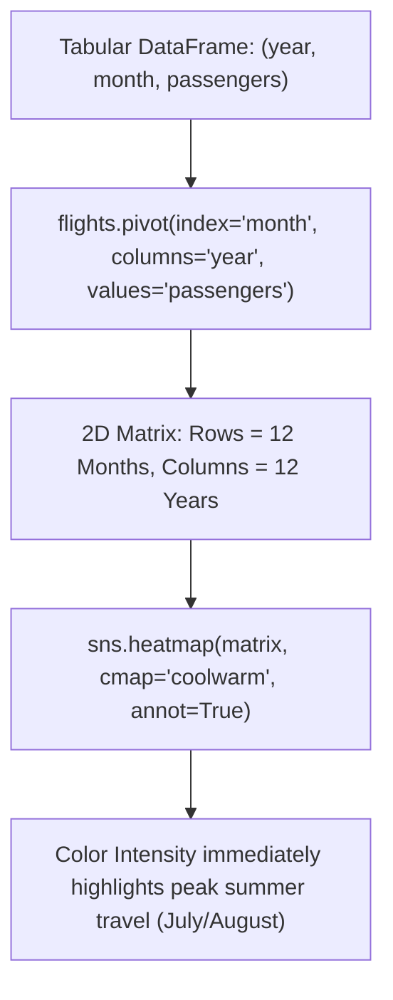

# Lecture 19.15: Relational Plots in Seaborn - Heatmaps

## 📌 Topic Overview
In this lecture, Shraddha ma'am introduces **Heatmaps (`sns.heatmap()`)**, demonstrating how to visualize 2D matrix relationships (such as airline passengers across months and years) using color intensity gradients, pandas pivot tables, and formatted numeric annotations (`annot=True, fmt='d'`).

---

## 🏛️ Tabular DataFrame to Heatmap Matrix Pipeline



---

## 📐 Mathematical Formulation: Matrix Color Normalization

Given a 2D matrix $\mathbf{M} \in \mathbb{R}^{R \times C}$, each cell $M_{i, j}$ is mapped to a normalized color scalar $c_{i, j} \in [0, 1]$ via min-max scaling:

$$
c_{i, j} = \frac{M_{i, j} - \min(\mathbf{M})}{\max(\mathbf{M}) - \min(\mathbf{M})}
$$

The colormap function $\mathcal{C}: [0, 1] \to \text{RGB}$ maps $c_{i, j}$ to a color along the spectrum (e.g., cool blue for low passenger volume, warm red for peak volume).

---

## 💻 Python Implementation

```python
import seaborn as sns
import matplotlib.pyplot as plt

def generate_flight_passenger_heatmap(cmap="coolwarm", show_plot=True):
    """
    Generates a 2D matrix heatmap showing airline passenger volume across
    months and years. Demonstrates pandas pivot tables, colormaps, and
    numeric cell annotations.
    
    Parameters:
        cmap (str): Matplotlib/Seaborn colormap name.
        show_plot (bool): Display control.
        
    Returns:
        dict: Peak month-year combination and passenger count.
    """
    sns.set_theme(style="white")
    flights = sns.load_dataset("flights")
    
    # 1. Pivot tabular data into 2D matrix (Index=Month, Columns=Year)
    flights_pivot = flights.pivot(index="month", columns="year", values="passengers")
    
    plt.figure(figsize=(10, 6))
    
    # 2. Draw Heatmap with integer annotations
    sns.heatmap(
        flights_pivot,
        cmap=cmap,
        annot=True,
        fmt="d",
        linewidths=0.5
    )
    plt.title("Airline Passenger Traffic (1949 - 1960) Heatmap", fontweight="bold", pad=12)
    plt.tight_layout()
    
    if show_plot:
        plt.show()
        
    max_val = int(flights_pivot.values.max())
    return {
        "max_passengers": max_val,
        "years_covered": list(flights_pivot.columns),
        "months": list(flights_pivot.index)
    }

# --- Execution & Verification ---
res = generate_flight_passenger_heatmap(show_plot=False)
print(f"Maximum Monthly Passengers: {res['max_passengers']}")
print(f"Years Tracked: {res['years_covered'][0]} to {res['years_covered'][-1]}")

```

---

## 🔑 Key Takeaways
1. Heatmaps require 2D matrix inputs; always restructure tidy tabular data using `df.pivot()` or `df.corr()`.
2. Use `annot=True` and `fmt='d'` (for integers) or `fmt='.2f'` (for floats) to display cell values directly.
3. Diverging colormaps like `'coolwarm'` or `'vlag'` are ideal for correlation matrices or deviations around a midpoint.
