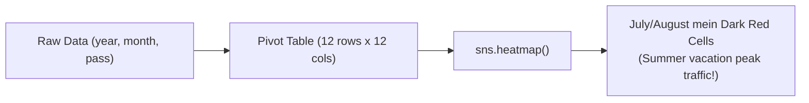

# Notes_19.15: Seaborn Heatmaps [Hinglish]

## 📌 Topic Overview
Is lecture mein Shraddha ma'am ne **Heatmap (`sns.heatmap()`)** ka use sikhaya hai: 2D matrix data ko color intensity ke zariye kaise visualize kiya jata hai, jaise 1949 se 1960 tak har mahine ke airline passengers ka traffic.

---

### 📋 Is Topic Mein Hum Kya Seekhenge?
- Heatmap kya hota hai aur iski zaroorat kab padti hai?
- Pandas `pivot()` function ka role: Tidy data ko 2D matrix mein badalna.
- `cmap="coolwarm"` colormap ka visual effect (Neela = Thanda/Kam, Laal = Garam/Zyada).
- `annot=True` aur `fmt="d"` se har cell mein actual number display karna.

---

### 🔍 Har Ek Point Ka Simple & Detailed Explanation

#### 1. Heatmap Kya Hai?
Jab hamare paas ek 2D table ya correlation matrix hoti hai, toh sirf numbers padhna bohot boring aur mushkil hota hai.
**Heatmap** numbers ki jagah **Colors** use karta hai:
- Jahan number chhota hai, wahan cool color (jaise Blue) dikhta hai.
- Jahan number bada hai, wahan warm color (jaise Red) dikhta hai.

#### 2. Pivot Table Banana:
Heatmap ko seedha DataFrame pasand nahi hai; use 2D Grid chahiye hoti hai.
Isliye hum `df.pivot()` use karte hain:
- `index="month"`: Rows mahine ban gaye.
- `columns="year"`: Columns saal ban gaye.
- `values="passengers"`: Cells mein passenger count aa gaya.

Formula:

$$
c_{i, j} = \frac{M_{i, j} - \min(\mathbf{M})}{\max(\mathbf{M}) - \min(\mathbf{M})}
$$

---

### 📊 Blackboard Diagram: DataFrame Se Heatmap



---

### 💻 Python Code Implementation

```python
import seaborn as sns
import matplotlib.pyplot as plt

def generate_flight_passenger_heatmap(cmap="coolwarm", show_plot=True):
    """
    Generates a 2D matrix heatmap showing airline passenger volume across
    months and years. Demonstrates pandas pivot tables, colormaps, and
    numeric cell annotations.
    
    Parameters:
        cmap (str): Matplotlib/Seaborn colormap name.
        show_plot (bool): Display control.
        
    Returns:
        dict: Peak month-year combination and passenger count.
    """
    sns.set_theme(style="white")
    flights = sns.load_dataset("flights")
    
    # 1. Pivot tabular data into 2D matrix (Index=Month, Columns=Year)
    flights_pivot = flights.pivot(index="month", columns="year", values="passengers")
    
    plt.figure(figsize=(10, 6))
    
    # 2. Draw Heatmap with integer annotations
    sns.heatmap(
        flights_pivot,
        cmap=cmap,
        annot=True,
        fmt="d",
        linewidths=0.5
    )
    plt.title("Airline Passenger Traffic (1949 - 1960) Heatmap", fontweight="bold", pad=12)
    plt.tight_layout()
    
    if show_plot:
        plt.show()
        
    max_val = int(flights_pivot.values.max())
    return {
        "max_passengers": max_val,
        "years_covered": list(flights_pivot.columns),
        "months": list(flights_pivot.index)
    }

# --- Execution & Verification ---
res = generate_flight_passenger_heatmap(show_plot=False)
print(f"Maximum Monthly Passengers: {res['max_passengers']}")
print(f"Years Tracked: {res['years_covered'][0]} to {res['years_covered'][-1]}")

```

---

### 🎯 Key Takeaways:
1. Feature correlation check karne ke liye (`sns.heatmap(df.corr(), annot=True)`) Machine Learning ka sabse pehla step hota hai.
2. `fmt="d"` integer values ke liye hota hai taaki scientific notation ($1.2e+02$) na dikhe.
