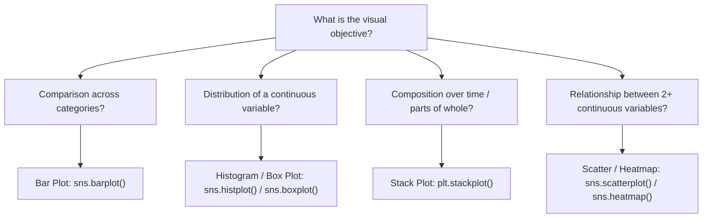

# Lecture 19.16: Best Practices for Data Visualization

## 📌 Topic Overview
In this lecture, Shraddha ma'am synthesizes the data visualization curriculum, detailing **industry best practices** for creating publication-quality graphics: integrating Seaborn with Matplotlib's OOP interface (`ax=ax`), removing chart clutter with `sns.despine()`, selecting color palettes thoughtfully, and choosing the appropriate chart type for any business problem.

---

## 🏛️ Chart Selection Decision Matrix



---

## 📐 Core Best Practice Principles

1. **Maximize Data-to-Ink Ratio:** Remove distracting gridlines, heavy borders, and 3D effects. Use `sns.despine()` to eliminate top and right borders.
2. **The `ax=ax` Pattern:** Always instantiate `fig, ax = plt.subplots()` and pass `ax=ax` into Seaborn. This grants absolute control over titles, axis scales, and multi-panel figures.
3. **Accessibility & Color Vision Deficiency:** Use perceptually uniform palettes (e.g. `'viridis'`, `'cividis'`) rather than rainbow or saturated red-green palettes.

---

## 💻 Python Implementation

```python
import seaborn as sns
import matplotlib.pyplot as plt

def create_publication_quality_plot(show_plot=True):
    """
    Demonstrates best practices in modern Data Visualization:
    1. Combining Seaborn statistical capabilities with Matplotlib OOP precision (ax=ax).
    2. Professional formatting: removing top/right spines (sns.despine).
    3. Informative labels, custom titles, and clean legends.
    
    Returns:
        dict: Final plot aesthetic configurations.
    """
    sns.set_theme(style="ticks")
    tips = sns.load_dataset("tips")
    
    fig, ax = plt.subplots(figsize=(8, 5))
    
    # Recommended approach: pass Matplotlib ax to Seaborn plotting function
    sns.lineplot(
        data=tips,
        x="day",
        y="total_bill",
        hue="sex",
        marker="o",
        errorbar=None,
        palette={"Male": "#2b5c8f", "Female": "#d95f02"},
        linewidth=2.2,
        ax=ax
    )
    
    # Polish labels and titles using OOP methods
    ax.set_title("Average Total Bill by Day and Sex (Publication Style)", fontsize=13, fontweight="bold", pad=12)
    ax.set_xlabel("Day of the Week", fontsize=11)
    ax.set_ylabel("Total Bill ($)", fontsize=11)
    ax.grid(axis="y", linestyle=":", alpha=0.6)
    
    # Remove unnecessary border clutter
    sns.despine(top=True, right=True)
    ax.legend(title="Customer Gender", frameon=True)
    
    plt.tight_layout()
    if show_plot:
        plt.show()
        
    return {
        "theme": "ticks",
        "despine_applied": True,
        "palette_used": ["#2b5c8f", "#d95f02"]
    }

# --- Execution & Verification ---
cfg = create_publication_quality_plot(show_plot=False)
print(f"Publication Styling Applied: {cfg}")

```

---

## 🔑 Key Takeaways
1. The `fig, ax = plt.subplots(); sns.function(..., ax=ax)` pattern is the professional gold standard across production ML engineering.
2. `sns.despine()` instantly elevates a plot from amateur to publication-grade by decluttering redundant borders.
3. Every plot must include clear units in axis labels (e.g., `Total Bill ($)` or `Temperature (°C)`).
