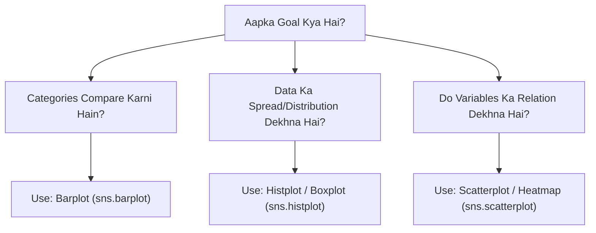

# Notes_19.16: Data Visualization Ki Best Practices [Hinglish]

## 📌 Topic Overview
Is lecture mein Shraddha ma'am ne **Data Visualization ki industry best practices** summarize ki hain: production-level plots kaise banaye jaate hain, Seaborn aur Matplotlib OOP ko ek sath (`ax=ax`) kaise use karte hain, aur chart clutter ko `sns.despine()` se kaise hataya jata hai.

---

### 📋 Is Topic Mein Hum Kya Seekhenge?
- Professional plotting ka gold standard: `fig, ax = plt.subplots()` aur `ax=ax`.
- `sns.despine()` ka use karke top aur right ki faltu borders hatana.
- Kaunse problem ke liye kaunsa chart select karein (Chart Selection Matrix).
- Data-to-ink ratio badhana aur visual clutter kam karna.

---

### 🔍 Har Ek Point Ka Simple & Detailed Explanation

#### 1. The Recommended Approach (`ax=ax`):
Industry mein sabse common mistake hoti hai ki log Matplotlib aur Seaborn ko alag-alag tarike se mix karte hain jisse control kho jata hai.
**Recommended Pattern:**
1. Pehle Matplotlib se canvas banayein: `fig, ax = plt.subplots()`
2. Seaborn function ko wahi axes de dein: `sns.lineplot(..., ax=ax)`
3. Phir OOP methods se title aur labels customize karein: `ax.set_title()`, `ax.set_xlabel()`

#### 2. `sns.despine()`:
Default graphs mein chaaron taraf border hoti hai. Lekin modern visual design mein top aur right border ki koi zaroorat nahi hoti. `sns.despine()` likhte hi chart ekdum clean aur modern ban jata hai.

#### 3. Chart Selection Rule:
- **Comparison:** Bar Plot (`sns.barplot`)
- **Distribution:** Histogram / Boxplot (`sns.histplot`, `sns.boxplot`)
- **Time Composition:** Stack Plot (`plt.stackplot`)
- **Relationship:** Scatter Plot / Heatmap (`sns.scatterplot`, `sns.heatmap`)

---

### 📊 Blackboard Diagram: Chart Selection Decision Tree



---

### 💻 Python Code Implementation

```python
import seaborn as sns
import matplotlib.pyplot as plt

def create_publication_quality_plot(show_plot=True):
    """
    Demonstrates best practices in modern Data Visualization:
    1. Combining Seaborn statistical capabilities with Matplotlib OOP precision (ax=ax).
    2. Professional formatting: removing top/right spines (sns.despine).
    3. Informative labels, custom titles, and clean legends.
    
    Returns:
        dict: Final plot aesthetic configurations.
    """
    sns.set_theme(style="ticks")
    tips = sns.load_dataset("tips")
    
    fig, ax = plt.subplots(figsize=(8, 5))
    
    # Recommended approach: pass Matplotlib ax to Seaborn plotting function
    sns.lineplot(
        data=tips,
        x="day",
        y="total_bill",
        hue="sex",
        marker="o",
        errorbar=None,
        palette={"Male": "#2b5c8f", "Female": "#d95f02"},
        linewidth=2.2,
        ax=ax
    )
    
    # Polish labels and titles using OOP methods
    ax.set_title("Average Total Bill by Day and Sex (Publication Style)", fontsize=13, fontweight="bold", pad=12)
    ax.set_xlabel("Day of the Week", fontsize=11)
    ax.set_ylabel("Total Bill ($)", fontsize=11)
    ax.grid(axis="y", linestyle=":", alpha=0.6)
    
    # Remove unnecessary border clutter
    sns.despine(top=True, right=True)
    ax.legend(title="Customer Gender", frameon=True)
    
    plt.tight_layout()
    if show_plot:
        plt.show()
        
    return {
        "theme": "ticks",
        "despine_applied": True,
        "palette_used": ["#2b5c8f", "#d95f02"]
    }

# --- Execution & Verification ---
cfg = create_publication_quality_plot(show_plot=False)
print(f"Publication Styling Applied: {cfg}")

```

---

### 🎯 Key Takeaways:
1. Hamesha axis labels ke sath units likhein (jaise `($)`, `(grams)`, `(°C)`).
2. `sns.despine()` aur `plt.tight_layout()` har professional presentation ki pehchan hain.
