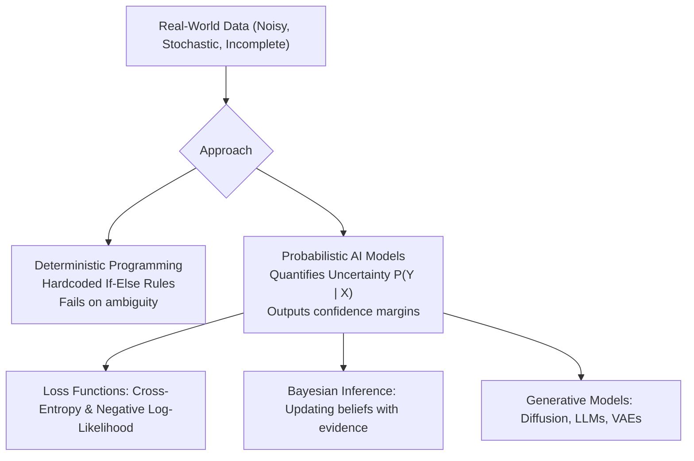

# Lecture 20.01: Math for AI & Why Probability Matters

## 📌 Topic Overview
In this lecture, Shraddha ma'am introduces **Probability Theory as the foundational mathematical framework for reasoning under uncertainty in AI and Machine Learning**. Classical deterministic logic fails in the presence of noise, missing attributes, and natural randomness; probabilistic modeling allows AI algorithms to quantify belief, optimize parameters via Maximum Likelihood Estimation, and calibrate confidence.

---

## 🏛️ Deterministic Logic vs Probabilistic Machine Learning



---

## 📐 Mathematical Formulation: Maximum Likelihood Estimation (MLE)

Given an independent and identically distributed (i.i.d.) dataset $\mathcal{D} = \{x_1, x_2, \dots, x_n\}$ drawn from parameterized distribution $P(x; \theta)$, the joint likelihood function is:

$$
\mathcal{L}(\theta) = \prod_{i=1}^n P(x_i; \theta)
$$

Because multiplying many probabilities in $[0, 1]$ leads to floating-point numerical underflow ($\to 0$), optimization is universally conducted over the **Negative Log-Likelihood (NLL)**:

$$
\mathcal{J}(\theta) = -\log \mathcal{L}(\theta) = -\sum_{i=1}^n \log P(x_i; \theta)
$$

Minimizing NLL transforms product terms into sums and directly yields standard loss functions such as **Binary Cross-Entropy**.

---

## 💻 Python Implementation

```python
import numpy as np

def evaluate_likelihood_vs_log_likelihood(n_trials=100, true_p=0.7, p_test=0.7):
    """
    Demonstrates why modern AI systems optimize Log-Likelihood rather than raw Likelihood.
    Multiplying many small probabilities causes floating-point numerical underflow,
    while summing logs remains numerically stable and convex.
    
    Parameters:
        n_trials (int): Number of independent Bernoulli observations.
        true_p (float): True underlying success probability.
        p_test (float): Candidate parameter value to evaluate.
        
    Returns:
        dict: Raw likelihood, log-likelihood, and MLE estimate.
    """
    np.random.seed(42)
    sample_data = np.random.binomial(1, true_p, size=n_trials)
    k_successes = int(np.sum(sample_data))
    n_failures = n_trials - k_successes
    
    # Analytical Maximum Likelihood Estimate
    p_mle = k_successes / n_trials
    
    # Raw Likelihood (subject to underflow when n_trials is large)
    raw_likelihood = (p_test ** k_successes) * ((1 - p_test) ** n_failures)
    
    # Log-Likelihood (numerically stable sum of logs)
    log_likelihood = k_successes * np.log(p_test) + n_failures * np.log(1 - p_test)
    
    return {
        "n_trials": n_trials,
        "k_successes": k_successes,
        "p_mle": p_mle,
        "raw_likelihood": float(raw_likelihood),
        "log_likelihood": float(log_likelihood)
    }

# --- Execution & Verification ---
res = evaluate_likelihood_vs_log_likelihood(n_trials=100, true_p=0.7)
print(f"Successes: {res['k_successes']}/{res['n_trials']}")
print(f"Analytical MLE: p_hat = {res['p_mle']:.4f}")
print(f"Raw Likelihood: {res['raw_likelihood']:.4e} (Extremely close to floating-point underflow!)")
print(f"Log-Likelihood: {res['log_likelihood']:.4f} (Stable & easy to optimize)")

```

---

## 🔑 Key Takeaways
1. Probability provides the principled language to measure and act upon uncertainty in real-world environments.
2. AI classification models do not output binary decisions directly; they output calibrated posterior probabilities $P(y = 1 \mid \mathbf{x})$.
3. Multiplying probabilities leads to numerical underflow; log transformations preserve rank ordering while ensuring numerical stability.
