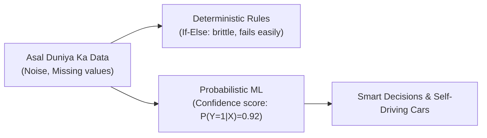

# Notes_20.01: AI Ke Liye Math Aur Probability Ki Zaroorat [Hinglish]

## 📌 Topic Overview
Is lecture mein Shraddha ma'am ne samjhaya hai ki **Artificial Intelligence aur Machine Learning mein Probability Theory kyu sabse important foundation hai**, aur real-world uncertainty aur noise ko handle karne ke liye probabilistic thinking kyu zaroori hai.

---

### 📋 Is Topic Mein Hum Kya Seekhenge?
- AI mein deterministic logic (If-Else) kyu fail ho jata hai?
- Machine Learning models uncertainty ko kaise measure karte hain?
- Maximum Likelihood Estimation (MLE) kya hai aur loss functions se iska rishta.
- Raw Likelihood ke mukable Log-Likelihood kyu use karte hain (Numerical Underflow se bachav).

---

### 🔍 Har Ek Point Ka Simple & Detailed Explanation

#### 1. Real World Mein Uncertainty:
Agar aap ek simple calculator banate hain, toh $2 + 2 = 4$ fixed hota hai.
Lekin agar aap AI se puchte hain: "Kya is photo mein cat hai?", ya "Kya kal baarish hogi?", toh koi bhi computer $100\%$ guarantee nahi de sakta kyunki camera mein noise ho sakta hai, lighting alag ho sakti hai.
Probability AI ko yeh batane ki taqat deti hai:
$P(\text{Cat} \mid \text{Image}) = 0.95$ (95% chance hai ki cat hai).

#### 2. Log-Likelihood Ka Math:
Jab hum 100 observations ka probability product nikalte hain:

$$
\mathcal{L}(\theta) = \prod_{i=1}^n P(x_i; \theta)
$$

$0.5 \times 0.5 \times \dots$ multiply hote-hote itna chhota number ban jata hai ($10^{-30}$) ki computer usse 0 maan leta hai (**Numerical Underflow**).
Isliye hum **Logarithm** lagate hain. Log multiplication ko addition mein badal deta hai:

$$
\log \mathcal{L}(\theta) = \sum_{i=1}^n \log P(x_i; \theta)
$$

Isi formula se machine learning ka **Cross-Entropy Loss** banta hai!

---

### 📊 Blackboard Diagram: Deterministic vs Probabilistic AI



---

### 💻 Python Code Implementation

```python
import numpy as np

def evaluate_likelihood_vs_log_likelihood(n_trials=100, true_p=0.7, p_test=0.7):
    """
    Demonstrates why modern AI systems optimize Log-Likelihood rather than raw Likelihood.
    Multiplying many small probabilities causes floating-point numerical underflow,
    while summing logs remains numerically stable and convex.
    
    Parameters:
        n_trials (int): Number of independent Bernoulli observations.
        true_p (float): True underlying success probability.
        p_test (float): Candidate parameter value to evaluate.
        
    Returns:
        dict: Raw likelihood, log-likelihood, and MLE estimate.
    """
    np.random.seed(42)
    sample_data = np.random.binomial(1, true_p, size=n_trials)
    k_successes = int(np.sum(sample_data))
    n_failures = n_trials - k_successes
    
    # Analytical Maximum Likelihood Estimate
    p_mle = k_successes / n_trials
    
    # Raw Likelihood (subject to underflow when n_trials is large)
    raw_likelihood = (p_test ** k_successes) * ((1 - p_test) ** n_failures)
    
    # Log-Likelihood (numerically stable sum of logs)
    log_likelihood = k_successes * np.log(p_test) + n_failures * np.log(1 - p_test)
    
    return {
        "n_trials": n_trials,
        "k_successes": k_successes,
        "p_mle": p_mle,
        "raw_likelihood": float(raw_likelihood),
        "log_likelihood": float(log_likelihood)
    }

# --- Execution & Verification ---
res = evaluate_likelihood_vs_log_likelihood(n_trials=100, true_p=0.7)
print(f"Successes: {res['k_successes']}/{res['n_trials']}")
print(f"Analytical MLE: p_hat = {res['p_mle']:.4f}")
print(f"Raw Likelihood: {res['raw_likelihood']:.4e} (Extremely close to floating-point underflow!)")
print(f"Log-Likelihood: {res['log_likelihood']:.4f} (Stable & easy to optimize)")

```

---

### 🎯 Key Takeaways:
1. Probability humein uncertainty ko quantify karna sikhati hai.
2. AI loss functions (jaise Binary Cross Entropy) seedhe negative log-likelihood minimization par aadharit hain.
