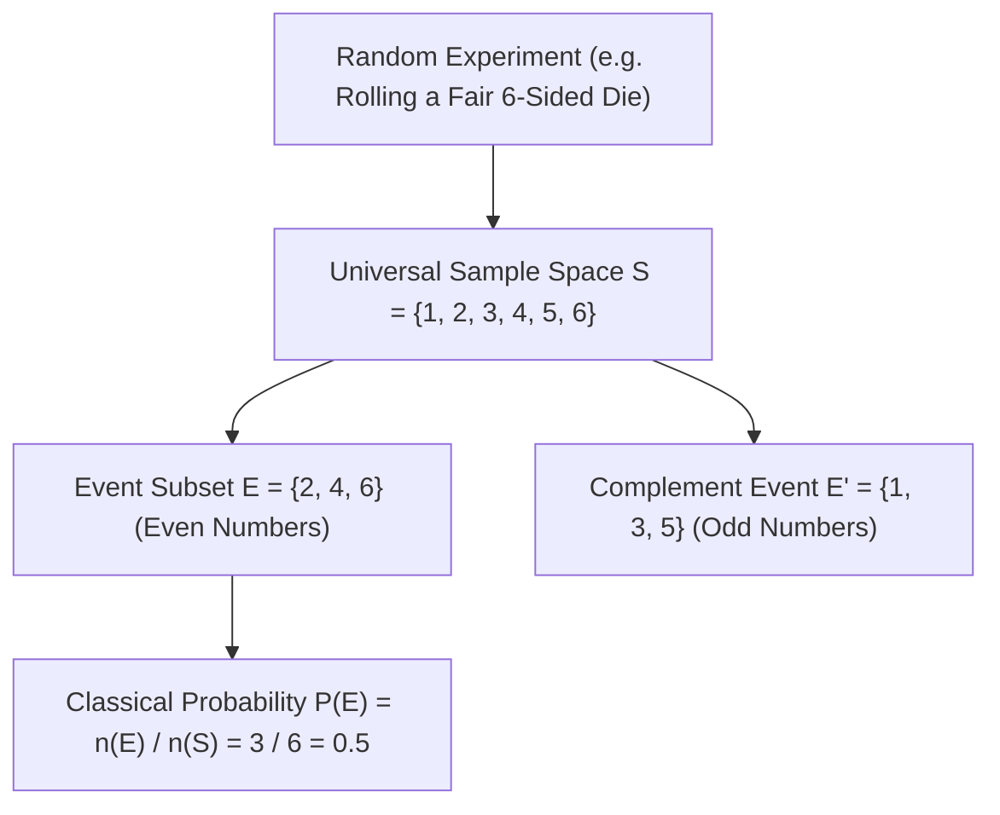

# Lecture 20.02: Understanding Probability

## 📌 Topic Overview
In this lecture, Shraddha ma'am covers the **foundational axioms and definitions of Probability Theory**, establishing the concepts of Random Experiments, Sample Spaces ($S$), Events ($E \subseteq S$), and the classical Laplacian definition of probability.

---

## 🏛️ Sample Space and Event Subsets



---

## 📐 Mathematical Formulation: Kolmogorov Axioms

Let $(\Omega, \mathcal{F}, P)$ be a probability space where $\Omega$ is the sample space and $\mathcal{F}$ is the event space:

1. **Non-negativity (Axiom 1):** For any event $E \in \mathcal{F}$:

$$
0 \le P(E) \le 1
$$

2. **Certainty (Axiom 2):** The probability of the universal sample space is unity:

$$
P(\Omega) = 1, \qquad P(\emptyset) = 0
$$

3. **Classical Probability Definition:** When all elemental outcomes in finite space $S$ are equally likely:

$$
P(E) = \frac{n(E)}{n(S)} = \frac{\text{Number of favorable outcomes}}{\text{Total number of possible outcomes}}
$$

---

## 💻 Python Implementation

```python
def compute_classical_probability(favorable_outcomes, total_outcomes):
    """
    Computes theoretical classical probability P(E) = n(E) / n(S)
    and verifies Kolmogorov's first two probability axioms.
    
    Parameters:
        favorable_outcomes (int or set): Event favorable outcomes.
        total_outcomes (int or set): Universal sample space outcomes.
        
    Returns:
        dict: Calculated probability and axiom compliance checks.
    """
    n_e = len(favorable_outcomes) if isinstance(favorable_outcomes, (set, list)) else favorable_outcomes
    n_s = len(total_outcomes) if isinstance(total_outcomes, (set, list)) else total_outcomes
    
    if n_s <= 0:
        raise ValueError("Sample space size must be strictly positive.")
        
    prob = n_e / n_s
    
    is_valid_range = (0.0 <= prob <= 1.0)
    
    return {
        "event_count_nE": n_e,
        "sample_space_nS": n_s,
        "probability_PE": prob,
        "axiom_valid_range": is_valid_range
    }

# --- Execution & Verification ---
# Rolling an even number on a 6-sided die: E = {2, 4, 6}, S = {1, 2, 3, 4, 5, 6}
res = compute_classical_probability(favorable_outcomes={2, 4, 6}, total_outcomes={1, 2, 3, 4, 5, 6})
print(f"Favorable Outcomes: {res['event_count_nE']}")
print(f"Total Outcomes: {res['sample_space_nS']}")
print(f"Theoretical Probability: P(E) = {res['probability_PE']:.4f}")
print(f"Axiom 0 <= P(E) <= 1 satisfied? {res['axiom_valid_range']}")

```

---

## 🔑 Key Takeaways
1. A random experiment has well-defined outcomes that cannot be predicted with certainty in advance.
2. The sample space $S$ represents the exhaustive set of all possible outcomes.
3. Probability $P(E)$ is strictly bounded in $[0, 1]$; $0$ indicates impossibility, $1$ indicates absolute certainty.
