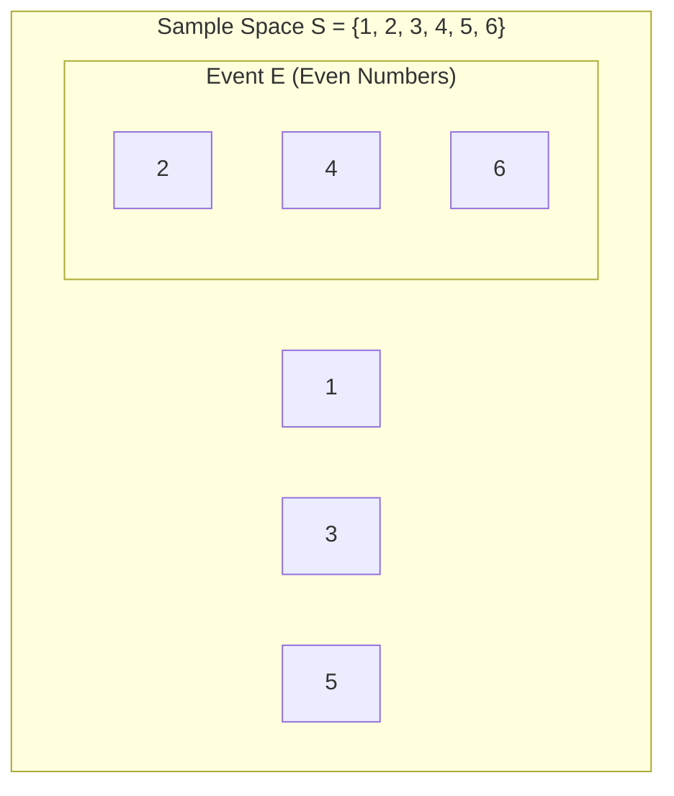

# Notes_20.02: Probability Ko Samajhna [Hinglish]

## 📌 Topic Overview
Is lecture mein Shraddha ma'am ne **Probability ke basic terms aur rules** ko detail mein samjhaya hai: Random Experiment kya hota hai, Sample Space ($S$) kaise banate hain, aur kisi Event ($E$) ki probability kaise calculate ki jaati hai.

---

### 📋 Is Topic Mein Hum Kya Seekhenge?
- Random Experiment, Sample Space ($S$), aur Event ($E$) ki paribhasha.
- Classical Probability formula: $P(E) = \frac{n(E)}{n(S)}$.
- Probability ki boundary: Value hamesha $0$ se $1$ ke beech kyu rehti hai?
- Impossible event ($P=0$) aur Sure event ($P=1$).

---

### 🔍 Har Ek Point Ka Simple & Detailed Explanation

#### 1. Basic Terms:
1. **Random Experiment:** Aisa action jiska result pehle se 100% pakka na pata ho (jaise coin toss karna ya ludo ka dice fekna).
2. **Sample Space ($S$):** Experiment ke sabhi possible outcomes ka set.
   - Coin toss: $S = \{\text{Head}, \text{Tail}\} \implies n(S) = 2$
   - 6-sided die: $S = \{1, 2, 3, 4, 5, 6\} \implies n(S) = 6$
3. **Event ($E$):** Sample space ka koi bhi subset jo hamare interest ka ho (jaise "Even number aana": $E = \{2, 4, 6\}$).

#### 2. Classical Formula:

$$
P(E) = \frac{n(E)}{n(S)} = \frac{\text{Kitne outcomes hamare favour mein hain}}{\text{Total kitne outcomes possible hain}}
$$

Even number aane ki probability:

$$
P(\text{Even}) = \frac{3}{6} = \frac{1}{2} = 0.5
$$

---

### 📊 Blackboard Diagram: Sample Space Aur Event Ka Venn Diagram



---

### 💻 Python Code Implementation

```python
def compute_classical_probability(favorable_outcomes, total_outcomes):
    """
    Computes theoretical classical probability P(E) = n(E) / n(S)
    and verifies Kolmogorov's first two probability axioms.
    
    Parameters:
        favorable_outcomes (int or set): Event favorable outcomes.
        total_outcomes (int or set): Universal sample space outcomes.
        
    Returns:
        dict: Calculated probability and axiom compliance checks.
    """
    n_e = len(favorable_outcomes) if isinstance(favorable_outcomes, (set, list)) else favorable_outcomes
    n_s = len(total_outcomes) if isinstance(total_outcomes, (set, list)) else total_outcomes
    
    if n_s <= 0:
        raise ValueError("Sample space size must be strictly positive.")
        
    prob = n_e / n_s
    
    is_valid_range = (0.0 <= prob <= 1.0)
    
    return {
        "event_count_nE": n_e,
        "sample_space_nS": n_s,
        "probability_PE": prob,
        "axiom_valid_range": is_valid_range
    }

# --- Execution & Verification ---
# Rolling an even number on a 6-sided die: E = {2, 4, 6}, S = {1, 2, 3, 4, 5, 6}
res = compute_classical_probability(favorable_outcomes={2, 4, 6}, total_outcomes={1, 2, 3, 4, 5, 6})
print(f"Favorable Outcomes: {res['event_count_nE']}")
print(f"Total Outcomes: {res['sample_space_nS']}")
print(f"Theoretical Probability: P(E) = {res['probability_PE']:.4f}")
print(f"Axiom 0 <= P(E) <= 1 satisfied? {res['axiom_valid_range']}")

```

---

### 🎯 Key Takeaways:
1. Probability hamesha $0 \le P(E) \le 1$ ke range mein hoti hai.
2. Agar koi event kabhi ho hi nahi sakta (jaise dice par 7 aana), toh $P(E) = 0$.
