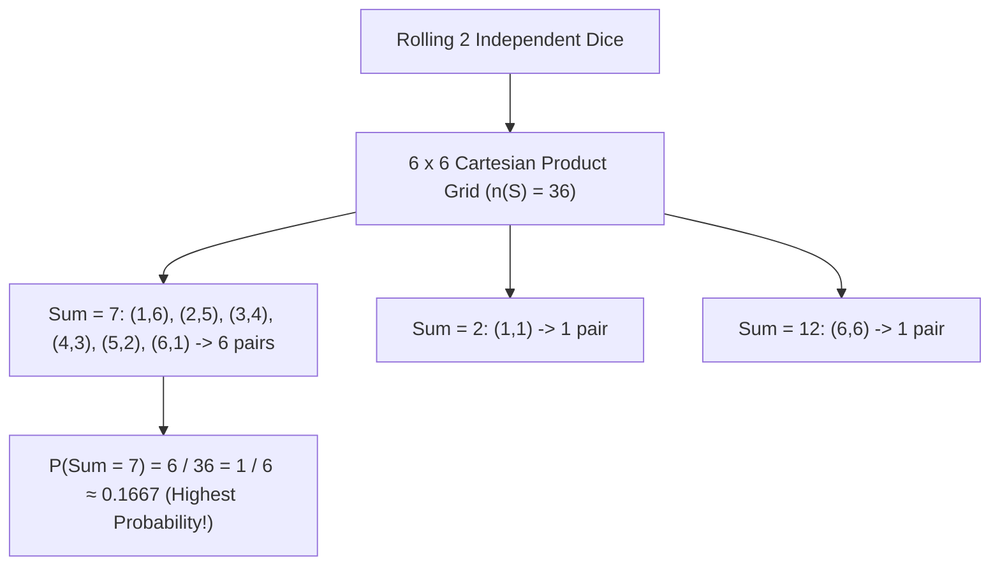

# Lecture 20.03: Probability Examples (Coins, Dice, Cards)

## 📌 Topic Overview
In this lecture, Shraddha ma'am walks through **concrete probability examples** on the blackboard: coin flips, rolling two dice simultaneously to construct the $6 \times 6 = 36$ outcome grid, and drawing cards from a standard 52-card deck.

---

## 🏛️ Two-Dice Sample Space Grid ($36$ Outcomes)



---

## 📐 Mathematical Formulation: Multi-Stage Counting

When an experiment consists of $k$ sequential independent stages with $n_1, n_2, \dots, n_k$ possible outcomes, the Fundamental Counting Principle states:

$$
n(S) = \prod_{i=1}^k n_i = n_1 \cdot n_2 \cdots n_k
$$

For two 6-sided dice:

$$
n(S) = 6 \times 6 = 36
$$

For obtaining a sum of 7:

$$
E_{\text{sum}=7} = \{(1, 6), (2, 5), (3, 4), (4, 3), (5, 2), (6, 1)\} \implies n(E) = 6
$$

$$
P(\text{Sum} = 7) = \frac{6}{36} = \frac{1}{6} \approx 0.1667
$$

---

## 💻 Python Implementation

```python
import itertools

def analyze_dice_sum_distribution(target_sum=7):
    """
    Simulates the classical two-dice experiment.
    Constructs the 6x6 sample space (36 elementary outcomes)
    and computes the exact theoretical probability of obtaining a specific sum.
    
    Parameters:
        target_sum (int): Desired sum of two dice faces (e.g. 7).
        
    Returns:
        dict: Sample space size, favorable outcome pairs, and probability.
    """
    die_faces = [1, 2, 3, 4, 5, 6]
    sample_space = list(itertools.product(die_faces, die_faces))
    total_outcomes = len(sample_space)  # 36
    
    favorable_pairs = [pair for pair in sample_space if sum(pair) == target_sum]
    n_favorable = len(favorable_pairs)
    
    theoretical_prob = n_favorable / total_outcomes
    
    return {
        "target_sum": target_sum,
        "sample_space_size": total_outcomes,
        "favorable_pairs": favorable_pairs,
        "count_favorable": n_favorable,
        "probability": theoretical_prob
    }

# --- Execution & Verification ---
res = analyze_dice_sum_distribution(target_sum=7)
print(f"Target Sum: {res['target_sum']}")
print(f"Total Outcomes n(S): {res['sample_space_size']}")
print(f"Favorable Pairs: {res['favorable_pairs']}")
print(f"Probability: {res['count_favorable']}/36 = {res['probability']:.4f}")

```

---

## 🔑 Key Takeaways
1. When rolling two dice, the sum distribution is triangular, peaking at 7 with $P = 6/36 = 1/6$.
2. For cards, a standard deck has 52 cards divided into 4 suits (Spades, Hearts, Diamonds, Clubs) of 13 ranks each.
3. Constructing explicit combinatorial sample spaces prevents double-counting or omitting valid permutations.
