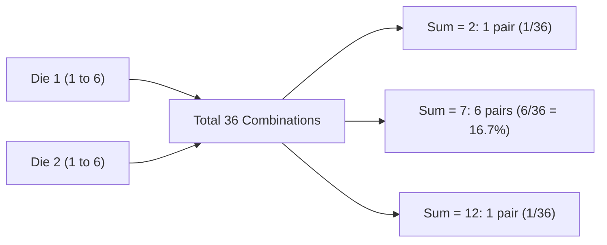

# Notes_20.03: Probability Ke Real Examples [Hinglish]

## 📌 Topic Overview
Is lecture mein Shraddha ma'am ne **Probability ke real-life textbook examples** blackboard par solve karwaye hain: Coins, do Dice ko ek sath fekna ($6 \times 6 = 36$ outcomes), aur 52 Taash ke patton (Playing Cards) ka structure.

---

### 📋 Is Topic Mein Hum Kya Seekhenge?
- Do dice fekne par sample space $36$ kaise banta hai?
- Dice par sum $= 7$ aane ki probability sabse zyada kyu hoti hai?
- Taash ke 52 patton ka classification (Suits, Colors, Face cards).
- Systematic counting se outcomes nikalne ka tarika.

---

### 🔍 Har Ek Point Ka Simple & Detailed Explanation

#### 1. Do Dice Ka Example:
Jab aap 2 dice ek sath roll karte hain:
Total outcomes: $6 \times 6 = 36$.
Agar humein chahiye **Sum = 7**, toh kaun-kaun se pairs ban sakte hain?
$\{(1, 6), (2, 5), (3, 4), (4, 3), (5, 2), (6, 1)\} \implies 6 \text{ pairs}$.

Formula:

$$
P(\text{Sum} = 7) = \frac{6}{36} = \frac{1}{6} \approx 0.1667
$$

#### 2. 52 Playing Cards Ka Structure:
- Total Cards $= 52$
- 2 Colors: Red ($26$), Black ($26$)
- 4 Suits: Spades ($13$), Hearts ($13$), Diamonds ($13$), Clubs ($13$)
- 12 Face Cards: 4 Kings, 4 Queens, 4 Jacks
- 4 Aces (Ikka)

---

### 📊 Blackboard Diagram: 2 Dice Ka Sum Distribution



---

### 💻 Python Code Implementation

```python
import itertools

def analyze_dice_sum_distribution(target_sum=7):
    """
    Simulates the classical two-dice experiment.
    Constructs the 6x6 sample space (36 elementary outcomes)
    and computes the exact theoretical probability of obtaining a specific sum.
    
    Parameters:
        target_sum (int): Desired sum of two dice faces (e.g. 7).
        
    Returns:
        dict: Sample space size, favorable outcome pairs, and probability.
    """
    die_faces = [1, 2, 3, 4, 5, 6]
    sample_space = list(itertools.product(die_faces, die_faces))
    total_outcomes = len(sample_space)  # 36
    
    favorable_pairs = [pair for pair in sample_space if sum(pair) == target_sum]
    n_favorable = len(favorable_pairs)
    
    theoretical_prob = n_favorable / total_outcomes
    
    return {
        "target_sum": target_sum,
        "sample_space_size": total_outcomes,
        "favorable_pairs": favorable_pairs,
        "count_favorable": n_favorable,
        "probability": theoretical_prob
    }

# --- Execution & Verification ---
res = analyze_dice_sum_distribution(target_sum=7)
print(f"Target Sum: {res['target_sum']}")
print(f"Total Outcomes n(S): {res['sample_space_size']}")
print(f"Favorable Pairs: {res['favorable_pairs']}")
print(f"Probability: {res['count_favorable']}/36 = {res['probability']:.4f}")

```

---

### 🎯 Key Takeaways:
1. Do dice fekne par 7 aane ke sabse zyada chances hote hain kyunki iske 6 combinations bante hain.
2. Combinatorics counting principle se sample space size directly multiply hota hai ($n_1 \times n_2$).
