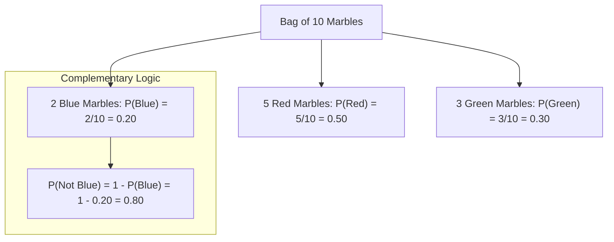

# Lecture 20.04: Solving Practice Problems (Basic Probability)

## 📌 Topic Overview
In this lecture, Shraddha ma'am solves **hands-on practice problems** covering basic classical probability, including the standard colored marble selection experiment (5 Red, 3 Green, and 2 Blue marbles) and complementary non-occurrence events.

---

## 🏛️ Marble Selection Breakdown



---

## 📐 Mathematical Formulation

Given discrete partitions with counts $n_1, n_2, \dots, n_k$ such that $\sum n_i = N$:

$$
P(C_i) = \frac{n_i}{N}
$$

The sum of all mutually exclusive and exhaustive partition probabilities satisfies the second axiom:

$$
\sum_{i=1}^k P(C_i) = \frac{5}{10} + \frac{3}{10} + \frac{2}{10} = 1.00
$$

The probability of drawing any marble that is not blue:

$$
P(\text{Not Blue}) = 1 - P(\text{Blue}) = 1 - \frac{2}{10} = \frac{8}{10} = 0.80
$$

---

## 💻 Python Implementation

```python
def solve_marble_bag_problem(red=5, green=3, blue=2):
    """
    Solves the classic colored marble bag problem:
    Total marbles = Red + Green + Blue.
    Computes probabilities of selecting specific colors and complementary events.
    
    Parameters:
        red (int): Red marble count.
        green (int): Green marble count.
        blue (int): Blue marble count.
        
    Returns:
        dict: Theoretical probabilities for all colored selections.
    """
    total = red + green + blue
    if total <= 0:
        raise ValueError("Bag must contain at least one marble.")
        
    p_red = red / total
    p_green = green / total
    p_blue = blue / total
    p_not_blue = 1.0 - p_blue
    
    return {
        "bag_contents": {"red": red, "green": green, "blue": blue, "total": total},
        "P(Red)": p_red,
        "P(Green)": p_green,
        "P(Blue)": p_blue,
        "P(Not Blue)": p_not_blue
    }

# --- Execution & Verification ---
solution = solve_marble_bag_problem(red=5, green=3, blue=2)
print("Bag Contents:", solution["bag_contents"])
print(f"P(Red)      = {solution['P(Red)']:.4f} (5/10)")
print(f"P(Green)    = {solution['P(Green)']:.4f} (3/10)")
print(f"P(Blue)     = {solution['P(Blue)']:.4f} (2/10)")
print(f"P(Not Blue) = {solution['P(Not Blue)']:.4f} (8/10)")

```

---

## 🔑 Key Takeaways
1. Exhaustive probabilities in any finite partition must sum to exactly 1.0.
2. Calculating the complement $1 - P(E)$ is frequently faster than summing multiple favorable sub-cases.
3. In machine learning, multi-class classification softmax outputs behave exactly like these normalized discrete probabilities.
