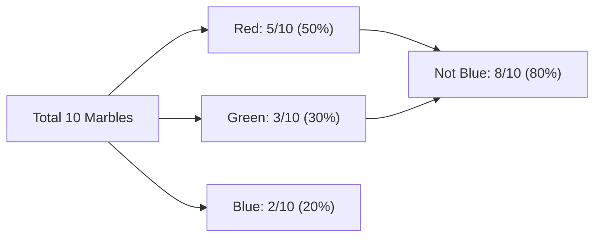

# Notes_20.04: Practice Problems Solve Karna [Hinglish]

## 📌 Topic Overview
Is lecture mein Shraddha ma'am ne **Classical Probability ke practice questions** step-by-step solve karwaye hain: Bag of Marbles example (5 Laal, 3 Hari, aur 2 Neeli goliyaan) aur complementary events ko nikalna.

---

### 📋 Is Topic Mein Hum Kya Seekhenge?
- Multi-colored marble bag problem ko solve karna.
- $P(\text{Red})$, $P(\text{Green})$, aur $P(\text{Blue})$ nikalna.
- $P(\text{Not Blue}) = 1 - P(\text{Blue})$ ka simple use.
- Sabhi mutually exclusive probabilities ka sum $1.0$ verify karna.

---

### 🔍 Har Ek Point Ka Simple & Detailed Explanation

#### 1. Question:
Ek bag mein 10 marbles hain:
- 5 Red
- 3 Green
- 2 Blue
Total $= 5 + 3 + 2 = 10$.

Agar bina dekhe 1 marble nikali jaye, toh kya probability hai ki:
1. **Red aaye:** $P(\text{Red}) = \frac{5}{10} = 0.5$ (50%)
2. **Green aaye:** $P(\text{Green}) = \frac{3}{10} = 0.3$ (30%)
3. **Blue aaye:** $P(\text{Blue}) = \frac{2}{10} = 0.2$ (20%)
4. **Blue NA aaye:** $P(\text{Not Blue}) = 1 - 0.2 = 0.8$ (80%)

Formula:

$$
\sum_{i=1}^k P(C_i) = 0.5 + 0.3 + 0.2 = 1.0
$$

---

### 📊 Blackboard Diagram: 10 Marbles Ka Partition



---

### 💻 Python Code Implementation

```python
def solve_marble_bag_problem(red=5, green=3, blue=2):
    """
    Solves the classic colored marble bag problem:
    Total marbles = Red + Green + Blue.
    Computes probabilities of selecting specific colors and complementary events.
    
    Parameters:
        red (int): Red marble count.
        green (int): Green marble count.
        blue (int): Blue marble count.
        
    Returns:
        dict: Theoretical probabilities for all colored selections.
    """
    total = red + green + blue
    if total <= 0:
        raise ValueError("Bag must contain at least one marble.")
        
    p_red = red / total
    p_green = green / total
    p_blue = blue / total
    p_not_blue = 1.0 - p_blue
    
    return {
        "bag_contents": {"red": red, "green": green, "blue": blue, "total": total},
        "P(Red)": p_red,
        "P(Green)": p_green,
        "P(Blue)": p_blue,
        "P(Not Blue)": p_not_blue
    }

# --- Execution & Verification ---
solution = solve_marble_bag_problem(red=5, green=3, blue=2)
print("Bag Contents:", solution["bag_contents"])
print(f"P(Red)      = {solution['P(Red)']:.4f} (5/10)")
print(f"P(Green)    = {solution['P(Green)']:.4f} (3/10)")
print(f"P(Blue)     = {solution['P(Blue)']:.4f} (2/10)")
print(f"P(Not Blue) = {solution['P(Not Blue)']:.4f} (8/10)")

```

---

### 🎯 Key Takeaways:
1. Sabhi possible categories ka total sum hamesha $1.0$ hota hai.
2. "Not Blue" nikalne ke liye Red + Green karne ke bajaye $1 - P(\text{Blue})$ karna zyada tezi se kaam karta hai.
