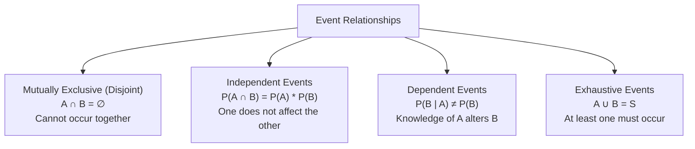

# Lecture 20.05: Types of Events in Probability

## 📌 Topic Overview
In this lecture, Shraddha ma'am classifies the **fundamental taxonomy of events in Probability Theory**: Mutually Exclusive (Disjoint) events, Independent events, Dependent events, and Exhaustive events, illustrating their differences using Venn diagrams.

---

## 🏛️ Event Classification Taxonomy



---

## 📐 Mathematical Formalism: Key Conditions

1. **Mutually Exclusive (Disjoint):**

$$
A \cap B = \emptyset \implies P(A \cap B) = 0
$$

2. **Independent Events:**

$$
P(A \cap B) = P(A) \cdot P(B) \iff P(A \mid B) = P(A)
$$

3. **Exhaustive Events:**

$$
\bigcup_{i=1}^k A_i = S \implies P\left(\bigcup_{i=1}^k A_i\right) = 1
$$

> **Critical Distinction:** Mutually exclusive events with positive probabilities can **never** be independent, because if $A$ occurs, $B$ is guaranteed *not* to occur ($P(B \mid A) = 0 \neq P(B)$)!

---

## 💻 Python Implementation

```python
def test_event_types(sample_space, event_a, event_b):
    """
    Classifies the mathematical relationship between two events A and B:
    1. Mutually Exclusive (Disjoint): A ∩ B = ∅
    2. Exhaustive: A ∪ B = S
    3. Independent: P(A ∩ B) = P(A) * P(B)
    
    Parameters:
        sample_space (set): Universal outcomes.
        event_a (set): Event A outcomes.
        event_b (set): Event B outcomes.
        
    Returns:
        dict: Classification results.
    """
    n_s = len(sample_space)
    intersection = event_a.intersection(event_b)
    union = event_a.union(event_b)
    
    p_a = len(event_a) / n_s
    p_b = len(event_b) / n_s
    p_intersection = len(intersection) / n_s
    
    is_mutually_exclusive = (len(intersection) == 0)
    is_exhaustive = (union == sample_space)
    is_independent = np.isclose(p_intersection, p_a * p_b)
    
    return {
        "P(A)": p_a,
        "P(B)": p_b,
        "P(A ∩ B)": p_intersection,
        "is_mutually_exclusive": is_mutually_exclusive,
        "is_exhaustive": is_exhaustive,
        "is_independent": bool(is_independent)
    }

# --- Execution & Verification ---
import numpy as np
S = {1, 2, 3, 4, 5, 6}
# A = Even {2, 4, 6}, B = Odd {1, 3, 5}
res = test_event_types(S, {2, 4, 6}, {1, 3, 5})
print("Even vs Odd Die Rolls:")
print(f"Mutually Exclusive (Disjoint)? {res['is_mutually_exclusive']}")
print(f"Exhaustive (Cover S)? {res['is_exhaustive']}")
print(f"Independent? {res['is_independent']}")

```

---

## 🔑 Key Takeaways
1. Mutually exclusive means events cannot happen simultaneously (non-overlapping Venn circles).
2. Independent means the occurrence of one event gives zero information about the other.
3. Exhaustive means the combined events cover the entire sample space $S$.
