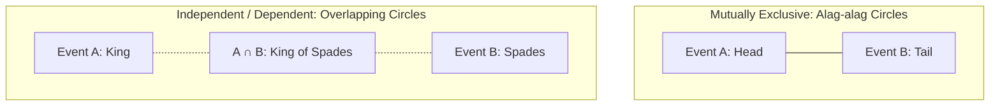

# Notes_20.05: Events Ke Prakar (Types of Events) [Hinglish]

## 📌 Topic Overview
Is lecture mein Shraddha ma'am ne **Events ke alag-alag types** ko detail mein samjhaya hai: Mutually Exclusive (Disjoint) events, Independent events, Dependent events, aur Exhaustive events mein kya antar hota hai.

---

### 📋 Is Topic Mein Hum Kya Seekhenge?
- Mutually Exclusive events kya hote hain ($A \cap B = \emptyset$)?
- Independent vs Dependent events ka farq.
- Exhaustive events ($A \cup B = S$) ka concept.
- Ek bohot bada misconception: Mutually exclusive events kabhi independent nahi ho sakte!

---

### 🔍 Har Ek Point Ka Simple & Detailed Explanation

#### 1. Mutually Exclusive (Disjoint) Events:
Aise events jo **ek sath kabhi nahi ho sakte**.
Jaise: Ek coin fekne par ya toh Head aayega ya Tail. Dono ek sath kabhi nahi aa sakte!
Inke beech ka intersection zero hota hai:

$$
P(A \cap B) = 0
$$

#### 2. Independent Events:
Jab ek event ke hone se doosre event par koi farq na pade.
Jaise: Pehle coin par Head aana aur doosre coin par Tail aana. Pehla coin doosre coin ko influence nahi karta.

$$
P(A \cap B) = P(A) \cdot P(B)
$$

#### 3. Exhaustive Events:
Jab saare events milkar poora sample space $S$ bana dein.
Jaise: Even numbers $\{2, 4, 6\}$ aur Odd numbers $\{1, 3, 5\}$ milkar poora dice $\{1, 2, 3, 4, 5, 6\}$ cover kar lete hain.

---

### 📊 Blackboard Diagram: Mutually Exclusive vs Overlapping Events



---

### 💻 Python Code Implementation

```python
def test_event_types(sample_space, event_a, event_b):
    """
    Classifies the mathematical relationship between two events A and B:
    1. Mutually Exclusive (Disjoint): A ∩ B = ∅
    2. Exhaustive: A ∪ B = S
    3. Independent: P(A ∩ B) = P(A) * P(B)
    
    Parameters:
        sample_space (set): Universal outcomes.
        event_a (set): Event A outcomes.
        event_b (set): Event B outcomes.
        
    Returns:
        dict: Classification results.
    """
    n_s = len(sample_space)
    intersection = event_a.intersection(event_b)
    union = event_a.union(event_b)
    
    p_a = len(event_a) / n_s
    p_b = len(event_b) / n_s
    p_intersection = len(intersection) / n_s
    
    is_mutually_exclusive = (len(intersection) == 0)
    is_exhaustive = (union == sample_space)
    is_independent = np.isclose(p_intersection, p_a * p_b)
    
    return {
        "P(A)": p_a,
        "P(B)": p_b,
        "P(A ∩ B)": p_intersection,
        "is_mutually_exclusive": is_mutually_exclusive,
        "is_exhaustive": is_exhaustive,
        "is_independent": bool(is_independent)
    }

# --- Execution & Verification ---
import numpy as np
S = {1, 2, 3, 4, 5, 6}
# A = Even {2, 4, 6}, B = Odd {1, 3, 5}
res = test_event_types(S, {2, 4, 6}, {1, 3, 5})
print("Even vs Odd Die Rolls:")
print(f"Mutually Exclusive (Disjoint)? {res['is_mutually_exclusive']}")
print(f"Exhaustive (Cover S)? {res['is_exhaustive']}")
print(f"Independent? {res['is_independent']}")

```

---

### 🎯 Key Takeaways:
1. Mutually Exclusive events mein koi common point nahi hota ($A \cap B = \emptyset$).
2. Exhaustive events ka union hamesha $1.0$ hota hai.
