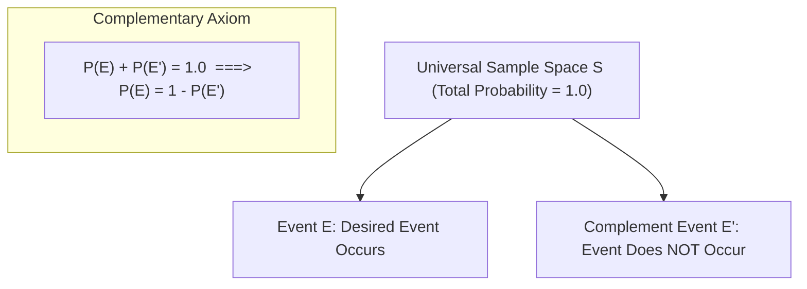

# Lecture 20.06: Complementary Rule in Probability

## 📌 Topic Overview
In this lecture, Shraddha ma'am introduces the **Complementary Rule of Probability**, showing how complex compound questions involving "at least one" occurrences can be solved effortlessly by computing the probability of zero occurrences and subtracting from 1.

---

## 🏛️ Universal Partition via Complements



---

## 📐 Mathematical Formulation: The "At Least One" Rule

Let $E$ be the event of observing at least one success across $n$ independent trials:

$$
P(E) = P(\text{At least one success})
$$

The direct calculation requires summing combinations of 1, 2, 3, up to $n$ successes. The complement $E'$ is the single elementary state where **zero successes** occur:

$$
P(E') = P(\text{Zero successes}) = (1 - p)^n
$$

Applying the Complementary Rule:

$$
P(\text{At least one}) = 1 - (1 - p)^n
$$

---

## 💻 Python Implementation

```python
def compute_at_least_one_success(p_single_failure=0.8, n_trials=5):
    """
    Computes probability of 'at least one success' across n independent trials
    using the Complementary Rule: P(at least 1) = 1 - P(none).
    
    Parameters:
        p_single_failure (float): Probability of failing on a single trial.
        n_trials (int): Number of independent attempts.
        
    Returns:
        dict: Failure and success probabilities.
    """
    # P(no success in n trials) = (p_single_failure)^n
    p_all_failures = p_single_failure ** n_trials
    
    # Complementary Rule
    p_at_least_one = 1.0 - p_all_failures
    
    return {
        "n_trials": n_trials,
        "P_single_failure": p_single_failure,
        "P_all_failures": p_all_failures,
        "P_at_least_one_success": p_at_least_one
    }

# --- Execution & Verification ---
# Rolling a 6 on a die: P(not rolling 6) = 5/6 ≈ 0.8333. Rolling 4 times:
res = compute_at_least_one_success(p_single_failure=5/6, n_trials=4)
print(f"Trials: {res['n_trials']}")
print(f"P(No 6 in 4 rolls) = {res['P_all_failures']:.4f}")
print(f"P(At least one 6 in 4 rolls) = 1 - P(none) = {res['P_at_least_one_success']:.4f} (51.77%)")

```

---

## 🔑 Key Takeaways
1. Whenever a question asks for "at least one", always invert the question to "what is the probability of none?".
2. $P(E') = 1 - P(E)$ is guaranteed by Kolmogorov's axioms because $E$ and $E'$ partition $S$.
3. Used extensively in reliability engineering to calculate multi-server uptime and redundancy failover probability.
