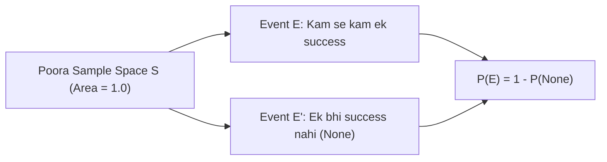

# Notes_20.06: Complementary Rule [Hinglish]

## 📌 Topic Overview
Is lecture mein Shraddha ma'am ne **Complementary Rule** ka magical shortcut sikhaya hai: "Kam se kam ek (At least one)" waale mushkil sawalon ko seedha solve karne ke bajaye $1 - P(\text{None})$ se kitni asani se solve kiya jata hai.

---

### 📋 Is Topic Mein Hum Kya Seekhenge?
- Complementary Event ($E'$) kya hota hai?
- Formula: $P(E') = 1 - P(E)$ kyu hamesha true hota hai.
- "At least one" problems ko solve karne ka shortcut.
- 4 baar dice fekne par kam se kam ek baar 6 aane ki probability.

---

### 🔍 Har Ek Point Ka Simple & Detailed Explanation

#### 1. Complementary Rule Kya Hai?
Kisi bhi event ke hone ki probability $P(E)$ aur na hone ki probability $P(E')$ ka jod hamesha $1.0$ hota hai:

$$
P(E) + P(E') = 1 \implies P(E) = 1 - P(E')
$$

#### 2. "At Least One" Ka Shortcut:
Maan lijiye aap 4 baar dice fekte hain aur sawal hai: "Kam se kam ek baar 6 aane ki probability kya hai?"
Agar aap direct solve karenge toh aapko 1 chhakka, 2 chhakke, 3 chhakke, 4 chhakke sabka alag alag jod nikalna padega (bohot lamba math!).

**Shortcut:**
1. Ek baar bhi 6 na aane ki probability:

$$
P(\text{No 6}) = \left(\frac{5}{6}\right)^4 \approx 0.4823
$$

2. Kam se kam ek 6 aane ki probability:

$$
P(\text{At least one 6}) = 1 - 0.4823 = 0.5177 \quad (51.77\%)
$$

---

### 📊 Blackboard Diagram: Sample Space Partition



---

### 💻 Python Code Implementation

```python
def compute_at_least_one_success(p_single_failure=0.8, n_trials=5):
    """
    Computes probability of 'at least one success' across n independent trials
    using the Complementary Rule: P(at least 1) = 1 - P(none).
    
    Parameters:
        p_single_failure (float): Probability of failing on a single trial.
        n_trials (int): Number of independent attempts.
        
    Returns:
        dict: Failure and success probabilities.
    """
    # P(no success in n trials) = (p_single_failure)^n
    p_all_failures = p_single_failure ** n_trials
    
    # Complementary Rule
    p_at_least_one = 1.0 - p_all_failures
    
    return {
        "n_trials": n_trials,
        "P_single_failure": p_single_failure,
        "P_all_failures": p_all_failures,
        "P_at_least_one_success": p_at_least_one
    }

# --- Execution & Verification ---
# Rolling a 6 on a die: P(not rolling 6) = 5/6 ≈ 0.8333. Rolling 4 times:
res = compute_at_least_one_success(p_single_failure=5/6, n_trials=4)
print(f"Trials: {res['n_trials']}")
print(f"P(No 6 in 4 rolls) = {res['P_all_failures']:.4f}")
print(f"P(At least one 6 in 4 rolls) = 1 - P(none) = {res['P_at_least_one_success']:.4f} (51.77%)")

```

---

### 🎯 Key Takeaways:
1. Jab bhi exam ya interview mein "At least one" dikhe, hamesha $1 - P(\text{None})$ use karein.
2. Server reliability aur cloud uptime calculations mein yeh rule sabse zaroori hota hai.
