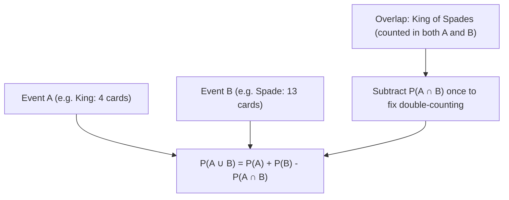

# Lecture 20.07: Addition Rule in Probability

## 📌 Topic Overview
In this lecture, Shraddha ma'am explains the **General Addition Rule of Probability** ($P(A \cup B)$), demonstrating why the overlapping intersection region $A \cap B$ must be subtracted once to eliminate double-counting, using the card drawing example (King or Spade).

---

## 🏛️ Venn Diagram Representation of Union



---

## 📐 Mathematical Formulation: Principle of Inclusion-Exclusion

For any two events $A$ and $B$:

$$
P(A \cup B) = P(A) + P(B) - P(A \cap B)
$$

### Special Case: Mutually Exclusive (Disjoint) Events
When $A$ and $B$ share no outcomes ($A \cap B = \emptyset \implies P(A \cap B) = 0$):

$$
P(A \cup B) = P(A) + P(B)
$$

### The Card Example:
- $P(\text{King}) = \frac{4}{52}$
- $P(\text{Spade}) = \frac{13}{52}$
- $P(\text{King of Spades}) = \frac{1}{52}$

$$
P(\text{King or Spade}) = \frac{4}{52} + \frac{13}{52} - \frac{1}{52} = \frac{16}{52} = \frac{4}{13} \approx 0.3077
$$

---

## 💻 Python Implementation

```python
def compute_addition_rule(p_a=0.4, p_b=0.5, p_intersection=0.2):
    """
    Computes the probability of the union of two events P(A ∪ B)
    using the General Addition Rule, subtracting the double-counted intersection.
    
    Parameters:
        p_a (float): P(A)
        p_b (float): P(B)
        p_intersection (float): P(A ∩ B)
        
    Returns:
        dict: Union probability and verification.
    """
    p_union = p_a + p_b - p_intersection
    
    return {
        "P(A)": p_a,
        "P(B)": p_b,
        "P(A ∩ B)": p_intersection,
        "P(A ∪ B)": p_union,
        "is_disjoint": (p_intersection == 0.0)
    }

# --- Execution & Verification ---
# Drawing a King or a Spade from 52 cards:
# P(King) = 4/52, P(Spade) = 13/52, P(King and Spade) = 1/52 (King of Spades)
res = compute_addition_rule(p_a=4/52, p_b=13/52, p_intersection=1/52)
print(f"P(King) = {res['P(A)']:.4f} (4/52)")
print(f"P(Spade) = {res['P(B)']:.4f} (13/52)")
print(f"P(King ∩ Spade) = {res['P(A ∩ B)']:.4f} (1/52)")
print(f"P(King ∪ Spade) = {res['P(A ∪ B)']:.4f} (16/52 = 4/13 ≈ {16/52:.4f})")

```

---

## 🔑 Key Takeaways
1. The word **"OR"** in probability problems signals the Addition Rule ($A \cup B$).
2. Always verify whether the events overlap; forgetting to subtract $P(A \cap B)$ is the most common student error.
3. If events are mutually exclusive, $P(A \cap B) = 0$ and the formula reduces to simple summation.
