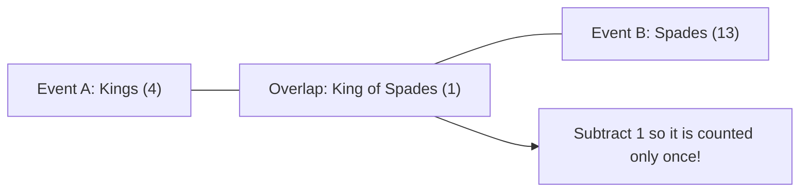

# Notes_20.07: Addition Rule (Jod Ka Niyam) [Hinglish]

## 📌 Topic Overview
Is lecture mein Shraddha ma'am ne **Probability ka Addition Rule** samjhaya hai: jab sawal mein "YA (OR)" poocha jaye ($P(A \cup B)$), toh formula $P(A) + P(B) - P(A \cap B)$ kyu lagaya jata hai aur common hisse ko minus kyu karte hain.

---

### 📋 Is Topic Mein Hum Kya Seekhenge?
- Addition Rule ka formula aur double counting ka logic.
- Taash ke 52 patton mein se King ya Spade aane ki probability.
- Mutually Exclusive events mein formula $P(A) + P(B)$ kyu ban jata hai.
- Venn diagram se union aur intersection ko visualize karna.

---

### 🔍 Har Ek Point Ka Simple & Detailed Explanation

#### 1. Double Counting Ka Problem:
Maan lijiye aap 52 cards mein se ek card nikalte hain.
- Event A: Card **King** ho ($4$ Kings: Spade, Heart, Diamond, Club) $\implies P(A) = \frac{4}{52}$
- Event B: Card **Spade** ho ($13$ Spades) $\implies P(B) = \frac{13}{52}$

Agar hum seedha $4 + 13 = 17$ jod dein, toh galati ho jayegi!
Kyunki ek patta aisa hai jo **King bhi hai aur Spade bhi** (**King of Spades**). Woh dono groups mein do baar count ho gaya!
Isliye us common intersection ko ek baar ghatana (minus karna) padta hai:

$$
P(A \cup B) = P(A) + P(B) - P(A \cap B)
$$

Calculation:

$$
P(\text{King or Spade}) = \frac{4}{52} + \frac{13}{52} - \frac{1}{52} = \frac{16}{52} = \frac{4}{13} \approx 0.3077
$$

---

### 📊 Blackboard Diagram: King Aur Spade Ka Overlap



---

### 💻 Python Code Implementation

```python
def compute_addition_rule(p_a=0.4, p_b=0.5, p_intersection=0.2):
    """
    Computes the probability of the union of two events P(A ∪ B)
    using the General Addition Rule, subtracting the double-counted intersection.
    
    Parameters:
        p_a (float): P(A)
        p_b (float): P(B)
        p_intersection (float): P(A ∩ B)
        
    Returns:
        dict: Union probability and verification.
    """
    p_union = p_a + p_b - p_intersection
    
    return {
        "P(A)": p_a,
        "P(B)": p_b,
        "P(A ∩ B)": p_intersection,
        "P(A ∪ B)": p_union,
        "is_disjoint": (p_intersection == 0.0)
    }

# --- Execution & Verification ---
# Drawing a King or a Spade from 52 cards:
# P(King) = 4/52, P(Spade) = 13/52, P(King and Spade) = 1/52 (King of Spades)
res = compute_addition_rule(p_a=4/52, p_b=13/52, p_intersection=1/52)
print(f"P(King) = {res['P(A)']:.4f} (4/52)")
print(f"P(Spade) = {res['P(B)']:.4f} (13/52)")
print(f"P(King ∩ Spade) = {res['P(A ∩ B)']:.4f} (1/52)")
print(f"P(King ∪ Spade) = {res['P(A ∪ B)']:.4f} (16/52 = 4/13 ≈ {16/52:.4f})")

```

---

### 🎯 Key Takeaways:
1. Jab bhi question mein **"OR"** ya **"At least one of them"** aaye, Addition Rule lagayein.
2. Agar events aapas mein overlap nahi karte ($A \cap B = \emptyset$), tab $P(A \cup B) = P(A) + P(B)$.
