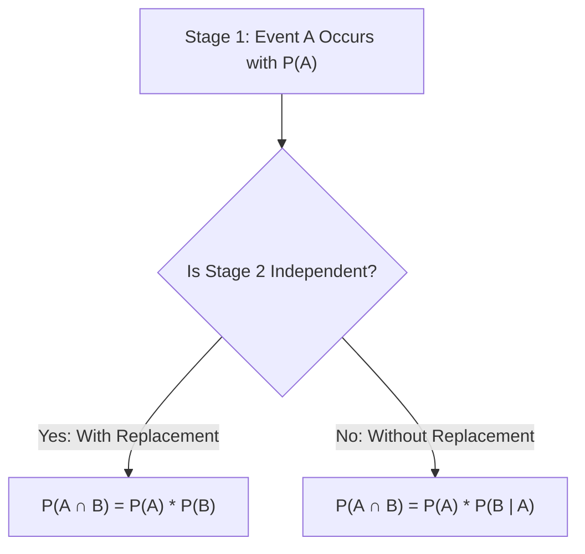

# Lecture 20.08: Multiplication Rule in Probability

## 📌 Topic Overview
In this lecture, Shraddha ma'am covers the **Multiplication Rule of Probability** ($P(A \cap B)$), detailing how joint probabilities are computed for sequential processes both with replacement (independent events) and without replacement (dependent events).

---

## 🏛️ Sequential Event Tree Architecture



---

## 📐 Mathematical Formulation: The General Chain Rule

1. **General Multiplication Rule (Dependent Events):**

$$
P(A \cap B) = P(A) \cdot P(B \mid A)
$$

where $P(B \mid A)$ denotes the conditional probability of $B$ given that $A$ has occurred.

2. **Independent Events Simplification:**
If $B$ is independent of $A$, then $P(B \mid A) = P(B)$:

$$
P(A \cap B) = P(A) \cdot P(B)
$$

### Drawing Two Kings Without Replacement:
- First draw: 4 Kings out of 52 cards $\implies P(K_1) = \frac{4}{52}$
- Second draw: 3 Kings remaining out of 51 total cards $\implies P(K_2 \mid K_1) = \frac{3}{51}$

$$
P(K_1 \cap K_2) = \frac{4}{52} \times \frac{3}{51} = \frac{12}{2652} = \frac{1}{221} \approx 0.00452 \quad (0.45\%)
$$

---

## 💻 Python Implementation

```python
def compute_multiplication_rule(p_a, p_b_given_a=None, independent=True, p_b=None):
    """
    Computes joint probability P(A ∩ B) using the Multiplication Rule.
    Handles both independent events (P(A)*P(B)) and dependent events (P(A)*P(B|A)).
    
    Parameters:
        p_a (float): P(A)
        p_b_given_a (float): P(B|A) for dependent events.
        independent (bool): True if events are independent.
        p_b (float): P(B) for independent events.
        
    Returns:
        dict: Joint probability and conditional details.
    """
    if independent:
        if p_b is None:
            raise ValueError("p_b must be supplied for independent events.")
        joint_prob = p_a * p_b
    else:
        if p_b_given_a is None:
            raise ValueError("p_b_given_a must be supplied for dependent events.")
        joint_prob = p_a * p_b_given_a
        
    return {
        "is_independent": independent,
        "P(A)": p_a,
        "P(A ∩ B)": joint_prob
    }

# --- Execution & Verification ---
# Dependent Case: Drawing 2 Kings consecutively WITHOUT replacement
# P(1st King) = 4/52, P(2nd King | 1st King) = 3/51
res_dep = compute_multiplication_rule(p_a=4/52, p_b_given_a=3/51, independent=False)
print(f"Two Kings without replacement: P(K1 ∩ K2) = (4/52) * (3/51) = {res_dep['P(A ∩ B)']:.6f} ≈ {res_dep['P(A ∩ B)'] * 100:.3f}%")

# Independent Case: Tossing 2 Heads on 2 coins
# P(H1) = 0.5, P(H2) = 0.5
res_ind = compute_multiplication_rule(p_a=0.5, p_b=0.5, independent=True)
print(f"Two Heads on independent coins: P(H1 ∩ H2) = 0.5 * 0.5 = {res_ind['P(A ∩ B)']:.4f}")

```

---

## 🔑 Key Takeaways
1. The word **"AND"** in probability problems signals the Multiplication Rule ($A \cap B$).
2. Sampling "without replacement" creates statistical dependence because earlier draws modify the sample space.
3. This rule forms the foundational premise for Naive Bayes machine learning classifiers.
