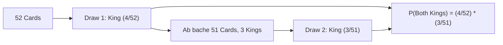

# Notes_20.08: Multiplication Rule (Guna Ka Niyam) [Hinglish]

## 📌 Topic Overview
Is lecture mein Shraddha ma'am ne **Probability ka Multiplication Rule** sikhaya hai: jab sawal mein "AUR (AND)" poocha jaye ($P(A \cap B)$), toh probabilities ko aapas mein multiply kaise karte hain, aur replacement vs without-replacement ka farq kya hota hai.

---

### 📋 Is Topic Mein Hum Kya Seekhenge?
- Multiplication Rule ka use: "Dono events ek sath hone chahiye".
- Independent events: $P(A \cap B) = P(A) \cdot P(B)$.
- Dependent events (Without replacement): $P(A \cap B) = P(A) \cdot P(B \mid A)$.
- Bina wapas rakhe (without replacement) lagaatar 2 King nikalne ki probability.

---

### 🔍 Har Ek Point Ka Simple & Detailed Explanation

#### 1. "AND" Ka Matlab Multiplication:
Jab humein chahiye ki pehla event bhi ho **AUR** doosra event bhi ho, toh hum probabilities ko **multiply** karte hain.

#### 2. Without Replacement Ka Example (Lagaatar 2 King):
Maan lijiye aap bina wapas rakhe 52 taash ke patton mein se ek ke baad ek 2 patte nikaalte hain:
1. **Pehla Patta King nikle ($K_1$):**
   Total 4 Kings hain 52 patton mein:

$$
P(K_1) = \frac{4}{52}
$$

2. **Doosra Patta bhi King nikle ($K_2 \mid K_1$):**
   Ab bag mein sirf 3 Kings bache hain aur total 51 patte bache hain! Sample space badal gaya:

$$
P(K_2 \mid K_1) = \frac{3}{51}
$$

Dono ke ek sath hone ki probability:

$$
P(K_1 \cap K_2) = \frac{4}{52} \times \frac{3}{51} = \frac{1}{221} \approx 0.0045 \quad (0.45\%)
$$

---

### 📊 Blackboard Diagram: Sequential Draw Tree



---

### 💻 Python Code Implementation

```python
def compute_multiplication_rule(p_a, p_b_given_a=None, independent=True, p_b=None):
    """
    Computes joint probability P(A ∩ B) using the Multiplication Rule.
    Handles both independent events (P(A)*P(B)) and dependent events (P(A)*P(B|A)).
    
    Parameters:
        p_a (float): P(A)
        p_b_given_a (float): P(B|A) for dependent events.
        independent (bool): True if events are independent.
        p_b (float): P(B) for independent events.
        
    Returns:
        dict: Joint probability and conditional details.
    """
    if independent:
        if p_b is None:
            raise ValueError("p_b must be supplied for independent events.")
        joint_prob = p_a * p_b
    else:
        if p_b_given_a is None:
            raise ValueError("p_b_given_a must be supplied for dependent events.")
        joint_prob = p_a * p_b_given_a
        
    return {
        "is_independent": independent,
        "P(A)": p_a,
        "P(A ∩ B)": joint_prob
    }

# --- Execution & Verification ---
# Dependent Case: Drawing 2 Kings consecutively WITHOUT replacement
# P(1st King) = 4/52, P(2nd King | 1st King) = 3/51
res_dep = compute_multiplication_rule(p_a=4/52, p_b_given_a=3/51, independent=False)
print(f"Two Kings without replacement: P(K1 ∩ K2) = (4/52) * (3/51) = {res_dep['P(A ∩ B)']:.6f} ≈ {res_dep['P(A ∩ B)'] * 100:.3f}%")

# Independent Case: Tossing 2 Heads on 2 coins
# P(H1) = 0.5, P(H2) = 0.5
res_ind = compute_multiplication_rule(p_a=0.5, p_b=0.5, independent=True)
print(f"Two Heads on independent coins: P(H1 ∩ H2) = 0.5 * 0.5 = {res_ind['P(A ∩ B)']:.4f}")

```

---

### 🎯 Key Takeaways:
1. Jab sawal mein **"AND"** ho, toh **Multiplication Rule** lagta hai.
2. "Without replacement" mein sample space har step par ek kam hota jata hai ($52 \to 51 \to 50$).
