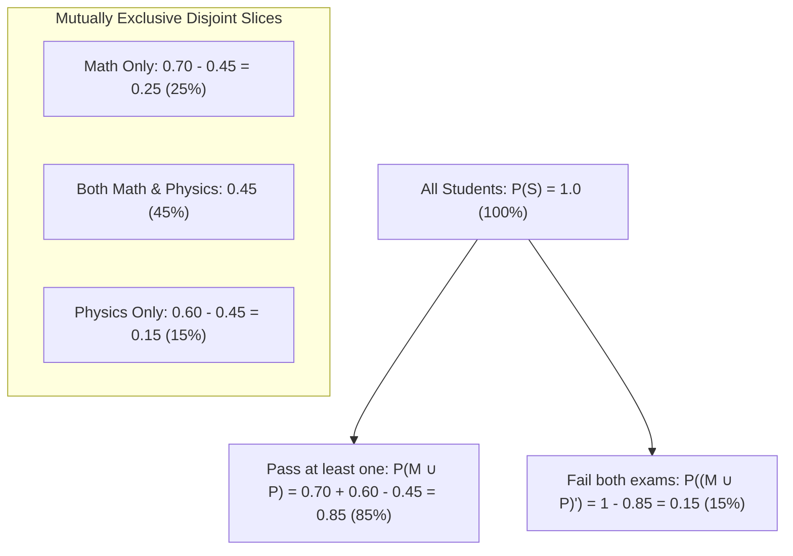

# Lecture 20.09: Solving Practice Problems (Rules of Probability)

## 📌 Topic Overview
In this lecture, Shraddha ma'am leads an intensive **problem-solving workshop**, combining the Addition Rule, Multiplication Rule, and Complementary principles on realistic multi-event scenarios (such as student examination pass rates and circuit reliability).

---

## 🏛️ Compound Event Venn Decomposition



---

## 📐 Mathematical Formulation

Given $P(M) = 0.70$, $P(P) = 0.60$, and $P(M \cap P) = 0.45$:

1. **Probability of passing Math OR Physics:**

$$
P(M \cup P) = P(M) + P(P) - P(M \cap P) = 0.70 + 0.60 - 0.45 = 0.85
$$

2. **Probability of failing both exams:**

$$
P(\text{Fail Both}) = P((M \cup P)') = 1 - P(M \cup P) = 1 - 0.85 = 0.15
$$

3. **Probability of passing Math ONLY:**

$$
P(M \cap P') = P(M) - P(M \cap P) = 0.70 - 0.45 = 0.25
$$

Summing all partitions: $0.25 + 0.45 + 0.15 + 0.15 = 1.00$.

---

## 💻 Python Implementation

```python
def solve_student_exam_problem(p_math=0.7, p_physics=0.6, p_both=0.45):
    """
    Solves compound probability problems combining Addition and Multiplication rules:
    - P(Pass Math OR Physics)
    - P(Pass Neither)
    - P(Pass Math but Fail Physics)
    
    Parameters:
        p_math (float): P(Pass Math)
        p_physics (float): P(Pass Physics)
        p_both (float): P(Pass Both)
        
    Returns:
        dict: Computed probabilities.
    """
    # 1. P(Pass Math or Physics)
    p_or = p_math + p_physics - p_both
    
    # 2. P(Pass Neither) = 1 - P(Pass at least one)
    p_neither = 1.0 - p_or
    
    # 3. P(Pass Math only) = P(Math) - P(Both)
    p_math_only = p_math - p_both
    
    return {
        "P(Math OR Physics)": p_or,
        "P(Pass Neither)": p_neither,
        "P(Math Only)": p_math_only
    }

# --- Execution & Verification ---
sol = solve_student_exam_problem(p_math=0.7, p_physics=0.6, p_both=0.45)
print(f"P(Pass at least one exam) = {sol['P(Math OR Physics)']:.2f} (85%)")
print(f"P(Fail both exams)        = {sol['P(Pass Neither)']:.2f} (15%)")
print(f"P(Pass Math ONLY)         = {sol['P(Math Only)']:.2f} (25%)")

```

---

## 🔑 Key Takeaways
1. Venn diagrams allow compound event scenarios to be partitioned into disjoint subsets that sum to 1.0.
2. "Math only" requires removing the intersection from the marginal event ($P(M) - P(M \cap P)$).
3. "Neither" is the direct complement of the union ($1 - P(A \cup B)$).
