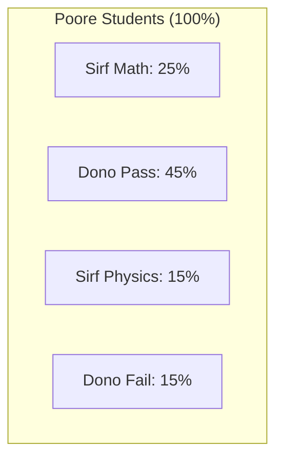

# Notes_20.09: Probability Ke Rules Par Practice Problems [Hinglish]

## 📌 Topic Overview
Is lecture mein Shraddha ma'am ne **Addition aur Multiplication rules ke mixed questions** solve karwaye hain: Students ke Math aur Physics exam pass karne ka famous scenario jisme Venn diagram se sabhi parts ko tod kar calculate kiya jata hai.

---

### 📋 Is Topic Mein Hum Kya Seekhenge?
- Mixed probability word problems ko break down karna.
- $P(\text{Math or Physics})$, $P(\text{Fail Both})$, aur $P(\text{Math Only})$ nikalna.
- Venn diagram ke 4 alag-alag disjoint tukdo ka total $1.0$ verify karna.

---

### 🔍 Har Ek Point Ka Simple & Detailed Explanation

#### 1. Question:
- 70% students Math pass karte hain $\implies P(M) = 0.70$
- 60% students Physics pass karte hain $\implies P(P) = 0.60$
- 45% students dono subjects pass karte hain $\implies P(M \cap P) = 0.45$

Poocha gaya hai:
1. **Kam se kam ek subject pass karne ki probability:**

$$
P(M \cup P) = 0.70 + 0.60 - 0.45 = 0.85 \quad (85\%)
$$

2. **Dono mein fail hone ki probability:**

$$
P(\text{Fail Both}) = 1 - 0.85 = 0.15 \quad (15\%)
$$

3. **Sirf Math pass hone ki probability (Physics mein fail):**

$$
P(\text{Math Only}) = 0.70 - 0.45 = 0.25 \quad (25\%)
$$

---

### 📊 Blackboard Diagram: 4 Disjoint Tukde



---

### 💻 Python Code Implementation

```python
def solve_student_exam_problem(p_math=0.7, p_physics=0.6, p_both=0.45):
    """
    Solves compound probability problems combining Addition and Multiplication rules:
    - P(Pass Math OR Physics)
    - P(Pass Neither)
    - P(Pass Math but Fail Physics)
    
    Parameters:
        p_math (float): P(Pass Math)
        p_physics (float): P(Pass Physics)
        p_both (float): P(Pass Both)
        
    Returns:
        dict: Computed probabilities.
    """
    # 1. P(Pass Math or Physics)
    p_or = p_math + p_physics - p_both
    
    # 2. P(Pass Neither) = 1 - P(Pass at least one)
    p_neither = 1.0 - p_or
    
    # 3. P(Pass Math only) = P(Math) - P(Both)
    p_math_only = p_math - p_both
    
    return {
        "P(Math OR Physics)": p_or,
        "P(Pass Neither)": p_neither,
        "P(Math Only)": p_math_only
    }

# --- Execution & Verification ---
sol = solve_student_exam_problem(p_math=0.7, p_physics=0.6, p_both=0.45)
print(f"P(Pass at least one exam) = {sol['P(Math OR Physics)']:.2f} (85%)")
print(f"P(Fail both exams)        = {sol['P(Pass Neither)']:.2f} (15%)")
print(f"P(Pass Math ONLY)         = {sol['P(Math Only)']:.2f} (25%)")

```

---

### 🎯 Key Takeaways:
1. $25\% + 45\% + 15\% + 15\% = 100\%$ — har slice disjoint hai aur milkarr 1 banti hai.
2. Word problem ko dekhte hi pehle $P(A)$, $P(B)$, aur $P(A \cap B)$ identify karein.
