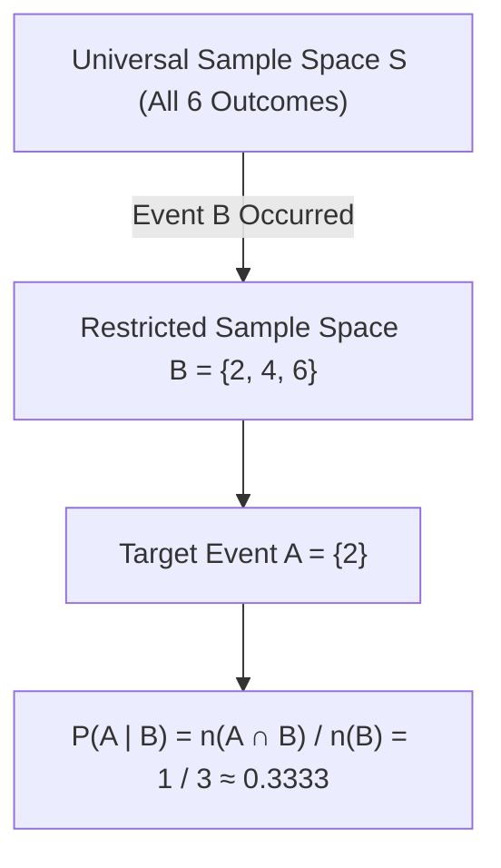

# Lecture 20.10: Conditional Probability

## 📌 Topic Overview
In this lecture, Shraddha ma'am introduces **Conditional Probability** ($P(A \mid B)$), explaining the fundamental concept of **restricting the sample space**: how observing that event $B$ has already occurred collapses the effective universal set from $S$ down to $B$, transforming prior uncertainties into updated conditional assessments.

---

## 🏛️ Sample Space Collapse Mechanism



---

## 📐 Mathematical Formalism: Kolmogorov's Ratio

For any events $A$ and $B$ where $P(B) > 0$:

$$
P(A \mid B) = \frac{P(A \cap B)}{P(B)}
$$

### Intuition:
- Prior probability of rolling a 2 on an unconstrained die: $P(2) = \frac{1}{6} \approx 0.1667$.
- If an observer informs us that the die landed on an **even number** ($B = \{2, 4, 6\}$):
  The universe of possibilities collapses from 6 down to 3.
  Since 2 is one of these three equally likely candidates:

$$
P(2 \mid \text{Even}) = \frac{P(\{2\} \cap \{2, 4, 6\})}{P(\{2, 4, 6\})} = \frac{1/6}{3/6} = \frac{1}{3} \approx 0.3333
$$

The probability doubles because all odd outcomes are eliminated!

---

## 💻 Python Implementation

```python
def compute_conditional_probability(p_intersection, p_given):
    """
    Computes conditional probability P(A | B) = P(A ∩ B) / P(B).
    Demonstrates the restriction of the universal sample space S to conditioning event B.
    
    Parameters:
        p_intersection (float): P(A ∩ B)
        p_given (float): P(B) where P(B) > 0
        
    Returns:
        dict: Calculated conditional probability.
    """
    if p_given <= 0:
        raise ValueError("Conditioning event probability P(B) must be strictly positive.")
        
    p_conditional = p_intersection / p_given
    
    return {
        "P(A ∩ B)": p_intersection,
        "P(B)": p_given,
        "P(A | B)": p_conditional
    }

# --- Execution & Verification ---
# Rolling a die: E = {number is 2}, B = {number is even {2, 4, 6}}
# P(E ∩ B) = P({2}) = 1/6, P(B) = 3/6
res = compute_conditional_probability(p_intersection=1/6, p_given=3/6)
print(f"P(Number is 2 ∩ Even) = {res['P(A ∩ B)']:.4f} (1/6)")
print(f"P(Even)               = {res['P(B)']:.4f} (3/6)")
print(f"P(Number is 2 | Even) = (1/6) / (3/6) = {res['P(A | B)']:.4f} (1/3 = 33.33%)")

```

---

## 🔑 Key Takeaways
1. Conditional probability represents the updated probability of $A$ after acquiring evidence that $B$ occurred.
2. The denominator becomes $P(B)$ because event $B$ acts as the new restricted sample space.
3. Conditional probability is the mathematical bridge leading directly to Bayes' Theorem.
