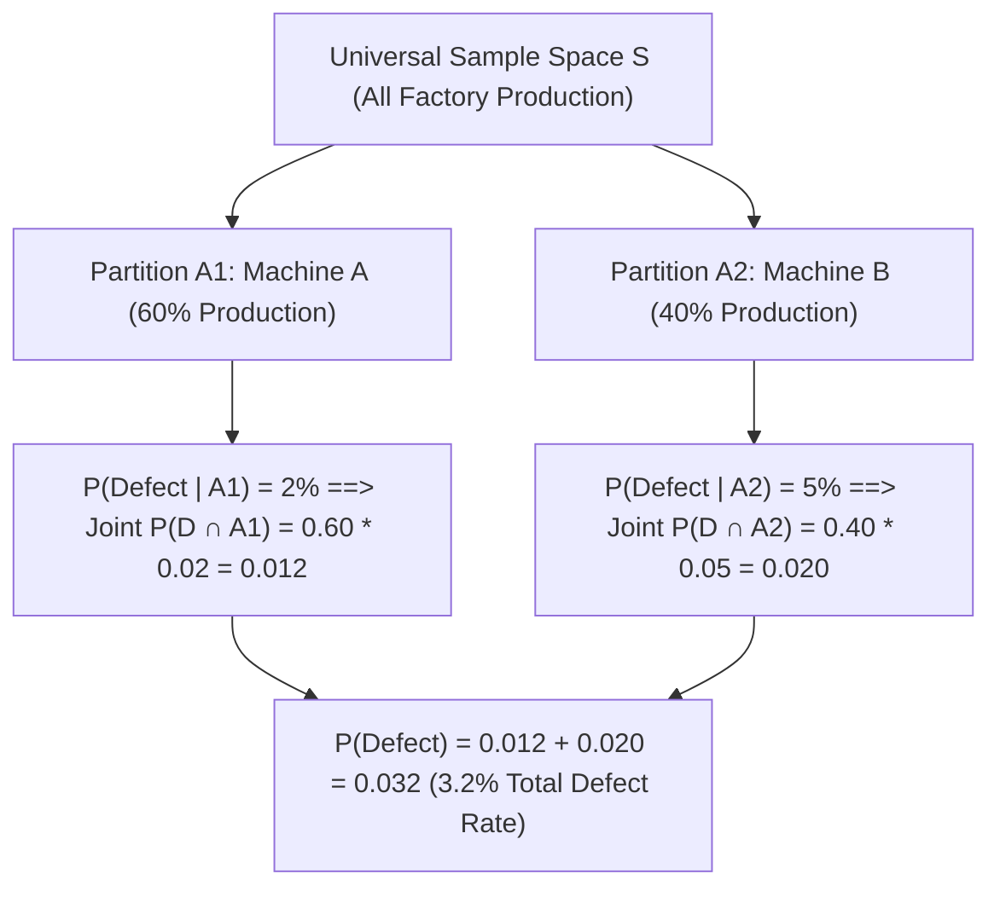

# Lecture 20.11: Law of Total Probability

## 📌 Topic Overview
In this lecture, Shraddha ma'am covers the **Law of Total Probability**, demonstrating how to calculate the overall probability of a target event $B$ by partitioning the universal sample space into mutually exclusive and exhaustive causes $A_1, A_2, \dots, A_n$, using the factory manufacturing problem (Machine A vs Machine B).

---

## 🏛️ Sample Space Partition Architecture



---

## 📐 Mathematical Formulation

Let $A_1, A_2, \dots, A_n$ form a partition of sample space $S$ such that:
1. $A_i \cap A_j = \emptyset$ for all $i \neq j$ (Mutually Exclusive)
2. $\bigcup_{i=1}^n A_i = S$ (Exhaustive)

For any arbitrary event $B \subseteq S$:

$$
P(B) = \sum_{i=1}^n P(B \cap A_i) = \sum_{i=1}^n P(B \mid A_i) \cdot P(A_i)
$$

### Blackboard Example: Factory Defective Rate
- Machine A: Share $= 60\%$ ($P(A) = 0.60$), Defect rate $= 2\%$ ($P(D \mid A) = 0.02$)
- Machine B: Share $= 40\%$ ($P(B) = 0.40$), Defect rate $= 5\%$ ($P(D \mid B) = 0.05$)

$$
P(D) = P(D \mid A)P(A) + P(D \mid B)P(B) = (0.02 \times 0.60) + (0.05 \times 0.40) = 0.012 + 0.020 = 0.032
$$

The overall probability that a randomly chosen product is defective is **$3.2\%$**.

---

## 💻 Python Implementation

```python
def compute_total_probability_factory(prod_a=0.60, defect_a=0.02, prod_b=0.40, defect_b=0.05):
    """
    Computes total defect probability using the Law of Total Probability.
    Sample space S is partitioned into Machine A and Machine B.
    
    Parameters:
        prod_a (float): Production share of Machine A, P(A).
        defect_a (float): Defect rate of Machine A, P(D|A).
        prod_b (float): Production share of Machine B, P(B).
        defect_b (float): Defect rate of Machine B, P(D|B).
        
    Returns:
        dict: Intermediate joint probabilities and total defect rate P(D).
    """
    if not (0.999 <= (prod_a + prod_b) <= 1.001):
        raise ValueError("Production shares must sum to 1.0 (Exhaustive partition).")
        
    # Joint probabilities: P(D ∩ A) = P(D|A) * P(A)
    p_defect_and_a = defect_a * prod_a
    p_defect_and_b = defect_b * prod_b
    
    # Law of Total Probability: P(D) = P(D ∩ A) + P(D ∩ B)
    p_total_defect = p_defect_and_a + p_defect_and_b
    
    return {
        "P(A)": prod_a,
        "P(D|A)": defect_a,
        "P(D ∩ A)": p_defect_and_a,
        "P(B)": prod_b,
        "P(D|B)": defect_b,
        "P(D ∩ B)": p_defect_and_b,
        "P(Total Defect)": p_total_defect
    }

# --- Execution & Verification ---
res = compute_total_probability_factory(prod_a=0.60, defect_a=0.02, prod_b=0.40, defect_b=0.05)
print(f"Machine A Contribution: P(D ∩ A) = 0.02 * 0.60 = {res['P(D ∩ A)']:.4f}")
print(f"Machine B Contribution: P(D ∩ B) = 0.05 * 0.40 = {res['P(D ∩ B)']:.4f}")
print(f"Total Defective Rate  : P(D)     = {res['P(Total Defect)']:.4f} (3.2%)")

```

---

## 🔑 Key Takeaways
1. The Law of Total Probability decomposes complex global probabilities into weighted sums of conditional probabilities.
2. The partition subsets must be strictly mutually exclusive and exhaustive ($\sum P(A_i) = 1$).
3. This formula serves as the essential denominator (marginal evidence) in Bayes' Theorem.
