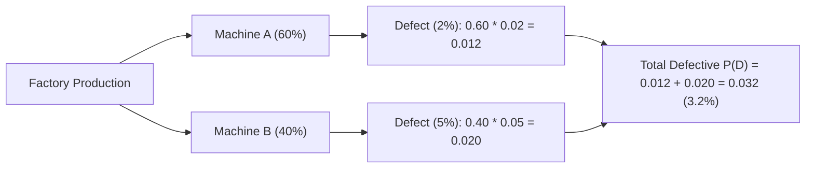

# Notes_20.11: Law of Total Probability [Hinglish]

## 📌 Topic Overview
Is lecture mein Shraddha ma'am ne **Law of Total Probability** ka concept samjhaya hai: kaise kisi overall event ki total probability nikaalne ke liye poore sample space ko alag-alag cases (partitions) mein tod diya jata hai, jaise Factory ke Machine A aur Machine B ka example.

---

### 📋 Is Topic Mein Hum Kya Seekhenge?
- Law of Total Probability kya hai aur kyu use hota hai?
- Mutually exclusive aur exhaustive partitions ka role.
- Shraddha ma'am ka blackboard factory example: Machine A (60%) aur Machine B (40%).
- Total Defect Rate $P(D) = 3.2\%$ nikalne ki step-by-step calculation.

---

### 🔍 Har Ek Point Ka Simple & Detailed Explanation

#### 1. Concept:
Maan lijiye ek factory mein do machines hain jo saara saman banati hain:
- Machine A: Factory ka $60\%$ saman banati hai ($P(A) = 0.60$). Iska defect rate $2\%$ hai ($P(D \mid A) = 0.02$).
- Machine B: Factory ka $40\%$ saman banati hai ($P(B) = 0.40$). Iska defect rate $5\%$ hai ($P(D \mid B) = 0.05$).

Agar hum market se bina dekhe ek product uthayein, toh **uske defective hone ki total probability kya hai?**

#### 2. Formula:
Defective product ya toh Machine A se aayega **YA** Machine B se aayega:

$$
P(D) = P(D \mid A) \cdot P(A) + P(D \mid B) \cdot P(B)
$$

Calculation:

$$
P(D) = (0.02 \times 0.60) + (0.05 \times 0.40) = 0.012 + 0.020 = 0.032 \quad (3.2\%)
$$

---

### 📊 Blackboard Diagram: Total Probability Tree



---

### 💻 Python Code Implementation

```python
def compute_total_probability_factory(prod_a=0.60, defect_a=0.02, prod_b=0.40, defect_b=0.05):
    """
    Computes total defect probability using the Law of Total Probability.
    Sample space S is partitioned into Machine A and Machine B.
    
    Parameters:
        prod_a (float): Production share of Machine A, P(A).
        defect_a (float): Defect rate of Machine A, P(D|A).
        prod_b (float): Production share of Machine B, P(B).
        defect_b (float): Defect rate of Machine B, P(D|B).
        
    Returns:
        dict: Intermediate joint probabilities and total defect rate P(D).
    """
    if not (0.999 <= (prod_a + prod_b) <= 1.001):
        raise ValueError("Production shares must sum to 1.0 (Exhaustive partition).")
        
    # Joint probabilities: P(D ∩ A) = P(D|A) * P(A)
    p_defect_and_a = defect_a * prod_a
    p_defect_and_b = defect_b * prod_b
    
    # Law of Total Probability: P(D) = P(D ∩ A) + P(D ∩ B)
    p_total_defect = p_defect_and_a + p_defect_and_b
    
    return {
        "P(A)": prod_a,
        "P(D|A)": defect_a,
        "P(D ∩ A)": p_defect_and_a,
        "P(B)": prod_b,
        "P(D|B)": defect_b,
        "P(D ∩ B)": p_defect_and_b,
        "P(Total Defect)": p_total_defect
    }

# --- Execution & Verification ---
res = compute_total_probability_factory(prod_a=0.60, defect_a=0.02, prod_b=0.40, defect_b=0.05)
print(f"Machine A Contribution: P(D ∩ A) = 0.02 * 0.60 = {res['P(D ∩ A)']:.4f}")
print(f"Machine B Contribution: P(D ∩ B) = 0.05 * 0.40 = {res['P(D ∩ B)']:.4f}")
print(f"Total Defective Rate  : P(D)     = {res['P(Total Defect)']:.4f} (3.2%)")

```

---

### 🎯 Key Takeaways:
1. Sample space ke sabhi cases ka production jod $100\%$ ($0.60 + 0.40 = 1.0$) hona chahiye.
2. Yeh formula aage chalkar **Bayes' Theorem** ka denominator (niche ka hissa) banta hai!
