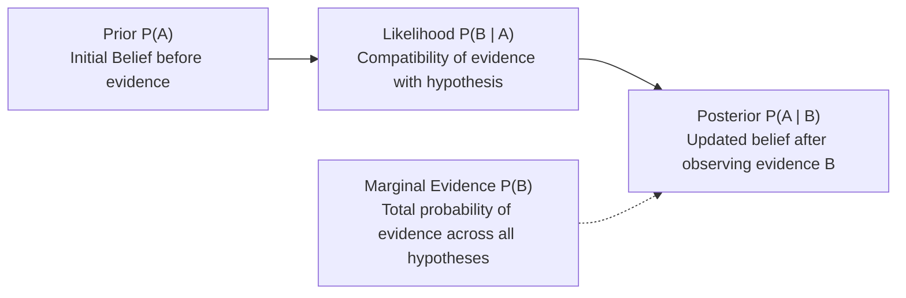

# Lecture 20.12: Bayes' Theorem

## 📌 Topic Overview
In this lecture, Shraddha ma'am derives **Bayes' Theorem** directly on the blackboard from conditional probability definitions, explaining how observing new evidence updates our prior beliefs into posterior probabilities.

---

## 🏛️ Bayesian Updating Cycle



---

## 📐 Blackboard Derivation: From Conditional Probability to Bayes

From the definition of conditional probability:

$$
P(A \mid B) = \frac{P(A \cap B)}{P(B)} \implies P(A \cap B) = P(A \mid B) \cdot P(B)
$$

Symmetrically:

$$
P(B \mid A) = \frac{P(B \cap A)}{P(A)} \implies P(A \cap B) = P(B \mid A) \cdot P(A)
$$

Equating the two joint expressions:

$$
P(A \mid B) \cdot P(B) = P(B \mid A) \cdot P(A)
$$

Dividing both sides by $P(B)$:

$$
P(A \mid B) = \frac{P(B \mid A) \cdot P(A)}{P(B)}
$$

Expanding the denominator via the Law of Total Probability for partitions $A_1, A_2, \dots, A_n$:

$$
P(A_i \mid B) = \frac{P(B \mid A_i) \cdot P(A_i)}{\sum_{j=1}^n P(B \mid A_j) \cdot P(A_j)}
$$

---

## 💻 Python Implementation

```python
def compute_bayes_theorem(prior_a, likelihood_b_given_a, marginal_b):
    """
    Computes posterior probability P(A | B) using Bayes' Theorem:
    P(A | B) = (P(B | A) * P(A)) / P(B)
    
    Parameters:
        prior_a (float): Prior belief P(A).
        likelihood_b_given_a (float): Likelihood P(B | A).
        marginal_b (float): Total marginal probability of evidence P(B).
        
    Returns:
        dict: Prior, likelihood, marginal evidence, and posterior probability.
    """
    if marginal_b <= 0:
        raise ValueError("Marginal probability P(B) must be strictly positive.")
        
    numerator = likelihood_b_given_a * prior_a
    posterior_a_given_b = numerator / marginal_b
    
    return {
        "Prior P(A)": prior_a,
        "Likelihood P(B|A)": likelihood_b_given_a,
        "Marginal P(B)": marginal_b,
        "Posterior P(A|B)": posterior_a_given_b
    }

# --- Execution & Verification ---
# Defective item was found: What is probability it came from Machine A?
# Prior P(A) = 0.60, Likelihood P(D|A) = 0.02, Marginal P(D) = 0.032
res = compute_bayes_theorem(prior_a=0.60, likelihood_b_given_a=0.02, marginal_b=0.032)
print(f"Prior Probability P(A)       = {res['Prior P(A)']:.2f} (60%)")
print(f"Likelihood P(D|A)            = {res['Likelihood P(B|A)']:.4f} (2%)")
print(f"Marginal Evidence P(D)       = {res['Marginal P(B)']:.4f} (3.2%)")
print(f"Posterior Probability P(A|D) = {res['Posterior P(A|B)']:.4f} (37.5%)")

```

---

## 🔑 Key Takeaways
1. **Prior $P(A)$**: Initial belief before seeing data.
2. **Likelihood $P(B \mid A)$**: Probability of observing the evidence if the hypothesis is true.
3. **Posterior $P(A \mid B)$**: Updated belief after incorporating new data.
4. Bayes' Theorem is the mathematical foundation of Naive Bayes, spam filters, medical diagnostic algorithms, and Bayesian Neural Networks.
