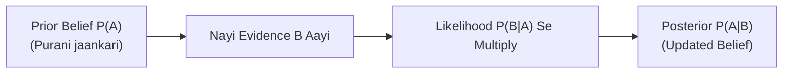

# Notes_20.12: Bayes' Theorem [Hinglish]

## 📌 Topic Overview
Is lecture mein Shraddha ma'am ne **Bayes' Theorem** ko blackboard par step-by-step derive kiya hai: kaise nayi evidence milne par hamara purana vishwas (**Prior**) badal kar naya vishwas (**Posterior**) ban jata hai.

---

### 📋 Is Topic Mein Hum Kya Seekhenge?
- Bayes' Theorem ka derivation: Conditional probability se formula kaise nikla?
- Char mukhya terms: Prior, Likelihood, Marginal Evidence, aur Posterior.
- Shraddha ma'am ka blackboard derivation: $P(A \cap B) = P(B \cap A)$.
- Machine Learning (Spam filters, Medical AI) mein iska role.

---

### 🔍 Har Ek Point Ka Simple & Detailed Explanation

#### 1. Blackboard Par Derivation:
Conditional probability ki paribhasha se:

$$
P(A \mid B) = \frac{P(A \cap B)}{P(B)} \implies P(A \cap B) = P(A \mid B) \cdot P(B)
$$

Usi tarah:

$$
P(B \mid A) = \frac{P(B \cap A)}{P(A)} \implies P(A \cap B) = P(B \mid A) \cdot P(A)
$$

Kyunki $A \cap B = B \cap A$ dono barabar hain, hum dono ko equate kar sakte hain:

$$
P(A \mid B) \cdot P(B) = P(B \mid A) \cdot P(A)
$$

Donon taraf $P(B)$ se divide karne par **Bayes' Theorem** mil jata hai:

$$
P(A \mid B) = \frac{P(B \mid A) \cdot P(A)}{P(B)}
$$

#### 2. Terminology:
- **Prior $P(A)$:** Saboot aane se pehle ka belief (Jaise Machine A ka share 60%).
- **Likelihood $P(B \mid A)$:** Agar hypothesis sach hai, toh saboot dikhne ke kitne chances hain?
- **Marginal Evidence $P(B)$:** Saboot aane ki total overall probability (Law of Total Probability se nikli hui).
- **Posterior $P(A \mid B)$:** Saboot dekhne ke baad update hua naya belief!

---

### 📊 Blackboard Diagram: Bayesian Updating Process



---

### 💻 Python Code Implementation

```python
def compute_bayes_theorem(prior_a, likelihood_b_given_a, marginal_b):
    """
    Computes posterior probability P(A | B) using Bayes' Theorem:
    P(A | B) = (P(B | A) * P(A)) / P(B)
    
    Parameters:
        prior_a (float): Prior belief P(A).
        likelihood_b_given_a (float): Likelihood P(B | A).
        marginal_b (float): Total marginal probability of evidence P(B).
        
    Returns:
        dict: Prior, likelihood, marginal evidence, and posterior probability.
    """
    if marginal_b <= 0:
        raise ValueError("Marginal probability P(B) must be strictly positive.")
        
    numerator = likelihood_b_given_a * prior_a
    posterior_a_given_b = numerator / marginal_b
    
    return {
        "Prior P(A)": prior_a,
        "Likelihood P(B|A)": likelihood_b_given_a,
        "Marginal P(B)": marginal_b,
        "Posterior P(A|B)": posterior_a_given_b
    }

# --- Execution & Verification ---
# Defective item was found: What is probability it came from Machine A?
# Prior P(A) = 0.60, Likelihood P(D|A) = 0.02, Marginal P(D) = 0.032
res = compute_bayes_theorem(prior_a=0.60, likelihood_b_given_a=0.02, marginal_b=0.032)
print(f"Prior Probability P(A)       = {res['Prior P(A)']:.2f} (60%)")
print(f"Likelihood P(D|A)            = {res['Likelihood P(B|A)']:.4f} (2%)")
print(f"Marginal Evidence P(D)       = {res['Marginal P(B)']:.4f} (3.2%)")
print(f"Posterior Probability P(A|D) = {res['Posterior P(A|B)']:.4f} (37.5%)")

```

---

### 🎯 Key Takeaways:
1. Bayes' Theorem probability ko "ulatta" hai: agar $P(B \mid A)$ pata hai, toh yeh $P(A \mid B)$ nikalta hai.
2. Email spam classifier isi formula se check karta hai: $P(\text{Spam} \mid \text{Words})$.
