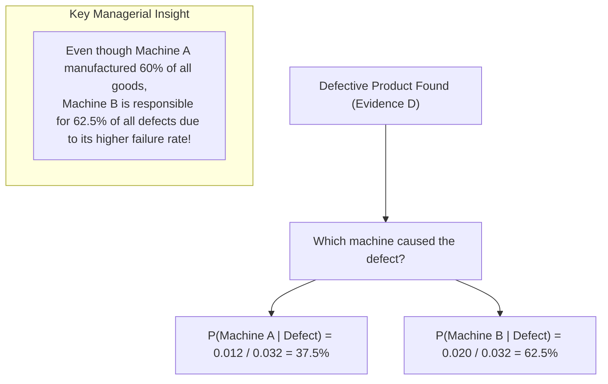

# Lecture 20.13: Solving Practice Problem (Bayes' Theorem)

## 📌 Topic Overview
In this lecture, Shraddha ma'am works through a complete **end-to-end numerical problem** on Bayes' Theorem: given that a randomly inspected product was found to be defective, what is the probability that it originated from Machine A versus Machine B?

---

## 🏛️ Bayesian Diagnostic Decision Tree



---

## 📐 Mathematical Formulation

### Given Parameters:
- Production Shares: $P(A) = 0.60$, $P(B) = 0.40$
- Defect Rates: $P(D \mid A) = 0.02$, $P(D \mid B) = 0.05$

### Step 1: Marginal Probability of Defect $P(D)$
Using the Law of Total Probability:

$$
P(D) = P(D \mid A)P(A) + P(D \mid B)P(B) = (0.02)(0.60) + (0.05)(0.40) = 0.012 + 0.020 = 0.032
$$

### Step 2: Posterior Attribution via Bayes' Theorem
For Machine A:

$$
P(A \mid D) = \frac{P(D \mid A)P(A)}{P(D)} = \frac{0.012}{0.032} = \frac{12}{32} = \frac{3}{8} = 0.375 \quad (37.5\%)
$$

For Machine B:

$$
P(B \mid D) = \frac{P(D \mid B)P(B)}{P(D)} = \frac{0.020}{0.032} = \frac{20}{32} = \frac{5}{8} = 0.625 \quad (62.5\%)
$$

Notice that $37.5\% + 62.5\% = 100\%$.

---

## 💻 Python Implementation

```python
def solve_factory_defect_bayes(p_a=0.60, d_given_a=0.02, p_b=0.40, d_given_b=0.05):
    """
    Solves the complete 2-step factory defective problem using Bayes' Theorem:
    Step 1: Compute total defect probability P(D) via Law of Total Probability.
    Step 2: Invert to find P(Machine A | Defective) and P(Machine B | Defective).
    
    Returns:
        dict: Step-by-step probabilities and final machine attribution percentages.
    """
    # Step 1: Total Defect Rate P(D)
    num_a = d_given_a * p_a  # 0.012
    num_b = d_given_b * p_b  # 0.020
    p_total_defect = num_a + num_b  # 0.032
    
    # Step 2: Bayes Theorem Inversion
    p_a_given_d = num_a / p_total_defect  # 0.012 / 0.032 = 0.375
    p_b_given_d = num_b / p_total_defect  # 0.020 / 0.032 = 0.625
    
    return {
        "P(D) Total Defect": p_total_defect,
        "P(Machine A | Defective)": p_a_given_d,
        "P(Machine B | Defective)": p_b_given_d,
        "Check Sum": p_a_given_d + p_b_given_d
    }

# --- Execution & Verification ---
res = solve_factory_defect_bayes()
print(f"Total Defective Rate P(D) = {res['P(D) Total Defect']:.4f} (3.2%)")
print(f"If defective, chance it came from Machine A = {res['P(Machine A | Defective)'] * 100:.2f}% (37.5%)")
print(f"If defective, chance it came from Machine B = {res['P(Machine B | Defective)'] * 100:.2f}% (62.5%)")
print(f"Sum of machine attributions = {res['Check Sum']:.1f}")

```

---

## 🔑 Key Takeaways
1. Even though Machine A produced 60% of the total output, an observed defective item is far more likely (62.5%) to have come from Machine B.
2. The denominator $P(D)$ scales the relative joint likelihoods so that posterior probabilities sum to 1.0.
3. This exact calculation is used in root-cause analysis, anomaly tracing, and medical diagnostics.
