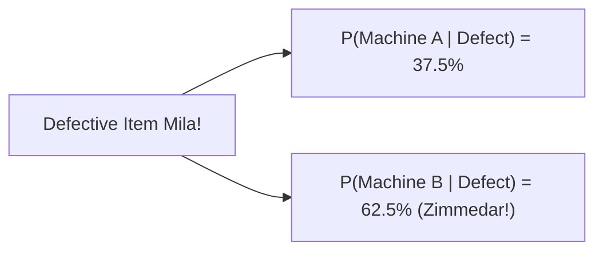

# Notes_20.13: Bayes' Theorem Par Practice Problem [Hinglish]

## 📌 Topic Overview
Is lecture mein Shraddha ma'am ne **Bayes' Theorem ka poora numerical question** blackboard par solve karwaya hai: agar factory mein ek defective product mila, toh kya probability hai ki woh Machine A ne banaya tha ya Machine B ne?

---

### 📋 Is Topic Mein Hum Kya Seekhenge?
- 2-Step problem solving: Pehle Total Probability $P(D)$, phir Bayes Theorem.
- Machine A ($P(A \mid D) = 37.5\%$) aur Machine B ($P(B \mid D) = 62.5\%$) ka result.
- Aashcharyajanak insight: Machine A ne 60% saman banaya, fir bhi defective item aane par Machine B par shak zyada kyu hai?

---

### 🔍 Har Ek Point Ka Simple & Detailed Explanation

#### 1. Question:
- Machine A: $60\%$ production, $2\%$ defect rate
- Machine B: $40\%$ production, $5\%$ defect rate
Ek product defective nikla ($D$). **Kya chance hai ki yeh Machine A se aaya hai ($P(A \mid D)$)?**

#### 2. Step-by-Step Solution:
**Step 1: Total Defect Rate $P(D)$:**

$$
P(D) = (0.02 \times 0.60) + (0.05 \times 0.40) = 0.012 + 0.020 = 0.032
$$

**Step 2: Bayes Formula:**

$$
P(A \mid D) = \frac{P(D \mid A) \cdot P(A)}{P(D)} = \frac{0.012}{0.032} = \frac{3}{8} = 0.375 \quad (37.5\%)
$$

Machine B ke liye:

$$
P(B \mid D) = \frac{0.020}{0.032} = \frac{5}{8} = 0.625 \quad (62.5\%)
$$

#### 3. Asli Insight:
Dekhne mein lagta hai ki Machine A ne $60\%$ saman banaya toh defect bhi usi ka hoga. Lekin Machine B ki defect rate ($5\%$) Machine A ($2\%$) se 2.5 guna zyada kharab hai!
Isliye defective item Milne par $62.5\%$ chance hai ki galti **Machine B** ki thi!

---

### 📊 Blackboard Diagram: Defect Attribution



---

### 💻 Python Code Implementation

```python
def solve_factory_defect_bayes(p_a=0.60, d_given_a=0.02, p_b=0.40, d_given_b=0.05):
    """
    Solves the complete 2-step factory defective problem using Bayes' Theorem:
    Step 1: Compute total defect probability P(D) via Law of Total Probability.
    Step 2: Invert to find P(Machine A | Defective) and P(Machine B | Defective).
    
    Returns:
        dict: Step-by-step probabilities and final machine attribution percentages.
    """
    # Step 1: Total Defect Rate P(D)
    num_a = d_given_a * p_a  # 0.012
    num_b = d_given_b * p_b  # 0.020
    p_total_defect = num_a + num_b  # 0.032
    
    # Step 2: Bayes Theorem Inversion
    p_a_given_d = num_a / p_total_defect  # 0.012 / 0.032 = 0.375
    p_b_given_d = num_b / p_total_defect  # 0.020 / 0.032 = 0.625
    
    return {
        "P(D) Total Defect": p_total_defect,
        "P(Machine A | Defective)": p_a_given_d,
        "P(Machine B | Defective)": p_b_given_d,
        "Check Sum": p_a_given_d + p_b_given_d
    }

# --- Execution & Verification ---
res = solve_factory_defect_bayes()
print(f"Total Defective Rate P(D) = {res['P(D) Total Defect']:.4f} (3.2%)")
print(f"If defective, chance it came from Machine A = {res['P(Machine A | Defective)'] * 100:.2f}% (37.5%)")
print(f"If defective, chance it came from Machine B = {res['P(Machine B | Defective)'] * 100:.2f}% (62.5%)")
print(f"Sum of machine attributions = {res['Check Sum']:.1f}")

```

---

### 🎯 Key Takeaways:
1. Prior belief (60% vs 40%) evidence ke aane ke baad flip hokar posterior (37.5% vs 62.5%) ban gaya.
2. Dono posterior probabilities ka jod hamesha $100\%$ ($37.5\% + 62.5\% = 100\%$) aana chahiye.
