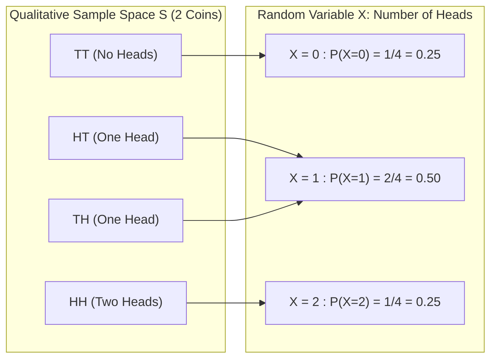

# Lecture 20.14: Random Variables (Discrete vs Continuous)

## 📌 Topic Overview
In this lecture, Shraddha ma'am introduces **Random Variables**, demystifying the terminology by showing that a random variable is mathematically a **function** that maps qualitative experimental outcomes into numerical real values ($X: S \to \mathbb{R}$).

---

## 🏛️ Mapping Sample Space Outcomes to Real Numbers



---

## 📐 Mathematical Formulation: Discrete vs Continuous Random Variables

### 1. Discrete Random Variable:
Takes countable values $\{x_1, x_2, \dots\}$. Governed by a **Probability Mass Function (PMF)**:

$$
p(x) = P(X = x), \qquad \text{where } p(x) \ge 0 \quad \text{and} \quad \sum_{i} p(x_i) = 1
$$

### 2. Continuous Random Variable:
Takes uncountably infinite values along continuous intervals. Governed by a **Probability Density Function (PDF)** $f(x)$:

$$
P(a \le X \le b) = \int_a^b f(x) \, dx, \qquad \text{where } \int_{-\infty}^{\infty} f(x) \, dx = 1
$$

> **Crucial Rule:** For continuous random variables, the probability of obtaining any exact singular real number is zero ($P(X = c) = 0$); probability only exists over non-zero intervals $[a, b]$.

---

## 💻 Python Implementation

```python
def simulate_coin_toss_random_variable():
    """
    Simulates a discrete random variable X defined as:
    X = Number of Heads observed when tossing 2 fair coins.
    Sample space S = {TT, HT, TH, HH}.
    Maps outcomes to {0, 1, 2} and builds the Probability Mass Function (PMF).
    
    Returns:
        dict: Outcome mappings, PMF, and verification that sum(P) = 1.
    """
    sample_space = ["TT", "HT", "TH", "HH"]
    
    # Mapping function X: S -> Real Numbers
    mapping = {
        "TT": 0,
        "HT": 1,
        "TH": 1,
        "HH": 2
    }
    
    # Probability Mass Function P(X = x)
    pmf = {0: 1/4, 1: 2/4, 2: 1/4}
    
    sum_pmf = sum(pmf.values())
    
    return {
        "sample_space": sample_space,
        "random_variable_mapping": mapping,
        "PMF_P(X=x)": pmf,
        "sum_of_probabilities": sum_pmf
    }

# --- Execution & Verification ---
rv = simulate_coin_toss_random_variable()
print("Sample Space S:", rv["sample_space"])
print("X(Outcome) Mapping:", rv["random_variable_mapping"])
for k, v in rv["PMF_P(X=x)"].items():
    print(f"P(X = {k}) = {v:.2f}")
print(f"PMF Axiom Check: Sum = {rv['sum_of_probabilities']:.1f}")

```

---

## 🔑 Key Takeaways
1. A random variable is neither "random" nor a "variable"; it is a deterministic mathematical function mapping experimental outcomes to numbers.
2. Discrete variables use PMF (probabilities at specific points); continuous variables use PDF (probabilities over intervals).
3. In machine learning, features and target labels ($y$) are treated as random variables.
