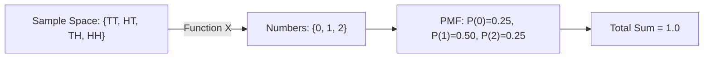

# Notes_20.14: Random Variables (Discrete vs Continuous) [Hinglish]

## 📌 Topic Overview
Is lecture mein Shraddha ma'am ne **Random Variables** ka concept explain kiya hai: Random variable koi variable nahi balki ek **Function** hota hai jo real-world outcomes ko numbers mein badalta hai, aur Discrete vs Continuous random variables mein kya antar hota hai.

---

### 📋 Is Topic Mein Hum Kya Seekhenge?
- Random Variable ($X$) asal mein kya hai? ($X: S \to \mathbb{R}$).
- 2 Coins toss example: $\{TT, HT, TH, HH\} \to \{0, 1, 2\}$ heads.
- Discrete (PMF) vs Continuous (PDF) ka farq.
- Continuous distribution mein kisi single point ki probability $0$ kyu hoti hai?

---

### 🔍 Har Ek Point Ka Simple & Detailed Explanation

#### 1. Random Variable Kya Hai?
Aap computer ko "Head" ya "Tail" directly math equations mein nahi de sakte. Computer ko numbers chahiye!
**Random Variable** ek rule ya function hai jo sample space ke outcomes ko real numbers assign karta hai.
Jaise: $X = \text{Kitne Heads aaye?}$
- $TT \to X = 0 \implies P(X=0) = \frac{1}{4} = 0.25$
- $HT, TH \to X = 1 \implies P(X=1) = \frac{2}{4} = 0.50$
- $HH \to X = 2 \implies P(X=2) = \frac{1}{4} = 0.25$

#### 2. Discrete vs Continuous:
- **Discrete:** Ginne laayak (countable) values (jaise 0, 1, 2, 3 heads ya dice ka number). Iske liye **PMF (Probability Mass Function)** hota hai:

$$
\sum p(x_i) = 1
$$

- **Continuous:** Naapne laayak (measurable) continuous values (jaise height, temperature, time). Iske liye **PDF (Probability Density Function)** hota hai:

$$
\int_{-\infty}^{\infty} f(x) \, dx = 1
$$

---

### 📊 Blackboard Diagram: Mapping Outcomes to Numbers



---

### 💻 Python Code Implementation

```python
def simulate_coin_toss_random_variable():
    """
    Simulates a discrete random variable X defined as:
    X = Number of Heads observed when tossing 2 fair coins.
    Sample space S = {TT, HT, TH, HH}.
    Maps outcomes to {0, 1, 2} and builds the Probability Mass Function (PMF).
    
    Returns:
        dict: Outcome mappings, PMF, and verification that sum(P) = 1.
    """
    sample_space = ["TT", "HT", "TH", "HH"]
    
    # Mapping function X: S -> Real Numbers
    mapping = {
        "TT": 0,
        "HT": 1,
        "TH": 1,
        "HH": 2
    }
    
    # Probability Mass Function P(X = x)
    pmf = {0: 1/4, 1: 2/4, 2: 1/4}
    
    sum_pmf = sum(pmf.values())
    
    return {
        "sample_space": sample_space,
        "random_variable_mapping": mapping,
        "PMF_P(X=x)": pmf,
        "sum_of_probabilities": sum_pmf
    }

# --- Execution & Verification ---
rv = simulate_coin_toss_random_variable()
print("Sample Space S:", rv["sample_space"])
print("X(Outcome) Mapping:", rv["random_variable_mapping"])
for k, v in rv["PMF_P(X=x)"].items():
    print(f"P(X = {k}) = {v:.2f}")
print(f"PMF Axiom Check: Sum = {rv['sum_of_probabilities']:.1f}")

```

---

### 🎯 Key Takeaways:
1. Random Variable outcomes ko ganit (numbers) mein convert karta hai.
2. Continuous case mein probability sirf kisi range $[a, b]$ ke beech ka area nikaal kar milti hai ($P(X=x) = 0$).
