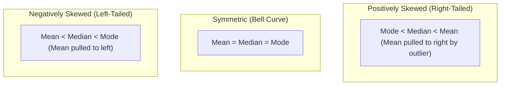

# Lecture 20.15: Mean, Median & Mode (Central Tendency)

## 📌 Topic Overview
In this lecture, Shraddha ma'am covers the **Measures of Central Tendency**: Expected Value / Mean ($\mu = E[X]$), Median, and Mode, explaining how extreme outliers pull the mean while the median remains robust.

---

## 🏛️ Skewness and Central Tendency Ordering



---

## 📐 Mathematical Formulation: Expected Value

1. **Discrete Expected Value (Mean):**

$$
E[X] = \mu = \sum_{i=1}^n x_i \cdot P(X = x_i)
$$

For sample data with equal weights:

$$
\bar{x} = \frac{1}{n} \sum_{i=1}^n x_i
$$

2. **Median ($M$):**
The value dividing the sorted distribution into two equal 50% halves:

$$
M = \begin{cases} X_{\left(\frac{n+1}{2}\right)} & \text{if } n \text{ is odd} \\ \frac{1}{2}\left( X_{\left(\frac{n}{2}\right)} + X_{\left(\frac{n}{2}+1\right)} \right) & \text{if } n \text{ is even} \end{cases}
$$

3. **Expected Value of a Fair Die:**

$$
E[X] = 1\left(\frac{1}{6}\right) + 2\left(\frac{1}{6}\right) + 3\left(\frac{1}{6}\right) + 4\left(\frac{1}{6}\right) + 5\left(\frac{1}{6}\right) + 6\left(\frac{1}{6}\right) = \frac{21}{6} = 3.5
$$

---

## 💻 Python Implementation

```python
import numpy as np
from scipy import stats

def compute_central_tendencies(data=None):
    """
    Computes measures of central tendency:
    - Mean (Arithmetic Average / Expected Value E[X])
    - Median (50th Percentile)
    - Mode (Most Frequent Value)
    Evaluates skewness based on relative positioning.
    
    Parameters:
        data (list or np.ndarray): 1D continuous dataset.
        
    Returns:
        dict: Mean, median, mode, and skewness classification.
    """
    if data is None:
        # Skewed salary dataset with high earner outlier
        data = [25, 28, 30, 32, 32, 35, 40, 42, 45, 150]
        
    arr = np.array(data)
    mean_val = float(np.mean(arr))
    median_val = float(np.median(arr))
    mode_res = stats.mode(arr, keepdims=True)
    mode_val = float(mode_res.mode[0])
    
    if np.isclose(mean_val, median_val, atol=1.0):
        skew_type = "Symmetric (Normal)"
    elif mean_val > median_val:
        skew_type = "Positively Skewed (Right-Tailed: Pulled by Outlier)"
    else:
        skew_type = "Negatively Skewed (Left-Tailed)"
        
    return {
        "mean": mean_val,
        "median": median_val,
        "mode": mode_val,
        "skewness_classification": skew_type
    }

# --- Execution & Verification ---
res = compute_central_tendencies()
print(f"Mean   : {res['mean']:.2f}")
print(f"Median : {res['median']:.2f}")
print(f"Mode   : {res['mode']:.2f}")
print(f"Shape  : {res['skewness_classification']}")

```

---

## 🔑 Key Takeaways
1. The **Mean** is mathematically convenient but hypersensitive to extreme values and outliers.
2. The **Median** is non-parametric and resistant to outliers, making it the preferred metric for skewed distributions (e.g. household income, house prices).
3. When $\text{Mean} > \text{Median}$, the distribution is positively skewed (long tail extending right).
