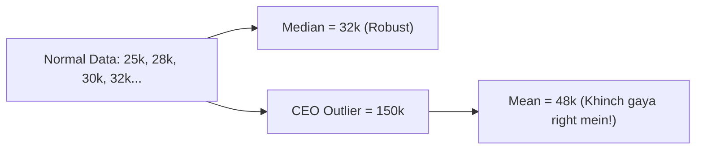

# Notes_20.15: Mean, Median Aur Mode [Hinglish]

## 📌 Topic Overview
Is lecture mein Shraddha ma'am ne **Central Tendency ke measures** (Mean, Median, Mode) samjhaye hain: Expected Value $E[X]$ kaise nikaalte hain aur bade outliers aane par Mean kyu bhatak jata hai jabki Median shant rehta hai.

---

### 📋 Is Topic Mein Hum Kya Seekhenge?
- Mean (Average / Expected Value $E[X]$) ka formula.
- Median (Beech ka number) aur Mode (Sabse baar aane waala number).
- Outliers ka asar: Salary example mein mean $45$ kaise ho gaya jabki sabki salary $30$ thi?
- Skewness: Right-skewed vs Symmetric distribution.

---

### 🔍 Har Ek Point Ka Simple & Detailed Explanation

#### 1. Mean (Expected Value $E[X]$):
Discrete probability mein mean ko **Expected Value** kehte hain:

$$
E[X] = \sum x_i \cdot P(X = x_i)
$$

Ek fair 6-sided dice par expected value:

$$
E[X] = \frac{1 + 2 + 3 + 4 + 5 + 6}{6} = \frac{21}{6} = 3.5
$$

#### 2. Mean vs Median Ka Jhagda (Outlier Effect):
Maan lijiye ek company mein 9 logon ki salary 30k hai aur 1 CEO ki salary 150k hai.
- **Mean:** Sabko jod kar 10 se divide kiya $\to \approx 48\text{k}$. (Yeh jhooth bol raha hai, kisi aam employee ki salary 48k nahi hai!).
- **Median:** Data ko sort karke beech ka banda dekha $\to 32\text{k}$. (Yeh asli sachai dikha raha hai!).

Isliye real-world Machine Learning mein jab data skewed ho, toh hum **Median** ko trust karte hain.

---

### 📊 Blackboard Diagram: Outlier Ka Khinchav



---

### 💻 Python Code Implementation

```python
import numpy as np
from scipy import stats

def compute_central_tendencies(data=None):
    """
    Computes measures of central tendency:
    - Mean (Arithmetic Average / Expected Value E[X])
    - Median (50th Percentile)
    - Mode (Most Frequent Value)
    Evaluates skewness based on relative positioning.
    
    Parameters:
        data (list or np.ndarray): 1D continuous dataset.
        
    Returns:
        dict: Mean, median, mode, and skewness classification.
    """
    if data is None:
        # Skewed salary dataset with high earner outlier
        data = [25, 28, 30, 32, 32, 35, 40, 42, 45, 150]
        
    arr = np.array(data)
    mean_val = float(np.mean(arr))
    median_val = float(np.median(arr))
    mode_res = stats.mode(arr, keepdims=True)
    mode_val = float(mode_res.mode[0])
    
    if np.isclose(mean_val, median_val, atol=1.0):
        skew_type = "Symmetric (Normal)"
    elif mean_val > median_val:
        skew_type = "Positively Skewed (Right-Tailed: Pulled by Outlier)"
    else:
        skew_type = "Negatively Skewed (Left-Tailed)"
        
    return {
        "mean": mean_val,
        "median": median_val,
        "mode": mode_val,
        "skewness_classification": skew_type
    }

# --- Execution & Verification ---
res = compute_central_tendencies()
print(f"Mean   : {res['mean']:.2f}")
print(f"Median : {res['median']:.2f}")
print(f"Mode   : {res['mode']:.2f}")
print(f"Shape  : {res['skewness_classification']}")

```

---

### 🎯 Key Takeaways:
1. Normal/symmetric data mein: $\text{Mean} = \text{Median} = \text{Mode}$.
2. Outlier hone par: $\text{Mean} > \text{Median}$ (Right skewed).
