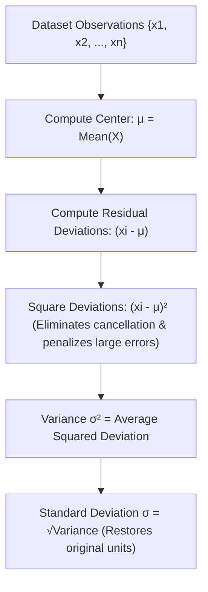

# Lecture 20.16: Variance & Standard Deviation

## 📌 Topic Overview
In this lecture, Shraddha ma'am covers the **Measures of Dispersion**: Variance ($\sigma^2$) and Standard Deviation ($\sigma$), explaining why mean alone fails to describe data spread and why squaring deviations penalizes extreme spread.

---

## 🏛️ Spread Around the Mean



---

## 📐 Mathematical Formulation

1. **Population Variance ($\sigma^2$):**

$$
\sigma^2 = \frac{1}{N} \sum_{i=1}^N (x_i - \mu)^2 = E[X^2] - (E[X])^2
$$

2. **Sample Variance ($s^2$ with Bessel's Correction):**

$$
s^2 = \frac{1}{n - 1} \sum_{i=1}^n (x_i - \bar{x})^2
$$

3. **Standard Deviation:**

$$
\sigma = \sqrt{\sigma^2}, \qquad s = \sqrt{s^2}
$$

### Why $n-1$ in Sample Variance?
Using $n$ systematically underestimates true population dispersion because sample deviations are calculated relative to $\bar{x}$ rather than the true unknown population mean $\mu$. Dividing by $n-1$ produces an **unbiased estimator**.

---

## 💻 Python Implementation

```python
import numpy as np

def compute_variance_and_standard_deviation(data=None, is_sample=True):
    """
    Computes sample or population Variance and Standard Deviation.
    Demonstrates Bessel's correction (ddof=1) for unbiased sample variance.
    
    Parameters:
        data (list or np.ndarray): Numerical observations.
        is_sample (bool): True for sample (ddof=1), False for population (ddof=0).
        
    Returns:
        dict: Mean, Variance, Standard Deviation, and step-by-step deviations.
    """
    if data is None:
        data = [10, 12, 23, 23, 16, 23, 21, 16]
        
    arr = np.array(data, dtype=float)
    n = len(arr)
    mean_val = np.mean(arr)
    
    # Deviations from mean
    deviations = arr - mean_val
    squared_deviations = deviations ** 2
    
    # Degrees of freedom: n - 1 for sample, n for population
    ddof = 1 if is_sample else 0
    variance = np.sum(squared_deviations) / (n - ddof)
    std_dev = np.sqrt(variance)
    
    return {
        "n": n,
        "mean": float(mean_val),
        "ddof": ddof,
        "sum_squared_deviations": float(np.sum(squared_deviations)),
        "variance": float(variance),
        "standard_deviation": float(std_dev)
    }

# --- Execution & Verification ---
stats = compute_variance_and_standard_deviation(is_sample=True)
print(f"Sample Size n: {stats['n']}")
print(f"Mean (mu)    : {stats['mean']:.2f}")
print(f"Variance (s²): {stats['variance']:.4f}")
print(f"Std Dev (s)  : {stats['standard_deviation']:.4f}")

```

---

## 🔑 Key Takeaways
1. Two datasets can have the exact same mean (e.g. $[50, 50, 50]$ vs $[0, 50, 100]$) but radically different variances.
2. Variance has squared units (e.g. $\text{dollars}^2$), making interpretation awkward; Standard Deviation takes the square root, returning to original units.
3. In machine learning, variance measures model sensitivity to training sample fluctuations (overfitting).
