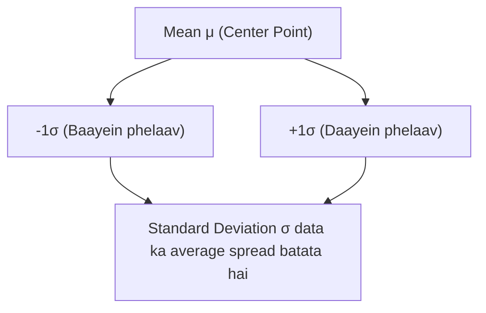

# Notes_20.16: Variance Aur Standard Deviation [Hinglish]

## 📌 Topic Overview
Is lecture mein Shraddha ma'am ne **Data ke phelaav (Dispersion)** ko naapne ke do sabse zaroori tools sikhaye hain: **Variance ($\sigma^2$)** aur **Standard Deviation ($\sigma$)**, aur yeh samjhaya hai ki sirf Mean pata hone se poori kahani kyu nahi pata chalti.

---

### 📋 Is Topic Mein Hum Kya Seekhenge?
- Do datasets ka Mean barabar hone par bhi unka spread alag kyu ho sakta hai?
- Deviations ko square kyu kiya jata hai? ($(x_i - \mu)^2$).
- Variance ($\sigma^2$) vs Standard Deviation ($\sigma$) ka farq.
- Sample variance mein $n-1$ (Bessel's correction) se divide kyu karte hain?

---

### 🔍 Har Ek Point Ka Simple & Detailed Explanation

#### 1. Mean Akela Kafi Kyu Nahi Hai?
Sochiye do patients ka body temperature:
- Patient 1: Teen din temperature tha: $[98.6, 98.6, 98.6] \implies \text{Mean} = 98.6^\circ\text{F}$ (Ekdum healthy!)
- Patient 2: Teen din temperature tha: $[90.0, 98.6, 107.2] \implies \text{Mean} = 98.6^\circ\text{F}$ (Bohot serious!)

Dono ka mean $98.6$ hai, lekin Patient 2 ke data mein bohot zyada **fluktuation/spread** hai! Is spread ko naapne ke liye hum **Variance** nikaalte hain.

#### 2. Formula:
1. Har number ka mean se doori nikaalo: $(x_i - \bar{x})$
2. Doori ko square karo taaki negative signs cancel na hon: $(x_i - \bar{x})^2$
3. Unka average lo:

$$
s^2 = \frac{1}{n - 1} \sum_{i=1}^n (x_i - \bar{x})^2
$$

Standard deviation square root lekar wapas original units ($^\circ\text{F}$) mein le aata hai:

$$
s = \sqrt{s^2}
$$

---

### 📊 Blackboard Diagram: Spread Around Mean



---

### 💻 Python Code Implementation

```python
import numpy as np

def compute_variance_and_standard_deviation(data=None, is_sample=True):
    """
    Computes sample or population Variance and Standard Deviation.
    Demonstrates Bessel's correction (ddof=1) for unbiased sample variance.
    
    Parameters:
        data (list or np.ndarray): Numerical observations.
        is_sample (bool): True for sample (ddof=1), False for population (ddof=0).
        
    Returns:
        dict: Mean, Variance, Standard Deviation, and step-by-step deviations.
    """
    if data is None:
        data = [10, 12, 23, 23, 16, 23, 21, 16]
        
    arr = np.array(data, dtype=float)
    n = len(arr)
    mean_val = np.mean(arr)
    
    # Deviations from mean
    deviations = arr - mean_val
    squared_deviations = deviations ** 2
    
    # Degrees of freedom: n - 1 for sample, n for population
    ddof = 1 if is_sample else 0
    variance = np.sum(squared_deviations) / (n - ddof)
    std_dev = np.sqrt(variance)
    
    return {
        "n": n,
        "mean": float(mean_val),
        "ddof": ddof,
        "sum_squared_deviations": float(np.sum(squared_deviations)),
        "variance": float(variance),
        "standard_deviation": float(std_dev)
    }

# --- Execution & Verification ---
stats = compute_variance_and_standard_deviation(is_sample=True)
print(f"Sample Size n: {stats['n']}")
print(f"Mean (mu)    : {stats['mean']:.2f}")
print(f"Variance (s²): {stats['variance']:.4f}")
print(f"Std Dev (s)  : {stats['standard_deviation']:.4f}")

```

---

### 🎯 Key Takeaways:
1. Variance squared units mein hoti hai, jabki Standard Deviation original units mein hoti hai.
2. Machine Learning mein high variance ka matlab hota hai **Overfitting** (model train data par overreact kar raha hai).
