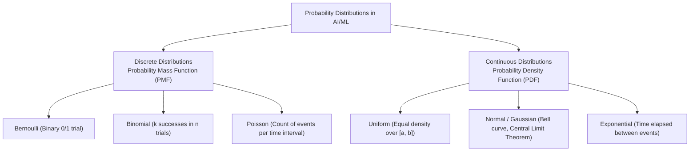

# Lecture 20.17: Probability Distributions & its Types

## 📌 Topic Overview
In this lecture, Shraddha ma'am provides a comprehensive **Taxonomy of Probability Distributions in Machine Learning**, contrasting Discrete distributions (PMF) with Continuous distributions (PDF) and defining the Cumulative Distribution Function (CDF).

---

## 🏛️ Machine Learning Distribution Taxonomy



---

## 📐 Mathematical Formulation: PMF, PDF, and CDF

### 1. Cumulative Distribution Function (CDF):
Defined identically for both discrete and continuous random variables as:

$$
F(x) = P(X \le x)
$$

### 2. Fundamental Properties Comparison:

| Feature | Discrete Distribution | Continuous Distribution |
| :--- | :--- | :--- |
| **Density Metric** | PMF: $p(x) = P(X = x)$ | PDF: $f(x) = \frac{dF(x)}{dx}$ |
| **Point Evaluation** | $P(X = x) \ge 0$ | $P(X = x) = 0$ |
| **Interval Probability** | $P(a \le X \le b) = \sum_{x=a}^b p(x)$ | $P(a \le X \le b) = \int_a^b f(x) \, dx$ |
| **Total Normalization** | $\sum_{x} p(x) = 1$ | $\int_{-\infty}^{\infty} f(x) \, dx = 1$ |

---

## 💻 Python Implementation

```python
def classify_distribution_type(variable_type="discrete", name="Binomial"):
    """
    Returns taxonomy specifications for discrete vs continuous distributions.
    
    Parameters:
        variable_type (str): 'discrete' or 'continuous'
        name (str): Distribution name
        
    Returns:
        dict: Mathematical properties (PMF/PDF, integration/summation, CDF).
    """
    taxonomies = {
        "discrete": {
            "function_type": "Probability Mass Function (PMF) P(X = x)",
            "support": "Countable distinct integers",
            "axiom_sum": "Sum of all P(X=x) == 1.0",
            "point_probability": "Can be strictly positive P(X=x) > 0",
            "examples": ["Bernoulli", "Binomial", "Poisson", "Geometric"]
        },
        "continuous": {
            "function_type": "Probability Density Function (PDF) f(x)",
            "support": "Uncountable real intervals (-inf, +inf) or [a, b]",
            "axiom_sum": "Integral from -inf to +inf f(x) dx == 1.0",
            "point_probability": "Always exactly zero at a point P(X=c) == 0",
            "examples": ["Uniform", "Normal (Gaussian)", "Exponential", "Beta"]
        }
    }
    
    props = taxonomies.get(variable_type.lower(), {})
    return {"name": name, "type": variable_type, "properties": props}

# --- Execution & Verification ---
disc_info = classify_distribution_type("discrete", "Binomial")
cont_info = classify_distribution_type("continuous", "Normal")
print(f"Discrete Distribution ({disc_info['name']}): {disc_info['properties']['function_type']}")
print(f"Continuous Distribution ({cont_info['name']}): {cont_info['properties']['function_type']}")

```

---

## 🔑 Key Takeaways
1. A PMF gives the probability of exact values; a PDF gives the height of a curve where area under the curve gives probability.
2. The CDF $F(x) = P(X \le x)$ is monotonically non-decreasing, bounded between 0 and 1.
3. Supervised classification targets follow discrete categorical/Bernoulli distributions; continuous regression targets assume Gaussian error residuals.
