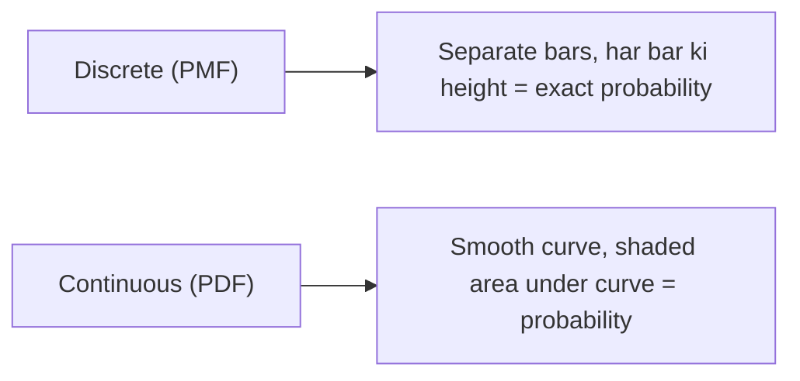

# Notes_20.17: Probability Distributions Aur Unke Types [Hinglish]

## 📌 Topic Overview
Is lecture mein Shraddha ma'am ne **Probability Distributions ka complete classification** samjhaya hai: Discrete vs Continuous distributions kya hote hain, PMF aur PDF mein kya farq hota hai, aur CDF ka concept kya hai.

---

### 📋 Is Topic Mein Hum Kya Seekhenge?
- Probability Distribution ka matlab kya hai?
- Discrete Distributions (Bernoulli, Binomial, Poisson).
- Continuous Distributions (Uniform, Normal, Exponential).
- PMF (Probability Mass Function) vs PDF (Probability Density Function).
- CDF (Cumulative Distribution Function) $F(x) = P(X \le x)$.

---

### 🔍 Har Ek Point Ka Simple & Detailed Explanation

#### 1. Distribution Kya Hoti Hai?
Distribution ek mathematical rule ya table hai jo batata hai ki kisi experiment ke alag-alag outcomes aane ke kitne chances hain.

#### 2. PMF vs PDF:
- **PMF (Discrete):** Yahan aap seedha bol sakte hain ki $P(X = 3) = 0.3125$. Discrete points par direct probability milti hai:

$$
\sum p(x) = 1
$$

- **PDF (Continuous):** Curve ke kisi single dot par probability zero hoti hai. Probability nikalne ke liye humein curve ke niche ka **Area** (Integral) nikalna padta hai:

$$
P(a \le X \le b) = \int_a^b f(x) \, dx
$$

---

### 📊 Blackboard Diagram: Discrete Bars vs Continuous Curve



---

### 💻 Python Code Implementation

```python
def classify_distribution_type(variable_type="discrete", name="Binomial"):
    """
    Returns taxonomy specifications for discrete vs continuous distributions.
    
    Parameters:
        variable_type (str): 'discrete' or 'continuous'
        name (str): Distribution name
        
    Returns:
        dict: Mathematical properties (PMF/PDF, integration/summation, CDF).
    """
    taxonomies = {
        "discrete": {
            "function_type": "Probability Mass Function (PMF) P(X = x)",
            "support": "Countable distinct integers",
            "axiom_sum": "Sum of all P(X=x) == 1.0",
            "point_probability": "Can be strictly positive P(X=x) > 0",
            "examples": ["Bernoulli", "Binomial", "Poisson", "Geometric"]
        },
        "continuous": {
            "function_type": "Probability Density Function (PDF) f(x)",
            "support": "Uncountable real intervals (-inf, +inf) or [a, b]",
            "axiom_sum": "Integral from -inf to +inf f(x) dx == 1.0",
            "point_probability": "Always exactly zero at a point P(X=c) == 0",
            "examples": ["Uniform", "Normal (Gaussian)", "Exponential", "Beta"]
        }
    }
    
    props = taxonomies.get(variable_type.lower(), {})
    return {"name": name, "type": variable_type, "properties": props}

# --- Execution & Verification ---
disc_info = classify_distribution_type("discrete", "Binomial")
cont_info = classify_distribution_type("continuous", "Normal")
print(f"Discrete Distribution ({disc_info['name']}): {disc_info['properties']['function_type']}")
print(f"Continuous Distribution ({cont_info['name']}): {cont_info['properties']['function_type']}")

```

---

### 🎯 Key Takeaways:
1. Binary classification problems (0 ya 1) Bernoulli distribution follow karte hain.
2. Continuous regression problems mein errors Normal (Gaussian) distribution follow karte hain.
